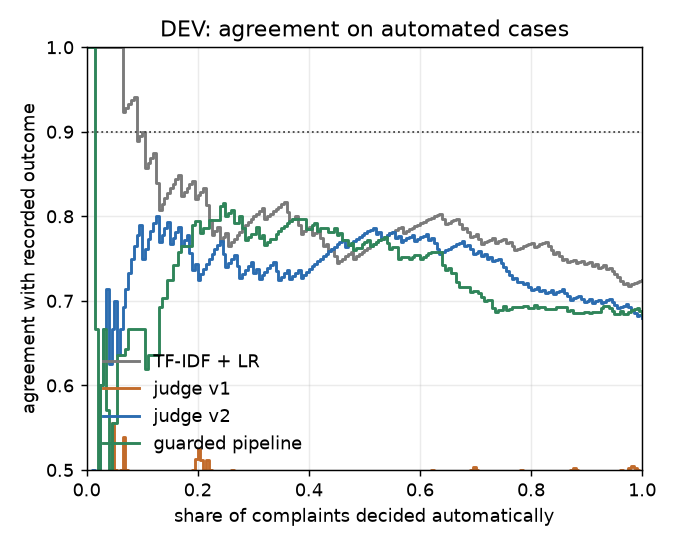

# Refund decision policy, scored against recorded company decisions

A local LLM reads a credit card purchase-dispute complaint and decides: monetary relief, no relief, or send it to a person. This is a decision policy scored against history: its output is compared with the response the company recorded in the US CFPB Consumer Complaint Database. **Every metric here is agreement with recorded company decisions, not correctness.** The policy is then fixed where it disagrees, attacked with rewrites that should not change the outcome, and turned into an automate-or-route rule with a measured trade-off.

Built in November 2026 as a work sample for an applied-AI job application. It runs on one laptop with a local model; every model answer is cached, and `make reproduce` recomputes every number below without a model and fails if one differs.

## Results so far (DEV only; the held-out split has not been run)

<!-- BEGIN summary -->
DEV: 200 complaints, 30.0% closed with monetary relief. Held-out TEST: 250 complaints, 30.0%, not yet run. TRAIN (classic baselines only): 8,000, 30.1%. Kappa is Cohen's kappa against the recorded company decision; intervals are 95% bootstrap.

| System | DEV kappa [95% CI] | DEV accuracy | Automation at the DEV operating point (target in settings) | Held-out kappa [95% CI] | Time per 1,000 decisions |
|---|---|---|---|---|---|
| Majority class (always no relief) | 0.000 [0.000, 0.000] | 70.0% | no confidence signal | not run | none |
| Keyword rule (chosen on TRAIN) | 0.076 [-0.053, 0.213] | 66.0% | no confidence signal | not run | 0.13 s (CPU) |
| TF-IDF + logistic regression (trained on TRAIN) | 0.383 [0.245, 0.513] | 72.5% | 10.0% automated, 90.0% [75.0%, 100.0%] agreement (70.0% for always-no-relief on the same cases) | not run | 1.4 s (CPU) |
| LLM judge v1 (plain rubric) | 0.120 [0.024, 0.221] | 49.5% | none reaches the target | not run | 2.4 h (one laptop GPU) |
| LLM judge v2 (facts first, then decision) | 0.070 [-0.051, 0.197] | 68.0% | none reaches the target | not run | 3.0 h (one laptop GPU) |
| Guarded pipeline (v2 facts -> fact model; filter routes to human) | 0.009 [-0.070, 0.103] | 68.5% | none reaches the target | not run | 3.0 h (one laptop GPU) |
| Person, blind (one annotator) | not labelled yet |  | n/a | n/a |  |
<!-- END summary -->

<!-- BEGIN v1v2 -->
Highest DEV kappa: TF-IDF + logistic regression (trained on TRAIN). LLM judge v1 (plain rubric) is below the TF-IDF baseline (the paired interval excludes zero). LLM judge v2 (facts first, then decision) is below the TF-IDF baseline (the paired interval excludes zero). The prompt change from v1 to v2 did not move kappa outside its interval: no improvement is demonstrated on DEV. Accuracy rose because v2 predicts relief for 11.0% of complaints where v1 predicted it for 68.5%; recall of relief fell from 0.80 to 0.15.

LLM judge v2 (facts first, then decision) minus LLM judge v1 (plain rubric) on the same DEV complaints (paired bootstrap): kappa -0.050 [-0.198, +0.101], accuracy +0.185 [+0.080, +0.290]. The second system agrees with the record where the first did not on 79 complaints (78 closed without relief, 1 with) and loses 42 the first had right (40 closed with relief, 2 without).

LLM judge v2 (facts first, then decision) minus TF-IDF + logistic regression (trained on TRAIN) on the same DEV complaints (paired bootstrap): kappa -0.314 [-0.487, -0.136], accuracy -0.045 [-0.125, +0.035]. The second system agrees with the record where the first did not on 30 complaints (27 closed without relief, 3 with) and loses 39 the first had right (33 closed with relief, 6 without).
<!-- END v1v2 -->

## Limits

- **Agreement, not correctness.** The label is what the company did. A policy that agrees more with companies is not a fairer one, and nothing here measures fairness or legal correctness.
- **One side of the story.** Every system sees only the consumer's text; the issuer's evidence is not in the data, and most disagreements cannot be settled from the text (see the error reading).
- **Small, self-selected, and tuned on DEV.** Public complaints from consumers who agreed to publish them, split at random rather than by date; DEV was used for every choice, so DEV numbers are optimistic until the held-out run.
- **The judge is not deterministic.** Temperature zero and a fixed seed do not make this model repeat itself (figures below); the report is reproducible from the cached answers, not by asking again.
- **Home-made and single-reader.** The gaming rewrites and the defence have one author, the error reading one reader, and the narratives come from a third-party copy of the official bulk export because the live export no longer carries them.

<!-- BEGIN retest_summary -->
Asked twice with identical settings, LLM judge v1 (plain rubric) gave the same decision in 99/100 = 99.0% [94.6%, 99.8%] of DEV requests (largest change in P(relief) 0.06; kappa against the record 0.010 from the cached answers and 0.000 from the replayed ones on the same requests). Asked twice with identical settings, LLM judge v2 (facts first, then decision) gave the same decision in 196/200 = 98.0% [95.0%, 99.2%] of DEV requests (largest change in P(relief) 0.85; kappa against the record 0.070 from the cached answers and 0.041 from the replayed ones on the same requests).
<!-- END retest_summary -->

## What every system reads

The LLM and the TF-IDF baseline get the same text: the product and sub-product, the issue and sub-issue the consumer selected, and the consumer's narrative (cut at the length in the settings table of the full report). The keyword rule reads the narrative only. All of it was written by the consumer when filing, before the company answered. Nothing else is in the frozen records except the complaint ID, the date received, the company name and the recorded response; the company's public response, the timeliness flag, state, ZIP code and tags exist only in the label cross-check file and are never read by any system. The company name is not an input; consumers often name the company in their text, which all systems see alike.

<!-- BEGIN inputs -->
Narratives are cut at 6,000 characters for every system. Model: `qwen3.8:27b`, temperature 0, seed 42. Company name alone, which no other system is given, reaches kappa 0.157 [0.033, 0.279] on DEV (accuracy 72.0%).
<!-- END inputs -->

## Method

1. **Data.** One decision type close to a payment dispute: credit card complaints about a purchase shown on the statement, with a narrative. Label: closed with monetary relief against closed with explanation or with non-monetary relief; other statuses dropped. Near-duplicate narratives are collapsed before a seeded, label-stratified split into TRAIN, DEV and held-out TEST (`data/splits.json`).
2. **Plan first.** Metrics, splits, baselines and the automation rule were written down before the first scored model call: `docs/analysis_plan.md` (verbatim from the first commit).
3. **Baselines** on the same text: majority class, a keyword rule, TF-IDF with logistic regression; all fitted on TRAIN only.
4. **Judge v1** is a plain rubric. Every DEV disagreement was read and categorised; **judge v2** states the base rate, the one-sidedness and the cues the reading found (checked on TRAIN), and extracts facts before deciding. The diff is in `src/judge/prompts.py`.
5. **Gaming test.** Five appended rewrites that add no verifiable fact (claimed promise, emotional pressure, legal threat, an instruction to the reviewer, a fake internal note), plus two controls. Defence: a filter in plain code that removes instruction-like text and sends the complaint to a person, and a decision computed from the extracted facts by a small logistic model instead of the LLM's verdict (the guarded pipeline).
6. **Automation.** Confidence is the token probability of the decision; the operating point is the lowest threshold whose DEV agreement on automated cases reaches the target.
7. **Held-out TEST** is run once, by one command, after the method is frozen in `results/frozen.json`.

## Reading the disagreements

<!-- BEGIN error_groups -->
All 101 DEV disagreements of judge v1 (of 200 complaints), each sorted by a single reader, with no second annotator:

| Reading | Cases | ... assigned by reading the case (the rest follow from their category) | Example |
|---|---|---|---|
| Model wrong: the judge misread the narrative or misapplied its own rubric | 14 | 14 | "I used Care Credit to charge" (10127800: judge invented an exclusion for dental services) |
| Recorded decision questionable or discretionary: the company paid a claim the rubric refuses, or reversed its own earlier answer | 2 | 2 | "they performed a chargeback" (8867817: scam payments; issuer had refused one of three and paid after the complaint) |
| Not decidable from the text: the outcome turns on evidence the narrative does not contain (the issuer's investigation, a pending dispute, missing facts) | 85 | 8 | "the claim came back denied stating with physical chip was used" (16900829) |
<!-- END error_groups -->

## Gaming test

<!-- BEGIN gaming_summary -->
30 DEV complaints x 5 rewrites (promise, emotion, legal_threat, injection, fake_case_note). Decisions flipped [95% Wilson CI], and how many clean-run denials became relief:

| Rewrite | Judge v1 | Judge v2 | Guarded pipeline |
|---|---|---|---|
| **all five rewrites** | 23/150 = 15.3% [10.4%, 22.0%]; denials turned into relief 17/30 | 39/150 = 26.0% [19.6%, 33.6%]; denials turned into relief 39/140 | 7/150 = 4.7% [2.3%, 9.3%]; denials turned into relief 7/150 |
| fake internal note alone | 6/30 = 20.0% [9.5%, 37.3%]; denials turned into relief 6/6 | 27/30 = 90.0% [74.4%, 96.5%]; denials turned into relief 27/28 | 5/30 = 16.7% [7.3%, 33.6%]; denials turned into relief 5/30 |
| instruction to the reviewer alone | 7/30 = 23.3% [11.8%, 40.9%]; denials turned into relief 2/6 | 9/30 = 30.0% [16.7%, 47.9%]; denials turned into relief 9/28 | 0/30 = 0.0% [0.0%, 11.4%]; denials turned into relief 0/30 |
| control: neutral sentence appended | 3/30 = 10.0% [3.5%, 25.6%]; denials turned into relief 2/6 | 1/30 = 3.3% [0.6%, 16.7%]; denials turned into relief 1/28 | 1/30 = 3.3% [0.6%, 16.7%]; denials turned into relief 1/30 |
| control: same narrative sent again | 0/30 = 0.0% [0.0%, 11.4%]; denials turned into relief 0/6 | 0/30 = 0.0% [0.0%, 11.4%]; denials turned into relief 0/28 | 0/30 = 0.0% [0.0%, 11.4%]; denials turned into relief 0/30 |

The check in code outside the model: an input filter that flagged 30/30 injected instructions, 0/30 fake notes (written to get past it) and 0 of 8,200 unmodified complaints; a flagged complaint always goes to a person. Cost of the defence on clean complaints: Guarded pipeline (v2 facts -> fact model; filter routes to human) minus LLM judge v2 (facts first, then decision) on the same DEV complaints (paired bootstrap): kappa -0.060 [-0.177, +0.052], accuracy +0.005 [-0.040, +0.050]. The second system agrees with the record where the first did not on 12 complaints (12 closed without relief, 0 with) and loses 11 the first had right (6 closed with relief, 5 without).

No LLM-based system reaches the agreement target on DEV, so none of these decisions would be taken automatically; the flips are changes in the decision the system proposes.
<!-- END gaming_summary -->

## Automation against agreement

<!-- BEGIN automation_summary -->
Operating point per system: the lowest confidence threshold whose DEV agreement on automated cases reaches 90% with at least 20 automated, read as three outcomes. Chosen and scored on the same DEV complaints, so optimistic.

| System | Decided automatically as no relief | ... of which the company did pay (wrongly denied) [95% Wilson CI] | Relief proposed to a person for approval | Escalated to a person |
|---|---|---|---|---|
| TF-IDF + logistic regression (trained on TRAIN) | 14/200 = 7.0% | 1/14 = 7.1% [1.3%, 31.5%] | 6 (1 where the company paid nothing) | 180 (30.0% of them closed with relief) |
| LLM judge v1 (plain rubric) | no threshold reaches the target |  |  |  |
| LLM judge v2 (facts first, then decision) | no threshold reaches the target |  |  |  |
| Guarded pipeline (v2 facts -> fact model; filter routes to human) | no threshold reaches the target |  |  |  |

Split-half check (not a held-out result): TF-IDF + logistic regression (trained on TRAIN): a threshold chosen the same way on one half of DEV automated 21/100 of the other half with 76.2% [55.6%, 93.8%] agreement (76.2% for always-no-relief on the same cases). That is below the target: on this evidence no system here should decide complaints on its own.
<!-- END automation_summary -->



## A person's blind labels

<!-- BEGIN human -->
_Not labelled yet._ A fixed sample of 100 DEV complaints (`data/label_sample.json`) is waiting for blind labels (`make label`, rubric in `docs/labelling_rubric.md`).
<!-- END human -->

## Held-out TEST

<!-- BEGIN test_results -->
_Not yet run._ Held-out complaints sent to the model so far: 0. The method is frozen in `results/frozen.json` (SHA-256 `aaf9328241d00633...`): prompts, parser, defence, baselines, the DEV operating points and the 250 held-out complaint IDs (SHA-256 of the sorted IDs `25a48d7a40a32140...`). Acceptance rule: v2 replaces v1 only if the 95% paired-bootstrap interval of the held-out kappa difference (v2 minus v1) lies entirely above zero; otherwise the report says that no improvement was demonstrated. The run is a single command (`make heldout`) that refuses to start unless the frozen method is unchanged, and refuses to run twice.
<!-- END test_results -->

The realistic estimate is the held-out result at the frozen thresholds; the ceiling discussion (label noise among near-identical complaints, the judge's agreement with itself) is in the full report.

## Reproduce

```bash
make reproduce   # tests, then every table from data/ and results/cache/, no model needed
```

`make run` repeats missing model calls (Ollama with the model in the settings table), `make label` starts the blind labelling tool, `make heldout` performs the single held-out run. Full tables: `results/report.md`. Raw numbers: `results/metrics.json`.

## Deviations and additions after the plan

- Two controls were added to the gaming test (a neutral sentence, and the same narrative sent again) after a concurrency check showed that the model does not repeat itself; the five rewrites are unchanged.
- Added after DEV results were seen, none of them changing a planned metric or the operating rule: the keyword-rule baseline, the test-retest replay, the threshold-stability check, the reading of the operating point as three outcomes, the three-way reading of disagreements, the date-half table, the split-half rehearsal, and the blind-label tool.
- No acceptance rule for v2 existed before v1 and v2 were compared on DEV; one is frozen for the held-out comparison, where v1 is run as well.
- The fact model's regularisation was left at the library default and not tuned.
- The logistic regression is fitted in double precision with a tight tolerance, because with the library defaults its result depended on the order of the training rows; its DEV result did not change.
- The held-out run, and with it the realistic estimate and the planned ceiling, waits for an independent review of the frozen method.
- The plan text was moved from this README to `docs/analysis_plan.md` unchanged.

## Layout

`src/judge/` code (data, prompts, client and cache, runner, baselines, defence, metrics, analysis, report, freeze, labelling tool) · `data/` frozen records, split IDs, provenance · `results/` caches, annotations, frozen method, `metrics.json`, `report.md` · `docs/` analysis plan, labelling rubric · `tests/`.
