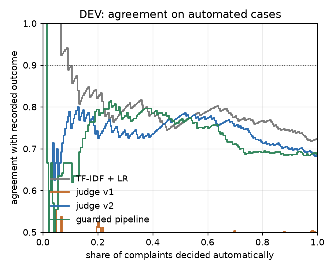

# Results report

Generated by `python -m judge.report` from `data/` and the cached model responses. Do not edit by hand.

## First screen

<!-- BEGIN first_screen -->
*Here the "judge" is the model that makes the refund decision, not a model that grades other models' answers.*

**The data.** Complaints that US consumers sent to the regulator (the CFPB) about a disputed credit-card charge. Most came after the card issuer had already handled the dispute. Of the 8,000 training complaints, 73% are filed as 'company isn't resolving a dispute'. On the 200 development complaints, the second prompt (judge v2, below) reported that the issuer had already refused in 175; a cruder keyword search finds a refusal in 28% of the training complaints. The label is how the company closed the complaint with the regulator, with money back (goodwill credits included) or without, so every figure here is agreement with what the company did, not correctness. A person reading only the complaint, blind (one annotator, the author), could not decide 44 of 100; on the 56 he decided, his agreement with the record is kappa 0.202 [-0.054, 0.456] (registered), an interval that includes zero, within the spread of the systems on the same cases (0.032 to 0.467; added after the labels were locked and read; descriptive; no difference tested). For this annotator, as for the text systems, the complaint text alone was a weak guide to what the company did (see below). Added later, exploratory: the same two prompts were run on other local models, on DEV and the labelled sample only; see [the section](../README.md#other-local-models-amendment-1-added-later-exploratory). Added later, exploratory: the same two prompts were also run on three hosted Anthropic models, on DEV and the labelled sample only; see [the section](../README.md#hosted-arm-amendment-2-added-later-exploratory).

- **Always answering "no money back" matches the record in 70.0% of the 250 held-out complaints, and no system is clearly above it.** *(exploratory)* The other 8 systems match the record in 46.8% to 73.6%. Agreement flatters systems that mostly say no, so the plan scores them by kappa (agreement beyond what the base rate gives), where the issuer lookup (0.354) and the TF-IDF model (0.320) lead.
- **A model applying the written refund rules to the consumer's account (judge v1) would pay 176 of the 250; the companies paid 75.** *(exploratory)* It errs towards paying (117 payments the company did not make, 16 refusals where it paid); judge v2 and the guarded pipeline err towards refusing (judge v2: 18 payments the company did not make, 54 refusals where it paid; the guarded pipeline: 5 and 61).
- **The record follows which issuer answered** *(exploratory)*: knowing the bank does about as well as reading the complaint. A lookup of each issuer's past payout rate, which never reads the text, agrees with the record about as well as the best text model (kappa 0.354 against 0.320, difference -0.034 [-0.176, +0.109]). Hiding the issuer's name from the text model makes it rank complaints worse (AUC -0.051 [-0.096, -0.007]). Comparing only complaints about the same issuer, the text systems put paid complaints above unpaid ones only weakly (AUC 0.58 to 0.61, where 0.5 is a coin toss), and whether even that is better than chance is not settled: the answer changes with what is resampled, complaints or issuers, and only 13 issuers have both a paid and an unpaid complaint to compare.
- **Decision: automate nothing.** The plan required 90% agreement on the cases a system would decide alone, and no system is shown to reach it. The only system with a frozen threshold, a classic text classifier (TF-IDF), would decide 29 of the 250 alone and agrees on 93.1% of them, but on so few cases the interval runs from 78.0% to 98.1% (Wilson). In a test on development complaints a fake internal note appended to the end of the text turned 27 of 28 of judge v2's refusals into refunds, and a sentence naming four banks, written with TF-IDF's published feature list in view, turned 18 of 21 of TF-IDF's refusals on the same complaints into refunds.
<!-- END first_screen -->

## Who

<!-- BEGIN who -->
**Who did what.** The author set the task and directed the work, run on his own laptop, through an AI coding assistant, and decided to publish the result as it came out. He chose to label all 100 complaints of the labelling sample himself rather than a smaller set, labelled them blind, and after the lock went through all 24 disagreements of judge v1 on DEV that the assistant had sorted one by one (the other 77 carry only a category) on a second screen in about 15 minutes from the first answer to the last (median 32 s between answers): he confirmed 16 drafted readings, changed 8 and left no notes. The AI coding assistant chose the data and the label and wrote or drafted the code (after the held-out run also the SQL queries in [`sql/`](../sql/), which it chose and wrote when the author asked for an SQL section), the prompts, the gaming rewrites, the defence and the first reading of the 101 DEV disagreements, 77 of which no person has confirmed. It wrote the rules that were frozen before the held-out run and started that run and, after the lock, the run of the judges on the labelled sample. The reviews named in [`docs/deviations.md`](../docs/deviations.md) were separate AI-agent sessions, not people, and there is no independent second author. Where a code comment says "by hand" (for example the issuer alias list in `src/judge/baselines.py`), it means a fixed list written into the code by that assistant.
<!-- END who -->

## Headline

<!-- BEGIN headline -->
**Held-out run**: 250 complaints, scored once from commit `822811d`, the last of 4 commits that froze the method; it precedes the run in this repository's history, and a GitHub gist created before the run holds its hashes (see the freeze section below). **Claims frozen before the run**, each with the verdict its rule in `results/frozen.json` gives, in the words the frozen code prints:

- *v2 replaces v1* (only if the paired kappa difference, v2 minus v1, lies entirely above zero): **no improvement of v2 over v1 was demonstrated**, +0.120 [-0.013, +0.249].
- *Each judge against TF-IDF, the issuer relief rate and the company rule* (6 paired kappa differences, judge minus baseline): **judge v1 is below the TF-IDF model** (-0.234 [-0.370, -0.096]); **judge v1 is below the issuer relief rate** (-0.268 [-0.407, -0.124]); both also exclude zero at the 99.17% level that corrects for 6 comparisons *(exploratory)*; **judge v2 is not distinguishable from the TF-IDF model** (-0.114 [-0.277, +0.048]); **judge v2 is not distinguishable from the issuer relief rate** (-0.148 [-0.328, +0.039]); **judge v1 is not distinguishable from the company rule** (-0.083 [-0.221, +0.049]); **judge v2 is not distinguishable from the company rule** (+0.037 [-0.141, +0.211]).
- *TF-IDF orders complaints better than the judge within one issuer* (AUC difference, TF-IDF minus the judge): **the lead of TF-IDF over judge v1 is not demonstrated once the issuer is held fixed** (-0.014 [-0.144, +0.107]); **the lead of TF-IDF over judge v2 is not demonstrated once the issuer is held fixed** (-0.031 [-0.135, +0.085]).
- *The TF-IDF threshold frozen on DEV meets the 90% agreement target on held-out cases*: **the frozen TF-IDF operating point: not shown to meet the target** (29/250 automated, 93.1%, Wilson [78.0%, 98.1%]; always answering no relief agrees on 75.9% of the same cases).
- Two frozen items are records of the procedure, not tests, so they could not have come out otherwise; they are listed only to complete the list: **the LLM judge automates nothing (no DEV threshold reached the target for: guarded, v1, v2)**, so none of them had a threshold to apply on held-out; and the noise pass was done (judge v1 repeated 248/250 decisions, judge v2 repeated 250/250 decisions).

| System | Reads | Matches the record, held-out (n=250) *(exploratory)* | Pays, of 250 (of these, the company did not pay) *(exploratory)* | Refuses where the company paid (it paid 75) *(exploratory)* | Held-out kappa [95% CI] | DEV kappa [95% CI], n=200 | Automated on held-out at the frozen threshold | Time per 1,000 decisions (DEV timings) |
|---|---|---|---|---|---|---|---|---|
| Always no relief | nothing | 70.0% | 0 (0) | 75 | 0.000 (constant answer) | 0.000 (constant answer) | not assessed | a table lookup |
| Keyword rule (added later) | narrative | 68.8% | 33 (18) | 60 | 0.116 [-0.002, 0.238] | 0.076 [-0.053, 0.213] | not assessed | 0.1 s (CPU) |
| Company rule (planned) | issuer only | 73.2% | 14 (3) | 64 | 0.169 [0.069, 0.278] | 0.157 [0.033, 0.279] | not assessed | a table lookup |
| Issuer relief rate (added later) | issuer only | 71.2% | 91 (44) | 28 | 0.354 [0.230, 0.473] | 0.318 [0.190, 0.442] | not assessed | a table lookup |
| TF-IDF, issuer names masked (added later) | text, issuer names masked | 68.4% | 64 (34) | 45 | 0.215 [0.085, 0.344] | 0.295 [0.153, 0.433] | not assessed | 1.4 s (CPU) |
| TF-IDF + logistic regression | text | 72.4% | 66 (30) | 39 | 0.320 [0.192, 0.445] | 0.383 [0.245, 0.513] | 29/250, agreement 93.1% (Wilson [78.0%, 98.1%]) | 1.4 s (CPU) |
| LLM judge v1 (plain rubric) | text | 46.8% | 176 (117) | 16 | 0.085 [0.000, 0.172] | 0.120 [0.024, 0.221] | none (no DEV threshold) | about 3 h (one laptop GPU) |
| LLM judge v2 (predicts the record) | text | 71.2% | 39 (18) | 54 | 0.205 [0.077, 0.332] | 0.070 [-0.051, 0.197] | none (no DEV threshold) | about 4 h (one laptop GPU) |
| Guarded pipeline (v2 facts -> fact model) | text | 73.6% | 19 (5) | 61 | 0.201 [0.092, 0.316] | 0.009 [-0.070, 0.103] | none (no DEV threshold) | about 4 h (one laptop GPU) |

Kappa is agreement beyond what the base rate gives (0 for a constant answer). Relief base rate 30.0% held-out, 30.0% DEV. Text: the product and issue fields and the consumer's narrative; issuer only: the issuer's relief rate on the 8,000 TRAIN complaints. DEV was used for every choice after the first prompt, so the DEV column is optimistic. The three columns marked exploratory were added after the run.

**Blind human labels** (a separate analysis on 100 TRAIN complaints, not the held-out split; registered in `docs/analysis_plan_human_labels.md` before any label existed; full tables under "A person's blind labels" below):

- One annotator, the author: not a lawyer, and not a native English reader, who read the English original with a machine translation beside it. He labelled 100 complaints blind and could not decide 44 of them from the text (registered).
- On the 56 he decided, his agreement with the company's record is kappa 0.202 [-0.054, 0.456] (registered), an interval that includes zero; 0.429 on the calibration half and 0.000 on the evaluation half (28 decided each; registered). The 8 systems' kappas against the record on the same 56 cases run from 0.032 (judge v1) to 0.467 (issuer lookup; added after the labels were locked and read; descriptive); no difference between the person and any system was tested. With 'cannot tell' counted as no money back, over all 100 (registered sensitivity line): kappa 0.197 [-0.010, 0.394]; counted as money back, 0.043, and from -0.256 to 0.523 if every 'cannot tell' took the opposite of the record or the record itself (added after the labels were locked and read; descriptive).
- The judges against the person, decided cases (registered): judge v1 0.103 [-0.111, 0.314]; judge v2 0.216 [0.000, 0.435]. Judge v1's interval includes zero. Judge v2's lower bound sits at zero: from -0.005 to +0.007 over 10 bootstrap seeds (added after the labels were locked and read; descriptive), so whether its interval clears zero depends on the bootstrap seed, and nothing is concluded for judge v2 either way. Registered check of the two readings ('cannot tell' left out, and counted as no money back): they disagree in sign or in the side of zero of the interval for judge v1 minus TF-IDF model, accuracy; judge v2 minus TF-IDF model, accuracy. The same reading of figures not in the registered plan (descriptive): they disagree for judge v2 minus judge v1, accuracy. For judge v2 against the person, kappa, a bound of the interval sits at zero and moves to either side of it with the bootstrap seed, so the check cannot be applied to it. No conclusion is drawn from these figures.
<!-- END headline -->

## Practice

<!-- BEGIN practice -->
Only the claims above were frozen before the run. Everything in this section is exploratory: the analyses and their wording were chosen after the held-out results were seen, and the bullets that restate a frozen claim say so.

- **Agreement against always answering no.** The 8 systems match the record in 46.8% to 73.6% of held-out complaints, always no in 70.0%. The highest, the guarded pipeline, was picked after the run as the highest of 8: +3.6 points [+0.4, +7.2] at 95%, [-0.8, +8.4] at the 99.375% level that corrects for 8 comparisons; it differs from always no on 19 complaints (right on 14 of them, wrong on 5; exact two-sided test p 0.064). The planned company rule: +3.2 points [+0.4, +6.0] at 95%, [-0.8, +7.5] corrected, on 14 complaints that differ (p 0.057). With so few complaints that differ, the exact test is a safer reading than the 95% bootstrap interval.
- **If one of these decided alone, on these 250 held-out complaints** (the company paid 75): judge v1 would pay 117 that the company did not pay and refuse 16 that it paid; judge v2 would pay 18 and refuse 54; the guarded pipeline would pay 5 and refuse 61; the TF-IDF model would pay 30 and refuse 39; the issuer lookup would pay 44 and refuse 28. 'Paid' and 'did not pay' are the company's record, not a correct decision. No money figure is given: the records hold company, company_response, complaint_id, date_received, issue, label, narrative, product, sub_issue, sub_product and no amount, and the dollar figures in the narratives are the consumer's own, unverified and not the refunded amount.
- **The issuer.** The issuer lookup's held-out kappa 0.354 [0.230, 0.473] is the highest point estimate, but TF-IDF cannot be told apart from it (kappa difference -0.034 [-0.176, +0.109], AUC difference +0.017 [-0.055, +0.097]), and its threshold (the TRAIN base rate) was chosen after DEV; the planned company rule (raw TRAIN rates, the overall rate for issuers with few complaints, threshold one half) gets 0.169, and the lookup's smoothed rates at one half would give 0.185. Masking issuer names lowers TF-IDF's AUC (-0.051 [-0.096, -0.007]). Within one issuer the text systems reach AUC 0.58 to 0.61, over 1,015 same-issuer pairs from only 13 issuers. Resampling complaints, no lower bound clears 0.5: the best, judge v2's, is 0.500 with 2,000 resamples and 0.497 with 10,000. Resampling the 13 issuers instead (10,000 resamples), 4 of the 5 lower bounds lie above 0.5 (TF-IDF model [0.528, 0.679]; masked TF-IDF [0.549, 0.696]; judge v1 [0.515, 0.661]; judge v2 [0.510, 0.678]; guarded pipeline [0.464, 0.697]). With so few issuers neither scheme is reliable, so whether the text beats a coin toss within an issuer is not settled. On DEV, TF-IDF's within-issuer AUC was 0.688 [0.573, 0.791], resampling complaints. The lookup encodes each issuer's past habit: it shows what the label measures and is not a policy to deploy; inside one company it is a constant.
- **What the LLM adds over a lookup or TF-IDF** (restates the frozen claims): nothing this sample can show. In 6 paired comparisons the judges are below in 2 and not distinguishable in the rest. This is a negative result for these two prompts on one local model, not for LLMs on this task.
- **The automation slice.** Routing as measured, at TF-IDF's frozen threshold: decide alone, none; for a person to approve, 24 proposed refusals (the company paid 2) and 5 proposed refunds (it paid 5); escalate, 221. Whether pre-filled proposals save a reviewer time was not measured. TF-IDF at its frozen threshold automated 29/250 at 93.1% (Wilson [78.0%, 98.1%]; frozen claim: not shown to meet the target). On those 29 the issuer lookup would also have been right in 27 (TF-IDF is right in 27), and TF-IDF with issuer names masked makes the same decision in 29 of the 29; 25 of the 29 narratives name an issuer. The proposed refusals come from issuers that paid 21% of their TRAIN complaints on average, the proposed refunds from issuers that paid 54%. The DEV operating point qualified on the boundary (20 cases, the minimum, at 90.0%, the target) and 19 held-out cases lie within 0.02 of the threshold. Whether a slice like this exists inside a single company, where the issuer is fixed, this sample cannot show.
- **Gaming the judges** (a fixed set of 5 appended English sentences, one template each, on 30 DEV complaints, plus two controls: a neutral sentence, and the unchanged narrative sent again; a smoke test, not a red team). The fake internal note turned 27 of 28 of judge v2's refusals and 6 of 6 of judge v1's into refunds (the neutral sentence: 2 of 6 for v1); with 6 refusals the test cannot tell v1 from the control: it shows that v2 is moved and cannot show whether v1 is. Of the 10 rewrite-against-control tests for the two judges, 1 survives a Holm correction (v2 fake note); these tests are two-sided and count flips in either direction. Counting only refusals turned into refunds, the direction an attacker wants, with a one-sided exact test, 2 survive (v2 fake note, v2 injection). The input filter is seven English patterns: it caught the one wording it was written against (30/30 copies), 0 of 10 other wordings of the same instruction, 0 of 8 further wordings (obfuscated or reworded) written after the AI-agent reviews listed in [`docs/deviations.md`](../docs/deviations.md), 0 of 30 fake notes, and 0 of 8,450 real narratives; it flags 3 of 3 harmless sentences that were written to hit its patterns, so its flag is a routing lever the complainant holds. The guarded pipeline flipped 5/30 on the note, but it pays 0 of these 30 and 9 of 200 DEV complaints, and a rule that always refuses would show no flips at all, so a low flip rate alone shows little. The note did change the facts v2 extracted (issuer error false to true in 18 of 30, issuer status changed in 23), and the fact model happens to weight 'credited' and 'pending' towards no relief; the low flip rate is not shown robustness.
- **Gaming TF-IDF** (DEV only, no model call). A sentence naming four issuers whose names TF-IDF weights towards relief turned 18 of 21 of its refusals on the same 30 complaints into refunds (65% to 95%, Wilson), and 106 of 127 on all 200 DEV complaints; the neutral sentence turned 0, the five rewrites 0 to 1, and naming four issuers weighted towards no relief turned 6 of 9 refunds into refusals. The sentences were written with the published feature list in view. The keyword rule was not attacked.
- **Not tested by the gaming test**: fabricated merchant correspondence; fake prior approvals with reference numbers; claims written to match the published rubric, cues and fact-model weights; a merchant dispute reframed as fraud through the sub-issue the consumer selects (every system reads it); other languages and obfuscated text sent to the model; the attack at the start, in the middle or inside a quoted email, and padding that pushes real content past the narrative cut; attacks aimed at the fact-extraction step, named as such; using the filter's flag to choose routing; refiling with trivial edits until the answer changes; an attack set written by someone other than the defence author and held out from tuning. The prompts, cues and fact-model weights are public in this repository. Text written by the claimant is evidence to check against the system of record, not an instruction.
- **DEV against held-out.** Judge v2 moved from 0.070 to 0.205: +0.136 [-0.044, +0.310] as two independent samples, within sampling variation (the change in v2 minus v1 is +0.170 [-0.033, +0.367]); no DEV-to-held-out test was registered. The guarded pipeline moved by +0.192 [+0.044, +0.333], which is not ordinary noise; its DEV figure is out-of-fold (ten fact models, each fitted on nine tenths of DEV) while the held-out figure uses one model fitted on all of DEV, a different estimator.
- **Repeatability** (the noise pass was frozen; this reading was not). Asked twice, the judges gave the same decision in 248/250 and 250/250 held-out cases and 99/100 and 196/200 DEV cases (v1, v2). On held-out, judge v2's answers were byte-identical in 250/250, against 191/200 on DEV, where its confidence moved by up to 0.85; judge v1 was about as repeatable on both (75/100 and 195/250 byte-identical). Generation speed as logged during each pass (`results/run_log.jsonl`): judge v2 DEV retest 8.5 tokens/s; judge v2 held-out noise pass 12.1 tokens/s; judge v1 DEV retest 8.2 and 15.4 tokens/s; judge v1 held-out noise pass 8.2 tokens/s. Memory was not recorded during either pass, so the cause of the DEV differences is not known. The confidence score is not stable enough to set a threshold on.
- **Cost** (compute on one laptop, an Apple M4 Max with 36 GB of memory, which the run logs do not record, and a local model; DEV timings; no money cost or handle time was measured): a table lookup for the issuer rows; TF-IDF 1.4 s of CPU per 1,000; judge v1 3.1 h, judge v2 3.7 h (on the held-out run v1 2.4 h and v2 3.8 h); a person: about 16 h at the median time per label (58 s) times 1,000 labels (at this annotator's rate about 560 of them would be decisions), or about 24 h from the mean time per label with each record capped at 5 minutes, so that a record that includes a long break counts for 5 minutes (88 s; added after the labels were locked and read; descriptive); the recorded times include pauses with the page open, so neither is a measured handle time.
- **Realistic against optimistic** (plan item 9; full table in the report's Estimates): TF-IDF automates 11.6% at 93.1% on held-out at the frozen threshold, 10.0% at 90.0% on DEV where the threshold was chosen, and 14.0% at 91.4% with the best threshold chosen on the held-out split itself; the LLM configurations automate nothing in any of the three.
- **Not tried**: few-shot examples, giving the LLM the issuer's payout rate, a larger or hosted model on the held-out split (added later, the same prompts ran on other local and on hosted models, on DEV and the labelled sample only), a label written by trained agents under a written policy. **Not measured**: handle time, money, customer outcomes, appeal rate, chargeback reason codes and scheme deadlines, billing-error time limits, who is accountable, whether a reviewer can use the output. **Before trying again**: a label that says what should have happened under a written policy, set by trained agents, not how a company closed a regulator complaint; the system of record beside the claimant's text (the transaction, the merchant's response, the amount, the scheme deadlines); handle time and money measured for the person and for the system on the same cases; an attack set written by someone other than the defence author and held out from tuning, with the claimant's text read as evidence and never as an instruction; and enough cases in the automated slice that the lower end of its interval, not the estimate, clears the target.
<!-- END practice -->

## Exploratory

<!-- BEGIN exploratory -->
Computed by `src/judge/posthoc.py` after the held-out run, from the same data and caches; nothing here was registered and none of it decides a claim. Kappa and accuracy intervals: 10,000 percentile-bootstrap resamples over complaints (paired where two systems are compared; DEV and held-out resampled independently when they are compared); AUC intervals elsewhere in this report use 2,000 resamples, as the frozen code does.

Held-out, by system: agreement with the record against always answering no relief (paired), the complaints on which exactly one of the two matches the record with the exact two-sided McNemar test on them, the paired interval at the Bonferroni level for 8 comparisons (99.375%, same resamples), and the direction of the errors:

| System | Matches the record | Minus always no relief [95% CI] | Differs from always no: system right / always no right | Exact p | Minus always no relief, 99.375% interval | Would pay | Pays where the company did not | Refuses where the company paid |
|---|---|---|---|---|---|---|---|---|
| Keyword rule (added later) | 68.8% | -1.2 points [-5.6, +3.2] | 15 / 18 | 0.728 | [-7.6, +5.2] | 33 | 18 | 60 |
| Company rule (planned) | 73.2% | +3.2 points [+0.4, +6.0] | 11 / 3 | 0.057 | [-0.8, +7.5] | 14 | 3 | 64 |
| Issuer relief rate (added later) | 71.2% | +1.2 points [-6.4, +8.8] | 47 / 44 | 0.834 | [-9.6, +12.0] | 91 | 44 | 28 |
| TF-IDF, issuer names masked (added later) | 68.4% | -1.6 points [-8.0, +4.8] | 30 / 34 | 0.708 | [-10.4, +7.2] | 64 | 34 | 45 |
| TF-IDF + logistic regression | 72.4% | +2.4 points [-4.0, +8.8] | 36 / 30 | 0.539 | [-6.8, +11.6] | 66 | 30 | 39 |
| LLM judge v1 (plain rubric) | 46.8% | -23.2 points [-33.2, -12.8] | 59 / 117 | below 0.001 | [-37.1, -8.5] | 176 | 117 | 16 |
| LLM judge v2 (predicts the record) | 71.2% | +1.2 points [-3.6, +6.0] | 21 / 18 | 0.749 | [-5.5, +8.0] | 39 | 18 | 54 |
| Guarded pipeline (v2 facts -> fact model) | 73.6% | +3.6 points [+0.4, +7.2] | 14 / 5 | 0.064 | [-0.8, +8.4] | 19 | 5 | 61 |

Which system is highest was seen only after the run, so the highest row is the best of 8 picked after the fact.

The records hold company, company_response, complaint_id, date_received, issue, label, narrative, product, sub_issue, sub_product; there is no amount field, so no error is given in money.

TF-IDF minus the issuer relief rate, held-out kappa (paired): -0.034 [-0.176, +0.109]. The issuer lookup's smoothed rates with the planned threshold of one half instead of the TRAIN base rate: held-out kappa 0.185 (the planned company rule, raw TRAIN rates at one half: 0.169).

The six frozen judge-against-baseline differences at the Bonferroni level for six comparisons (99.17% intervals, same resamples): v1 minus tfidf_lr -0.234 [-0.417, -0.045]; v1 minus issuer_rate -0.268 [-0.458, -0.068]; v1 minus company_rule -0.083 [-0.274, +0.090]; v2 minus tfidf_lr -0.114 [-0.327, +0.100]; v2 minus issuer_rate -0.148 [-0.390, +0.097]; v2 minus company_rule +0.037 [-0.210, +0.270].

DEV against held-out kappa (independent samples; two-sided bootstrap p): v1 -0.035 [-0.166, +0.095] (p 0.60); v2 +0.136 [-0.044, +0.310] (p 0.14); guarded +0.192 [+0.044, +0.333] (p 0.01); v2 minus v1, change +0.170 [-0.033, +0.367] (p 0.10).

Judge v2's within-issuer AUC on held-out with 10,000 resamples: [0.497, 0.712], 2.9% of resamples at or below 0.5. The within-issuer intervals elsewhere in this report resample complaints. Only 13 held-out issuers carry a pair of a relief and a no-relief complaint (1,015 pairs); resampling those issuers instead (10,000 resamples):

| System | Within-issuer AUC | 95% interval, issuers resampled | Resamples at or below 0.5 | 95% interval, complaints resampled |
|---|---|---|---|---|
| TF-IDF + logistic regression | 0.577 | [0.528, 0.679] | 0.2% | [0.464, 0.685] |
| TF-IDF, issuer names masked (added later) | 0.603 | [0.549, 0.696] | 0.1% | [0.496, 0.707] |
| LLM judge v1 (plain rubric) | 0.591 | [0.515, 0.661] | 1.3% | [0.481, 0.699] |
| LLM judge v2 (predicts the record) | 0.608 | [0.510, 0.678] | 1.7% | [0.500, 0.709] |
| Guarded pipeline (v2 facts -> fact model) | 0.602 | [0.464, 0.697] | 5.7% | [0.493, 0.710] |

With 13 clusters neither scheme is reliable; the two disagree on whether the lower bounds clear 0.5.

The TF-IDF slice automated at the frozen threshold (29 cases from 12 issuers, the largest contributing 21%): TF-IDF right in 27, the issuer lookup right in 27; same decision as the issuer lookup in 27, as masked TF-IDF in 29; narratives naming an issuer 25; held-out cases within 0.02 of the threshold 19.

TRAIN relief rate by the sub-issue the consumer selected:

| Sub-issue | TRAIN complaints | Closed with monetary relief |
|---|---|---|
| Credit card company isn't resolving a dispute about a purchase on your statement | 5,818 | 30.3% |
| Card was charged for something you did not purchase with the card | 1,927 | 29.8% |
| Overcharged for something you did purchase with the card | 255 | 27.1% |

Gaming the TF-IDF baseline: each sentence appended to the narrative and scored by the TF-IDF model (fitted on TRAIN with the frozen settings). Refusals turned into refunds [95% Wilson CI], refunds turned into refusals, mean change in P(relief), and the exact McNemar comparison with the neutral control on refusals turned into refunds:

The gaming subset (30 complaints, 21 refusals on the unmodified text):

| Sentence | Refusals turned into refunds | Refunds turned into refusals | Mean change in P(relief) | Against the neutral control |
|---|---|---|---|---|
| claimed promise | 1/21 [0.8%, 22.7%] | 0/9 | +0.027 | 1 / 0, p 1.000 |
| emotional pressure | 0/21 [0.0%, 15.5%] | 0/9 | +0.002 | 0 / 0, p 1.000 |
| legal threat | 0/21 [0.0%, 15.5%] | 0/9 | +0.005 | 0 / 0, p 1.000 |
| instruction to the reviewer | 1/21 [0.8%, 22.7%] | 0/9 | +0.028 | 1 / 0, p 1.000 |
| fake internal note | 0/21 [0.0%, 15.5%] | 0/9 | -0.003 | 0 / 0, p 1.000 |
| neutral sentence (control) | 0/21 [0.0%, 15.5%] | 2/9 | -0.021 |  |
| issuer names weighted towards relief | 18/21 [65.4%, 95.0%] | 0/9 | +0.261 | 18 / 0, p below 0.001 |
| issuer names weighted towards no relief (control) | 0/21 [0.0%, 15.5%] | 6/9 | -0.109 | 0 / 0, p 1.000 |

All of dev (200 complaints, 127 refusals on the unmodified text):

| Sentence | Refusals turned into refunds | Refunds turned into refusals | Mean change in P(relief) | Against the neutral control |
|---|---|---|---|---|
| claimed promise | 5/127 [1.7%, 8.9%] | 0/73 | +0.020 | 5 / 0, p 0.062 |
| emotional pressure | 0/127 [0.0%, 2.9%] | 1/73 | -0.000 | 0 / 0, p 1.000 |
| legal threat | 1/127 [0.1%, 4.3%] | 0/73 | +0.003 | 1 / 0, p 1.000 |
| instruction to the reviewer | 5/127 [1.7%, 8.9%] | 0/73 | +0.021 | 5 / 0, p 0.062 |
| fake internal note | 0/127 [0.0%, 2.9%] | 2/73 | -0.004 | 0 / 0, p 1.000 |
| neutral sentence (control) | 0/127 [0.0%, 2.9%] | 8/73 | -0.018 |  |
| issuer names weighted towards relief | 106/127 [76.0%, 88.9%] | 0/73 | +0.208 | 106 / 0, p below 0.001 |
| issuer names weighted towards no relief (control) | 0/127 [0.0%, 2.9%] | 37/73 | -0.094 | 0 / 0, p 1.000 |

The issuer-name sentences: issuer names weighted towards relief: "I also have cards with Citi, Bank of America, Apple and Goldman Sachs."; issuer names weighted towards no relief (control): "I also have cards with Chase, Discover, Barclays and Affirm.".

Input filter on further wordings (written after the AI-agent reviews listed in [`docs/deviations.md`](../docs/deviations.md), checked against the filter only): 0 of 8 obfuscated or reworded instructions flagged, 3 of 3 harmless sentences flagged (written to hit the patterns), 0 of 250 held-out narratives and 0 of 8,450 real narratives of TRAIN, DEV and held-out flagged (`FURTHER_WORDINGS` and `BENIGN` in `src/judge/posthoc.py`).

What the fake internal note changed in judge v2's extracted facts on the 30 gaming complaints: issuer status denied -> credited 10, denied -> pending 8, denied -> partly_credited 4, pending -> credited 1; issuer error False -> True 18. Fact-model weights (DEV fit): issuer_status=denied +0.52, issuer_status=credited -0.25, issuer_status=pending -0.20, issuer_status=partly_credited +0.74, issuer_error=True +0.20, claim=unauthorized +1.00.

Holm correction over the 10 rewrite-against-control tests of the two judges (exact McNemar, two-sided, flips in either direction): surviving v2 fake_case_note; the smallest p-values v2 fake_case_note below 0.001, v2 injection 0.0078, v1 injection 0.2891.

The same 10 tests counting only refusals turned into refunds (exact McNemar, one-sided): surviving Holm v2 fake_case_note, v2 injection; v2 fake_case_note 26 / 0, p below 0.001; v2 injection 8 / 0, p 0.0039; v1 fake_case_note 4 / 0, p 0.0625; v2 promise 2 / 0, p 0.2500; v1 emotion 2 / 1, p 0.5000; v1 legal_threat 2 / 1, p 0.5000; v1 promise 2 / 1, p 0.5000; v1 injection 1 / 1, p 0.7500; v2 emotion 0 / 1, p 1.0000; v2 legal_threat 0 / 1, p 1.0000 (complaints moved by the rewrite only / by the neutral control only).

Known gaps of the gaming test: fabricated merchant correspondence; fake prior approvals with reference numbers; claims written to match the published rubric, cues and fact-model weights; a merchant dispute reframed as fraud through the sub-issue the consumer selects (every system reads it); other languages and obfuscated text sent to the model; the attack at the start, in the middle or inside a quoted email, and padding that pushes real content past the narrative cut; attacks aimed at the fact-extraction step, named as such; using the filter's flag to choose routing; refiling with trivial edits until the answer changes; an attack set written by someone other than the defence author and held out from tuning.
<!-- END exploratory -->

## Lead

<!-- BEGIN lead -->
**DEV result (200 complaints, used for every choice; the held-out results are below).** The judge agrees with recorded company decisions little better than chance: kappa 0.12 for the first prompt and 0.07 for the revised one. The revision did not help (-0.05 [-0.20, +0.10]). Both versions are below a TF-IDF baseline (kappa 0.38). The issuer's relief rate alone, without reading the complaint, orders complaints about as well (AUC 0.73 against 0.74), so part of that lead may be knowing how each issuer usually answers; but with issuer names masked, TF-IDF is still above both judges (kappa difference +0.18 [+0.02, +0.32] and +0.23 [+0.04, +0.40]). No judge configuration qualifies for automation at the planned target. Blind human labels on a separate TRAIN sample are reported in the human-label section.
<!-- END lead -->

## Summary

<!-- BEGIN summary -->
DEV: 200 complaints, 30.0% closed with monetary relief. Held-out TEST: 250 complaints, 30.0%. TRAIN (classic baselines only): 8,000, 30.1%. Kappa is Cohen's kappa against the recorded company decision, with a 95% bootstrap interval; AUC is the chance that a relief case is scored above a no-relief case, over all pairs and over pairs answered by the same issuer.

| System | Reads | DEV kappa [95% CI] | DEV AUC: all pairs / same issuer | Automated on DEV at the planned target | Held-out kappa [95% CI] | Time per 1,000 decisions |
|---|---|---|---|---|---|---|
| Majority class (always no relief) | nothing | 0.000 (constant answer) | n/a | not assessed | 0.000 (constant answer) | a table lookup |
| Keyword rule (cues from the DEV reading, choice on TRAIN) | narrative | 0.076 [-0.053, 0.213] | n/a | not assessed | 0.116 [-0.002, 0.238] | 0.1 s (CPU) |
| Company rule (planned: issuer's TRAIN relief rate above one half) | company field only | 0.157 [0.033, 0.279] | n/a | not assessed | 0.169 [0.069, 0.278] | a table lookup |
| Issuer relief rate (added later: above the TRAIN base rate) | company field only | 0.318 [0.190, 0.442] | 0.73 / 0.50 | not assessed | 0.354 [0.230, 0.473] | a table lookup |
| TF-IDF + logistic regression, issuer names masked (added later) | header + narrative, issuer names masked | 0.295 [0.153, 0.433] | 0.67 / 0.66 | not assessed | 0.215 [0.085, 0.344] | 1.4 s (CPU) |
| TF-IDF + logistic regression (trained on TRAIN) | header + narrative | 0.383 [0.245, 0.513] | 0.74 / 0.69 | 20/200 at 90.0% agreement (Wilson [69.9%, 97.2%]); chosen and scored on the same cases, does not survive a split | 0.320 [0.192, 0.445] | 1.4 s (CPU) |
| LLM judge v1 (plain rubric) | header + narrative | 0.120 [0.024, 0.221] | 0.62 / 0.61 | none: no threshold reaches the target | 0.085 [0.000, 0.172] | about 3 h (one laptop GPU) |
| LLM judge v2 (predicts the record, facts first) | header + narrative | 0.070 [-0.051, 0.197] | 0.59 / 0.60 | none: no threshold reaches the target | 0.205 [0.077, 0.332] | about 4 h (one laptop GPU) |
| Guarded pipeline (v2 facts -> fact model; filter routes to human) | header + narrative | 0.009 [-0.070, 0.103] | 0.58 / 0.58 | none: no threshold reaches the target | 0.201 [0.092, 0.316] | about 4 h (one laptop GPU) |

The blind human labels are a TRAIN sample, so the person never appears in a DEV column; the person's table against the recorded decision prints once, in the human-label section.
<!-- END summary -->

## Settings

<!-- BEGIN settings -->
| Setting | Value |
|---|---|
| Model | `qwen3.8:27b` via Ollama (local) |
| Ollama version / model digest | 0.40.15 / `47951e4a666180bc2aedfc93c169472f2de783696fe196efbf063f5730ecf163` |
| Decoding | temperature 0, seed 42, thinking disabled, JSON schema enforced, num_ctx 8192 |
| Narrative cap | 6000 characters (same text for every model) |
| Split sizes (DEBUG / DEV / TEST / TRAIN) | 12 / 200 / 250 / 8000 |
| Split seed | 20261109 |
| Bootstrap | 10000 resamples for kappa, accuracy, paired differences and coverage; 2000 for AUC intervals (the default of `metrics.bootstrap_stat`, as frozen); seed 0, percentile 95% CI |
| Automation target | agreement >= 0.90 on automated DEV cases, at least 20 automated |
| Gaming subset | 30 DEV complaints x 5 rewrites, seed 7 (plus 1 control sentence, added later) |
| Near-duplicate rule | word-trigram TF-IDF cosine >= 0.5 (collapsed); ceiling proxy uses same-company pairs >= 0.9 |
<!-- END settings -->

## Data

<!-- BEGIN data -->
| Step | Complaints |
|---|---|
| Rows in the archived copy of the bulk export | 17,021,062 |
| Credit card / purchase-on-statement complaints received in the window | 39,044 |
| ... with a consumer narrative | 22,044 |
| ... dropped: status not mapped (in progress / untimely) | 10 |
| ... dropped: metadata differs from the live API | 4 |
| ... dropped: not found in the live API | 0 |
| ... removed as near-duplicates (re-filed or templated text) | 512 |
| Sampling frame | 21,518 |

| Recorded company response | Complaints with narrative | Label |
|---|---|---|
| Closed with explanation | 13,995 | 0 |
| Closed with monetary relief | 6,576 | 1 |
| Closed with non-monetary relief | 1,463 | 0 |
| Untimely response | 10 | dropped |
<!-- END data -->

## Base rates

<!-- BEGIN base_rates -->
| Split | Complaints | Share closed with monetary relief |
|---|---|---|
| TRAIN | 8,000 | 30.1% |
| DEV | 200 | 30.0% |
| TEST | 250 | 30.0% |
| DEBUG | 12 | 33.3% |
<!-- END base_rates -->

## Inputs

<!-- BEGIN inputs -->
Narratives are cut at 6,000 characters for every system. Model: `qwen3.8:27b`, temperature 0, seed 42.
<!-- END inputs -->

## Dev results

<!-- BEGIN dev_results -->
| System | n | Accuracy [95% CI] | Kappa [95% CI] | Precision relief | Recall relief | Precision no-relief | Recall no-relief | Invalid |
|---|---|---|---|---|---|---|---|---|
| Majority class (always no relief) | 200 | 0.700 [0.635, 0.760] | 0.000 (constant answer) | n/a | 0.000 | 0.700 | 1.000 | 0 |
| Keyword rule (cues from the DEV reading, choice on TRAIN) | 200 | 0.660 [0.595, 0.725] | 0.076 [-0.053, 0.213] | 0.382 | 0.217 | 0.717 | 0.850 | 0 |
| Company rule (planned: issuer's TRAIN relief rate above one half) | 200 | 0.720 [0.660, 0.780] | 0.157 [0.033, 0.279] | 0.625 | 0.167 | 0.728 | 0.957 | 0 |
| Issuer relief rate (added later: above the TRAIN base rate) | 200 | 0.670 [0.605, 0.735] | 0.318 [0.190, 0.442] | 0.467 | 0.717 | 0.843 | 0.650 | 0 |
| TF-IDF + logistic regression, issuer names masked (added later) | 200 | 0.690 [0.625, 0.750] | 0.295 [0.153, 0.433] | 0.486 | 0.567 | 0.800 | 0.743 | 0 |
| TF-IDF + logistic regression (trained on TRAIN) | 200 | 0.725 [0.660, 0.785] | 0.383 [0.245, 0.513] | 0.534 | 0.650 | 0.835 | 0.757 | 0 |
| LLM judge v1 (plain rubric) | 200 | 0.495 [0.425, 0.565] | 0.120 [0.024, 0.221] | 0.350 | 0.800 | 0.810 | 0.364 | 0 |
| LLM judge v2 (predicts the record, facts first) | 200 | 0.680 [0.615, 0.745] | 0.070 [-0.051, 0.197] | 0.409 | 0.150 | 0.713 | 0.907 | 0 |
| Guarded pipeline (v2 facts -> fact model; filter routes to human) | 200 | 0.685 [0.620, 0.750] | 0.009 [-0.070, 0.103] | 0.333 | 0.050 | 0.702 | 0.957 | 0 |

Confusion counts:

| System | Recorded relief, system relief | Recorded relief, system none | Recorded none, system relief | Recorded none, system none |
|---|---|---|---|---|
| Majority class (always no relief) | 0 | 60 | 0 | 140 |
| Keyword rule (cues from the DEV reading, choice on TRAIN) | 13 | 47 | 21 | 119 |
| Company rule (planned: issuer's TRAIN relief rate above one half) | 10 | 50 | 6 | 134 |
| Issuer relief rate (added later: above the TRAIN base rate) | 43 | 17 | 49 | 91 |
| TF-IDF + logistic regression, issuer names masked (added later) | 34 | 26 | 36 | 104 |
| TF-IDF + logistic regression (trained on TRAIN) | 39 | 21 | 34 | 106 |
| LLM judge v1 (plain rubric) | 48 | 12 | 89 | 51 |
| LLM judge v2 (predicts the record, facts first) | 9 | 51 | 13 | 127 |
| Guarded pipeline (v2 facts -> fact model; filter routes to human) | 3 | 57 | 6 | 134 |

LLM judge v2 (predicts the record, facts first) minus LLM judge v1 (plain rubric) on the same DEV complaints (paired bootstrap): kappa -0.050 [-0.198, +0.101], accuracy +0.185 [+0.080, +0.290]. The first-named system agrees with the record on 79 complaints where the other does not (78 closed without relief, 1 with), and disagrees on 42 where the other agrees (40 closed with relief, 2 without).

Guarded pipeline (v2 facts -> fact model; filter routes to human) minus LLM judge v2 (predicts the record, facts first) on the same DEV complaints (paired bootstrap): kappa -0.060 [-0.177, +0.052], accuracy +0.005 [-0.040, +0.050]. The first-named system agrees with the record on 12 complaints where the other does not (12 closed without relief, 0 with), and disagrees on 11 where the other agrees (6 closed with relief, 5 without).

LLM judge v1 (plain rubric) minus TF-IDF + logistic regression (trained on TRAIN) on the same DEV complaints (paired bootstrap): kappa -0.263 [-0.409, -0.110], accuracy -0.230 [-0.315, -0.140]. The first-named system agrees with the record on 22 complaints where the other does not (7 closed without relief, 15 with), and disagrees on 68 where the other agrees (6 closed with relief, 62 without).

LLM judge v2 (predicts the record, facts first) minus TF-IDF + logistic regression (trained on TRAIN) on the same DEV complaints (paired bootstrap): kappa -0.314 [-0.487, -0.136], accuracy -0.045 [-0.125, +0.035]. The first-named system agrees with the record on 30 complaints where the other does not (27 closed without relief, 3 with), and disagrees on 39 where the other agrees (33 closed with relief, 6 without).

LLM judge v1 (plain rubric) minus Issuer relief rate (added later: above the TRAIN base rate) on the same DEV complaints (paired bootstrap): kappa -0.198 [-0.359, -0.036], accuracy -0.175 [-0.270, -0.080]. The first-named system agrees with the record on 34 complaints where the other does not (19 closed without relief, 15 with), and disagrees on 69 where the other agrees (10 closed with relief, 59 without).

LLM judge v2 (predicts the record, facts first) minus Issuer relief rate (added later: above the TRAIN base rate) on the same DEV complaints (paired bootstrap): kappa -0.248 [-0.424, -0.061], accuracy +0.010 [-0.080, +0.100]. The first-named system agrees with the record on 46 complaints where the other does not (42 closed without relief, 4 with), and disagrees on 44 where the other agrees (38 closed with relief, 6 without).

LLM judge v1 (plain rubric) minus Company rule (planned: issuer's TRAIN relief rate above one half) on the same DEV complaints (paired bootstrap): kappa -0.036 [-0.191, +0.116], accuracy -0.225 [-0.330, -0.120]. The first-named system agrees with the record on 41 complaints where the other does not (1 closed without relief, 40 with), and disagrees on 86 where the other agrees (2 closed with relief, 84 without).

LLM judge v2 (predicts the record, facts first) minus Company rule (planned: issuer's TRAIN relief rate above one half) on the same DEV complaints (paired bootstrap): kappa -0.087 [-0.261, +0.092], accuracy -0.040 [-0.095, +0.015]. The first-named system agrees with the record on 12 complaints where the other does not (4 closed without relief, 8 with), and disagrees on 20 where the other agrees (9 closed with relief, 11 without).

TF-IDF + logistic regression (trained on TRAIN) minus TF-IDF + logistic regression, issuer names masked (added later) on the same DEV complaints (paired bootstrap): kappa +0.088 [-0.023, +0.203], accuracy +0.035 [-0.015, +0.085]. The first-named system agrees with the record on 17 complaints where the other does not (9 closed without relief, 8 with), and disagrees on 10 where the other agrees (3 closed with relief, 7 without).

TF-IDF + logistic regression, issuer names masked (added later) minus LLM judge v1 (plain rubric) on the same DEV complaints (paired bootstrap): kappa +0.175 [+0.024, +0.320], accuracy +0.195 [+0.100, +0.285]. The first-named system agrees with the record on 65 complaints where the other does not (62 closed without relief, 3 with), and disagrees on 26 where the other agrees (17 closed with relief, 9 without).

TF-IDF + logistic regression, issuer names masked (added later) minus LLM judge v2 (predicts the record, facts first) on the same DEV complaints (paired bootstrap): kappa +0.226 [+0.044, +0.399], accuracy +0.010 [-0.070, +0.090]. The first-named system agrees with the record on 35 complaints where the other does not (7 closed without relief, 28 with), and disagrees on 33 where the other agrees (3 closed with relief, 30 without).

No acceptance rule for v2 was written before this DEV comparison; the rule for the held-out comparison is in the frozen file.

Issuer identity (added after DEV results). TRAIN has 164 issuers; among those with at least 100 TRAIN complaints the smoothed relief rate (the issuer lookup's score) runs from 7.9% (Block, Inc.) to 63.1% (BANK OF AMERICA, NATIONAL ASSOCIATION); 1 issuer with at least 20 TRAIN complaints paid more than half of them (raw rate), which is why the planned company rule rarely predicts relief. TF-IDF features with the largest weights towards relief: citi, of america, america, bank of, citibank, boa, 00, apple, goldman, goldman sachs, sachs, new; towards no relief: chase, chime, discover, affirm, barclays, app, cash app, complaint, discover card, services, loan, avant. The masked model replaces 23 issuer words (chosen by a share-and-lift rule on TRAIN) and a short list of common short names.

| System | AUC, all pairs [95% CI] | AUC, pairs with the same issuer [95% CI] |
|---|---|---|
| Issuer relief rate (added later: above the TRAIN base rate) | 0.726 [0.645, 0.798] | 0.500 (constant within an issuer) |
| TF-IDF + logistic regression, issuer names masked (added later) | 0.674 [0.592, 0.754] | 0.663 [0.548, 0.768] |
| TF-IDF + logistic regression (trained on TRAIN) | 0.736 [0.650, 0.810] | 0.688 [0.573, 0.791] |
| LLM judge v1 (plain rubric) | 0.616 [0.531, 0.695] | 0.609 [0.497, 0.725] |
| LLM judge v2 (predicts the record, facts first) | 0.593 [0.503, 0.681] | 0.596 [0.480, 0.710] |
| Guarded pipeline (v2 facts -> fact model; filter routes to human) | 0.575 [0.486, 0.661] | 0.580 [0.456, 0.697] |

Differences (first minus second): tfidf lr minus v1: all pairs +0.120 [+0.016, +0.218], same issuer +0.079 [-0.058, +0.196]; tfidf lr minus v2: all pairs +0.143 [+0.033, +0.240], same issuer +0.092 [-0.060, +0.230]; issuer rate minus tfidf lr: all pairs -0.010 [-0.088, +0.064], same issuer -0.188 [-0.291, -0.073]; tfidf masked minus tfidf lr: all pairs -0.062 [-0.110, -0.015], same issuer -0.025 [-0.082, +0.029].

Keyword rule: the candidate cues come from the reading of DEV disagreements; of 11 candidate rules scored on TRAIN, the best was "any cue the v2 prompt calls 'more relief'" (TRAIN kappa 0.091, predicts relief for 18.1% of TRAIN).

Logistic regression settings chosen by 5-fold CV on TRAIN: C = 1.0, class weighting = balanced (CV kappa 0.283). DEV kappa as a function of the number of TRAIN labels:

| TRAIN labels | DEV kappa | DEV accuracy |
|---|---|---|
| 250 | 0.175 | 0.685 |
| 500 | 0.202 | 0.700 |
| 1,000 | 0.277 | 0.715 |
| 2,000 | 0.325 | 0.715 |
| 4,000 | 0.369 | 0.720 |
| 8,000 | 0.383 | 0.725 |
<!-- END dev_results -->

## Date halves

<!-- BEGIN date_halves -->
The split is random within the window, not by date. Dates received: TRAIN 2023-08-25 to 2025-12-31 (median 2025-01-06); DEV 2023-08-30 to 2025-12-31 (median 2025-01-08); TEST 2023-09-04 to 2025-12-29 (median 2024-12-16). Kappa on the earlier and the later half of DEV:

| System | Earlier half (2023-08-30 to 2025-01-05, n=100, 28.0% relief) | Later half (2025-01-08 to 2025-12-31, n=100, 32.0% relief) |
|---|---|---|
| Keyword rule (cues from the DEV reading, choice on TRAIN) | -0.069 [-0.219, 0.108] | 0.202 [0.006, 0.400] |
| Issuer relief rate (added later: above the TRAIN base rate) | 0.282 [0.097, 0.461] | 0.351 [0.170, 0.520] |
| TF-IDF + logistic regression (trained on TRAIN) | 0.424 [0.229, 0.608] | 0.343 [0.149, 0.529] |
| LLM judge v1 (plain rubric) | 0.064 [-0.078, 0.208] | 0.171 [0.043, 0.303] |
| LLM judge v2 (predicts the record, facts first) | 0.112 [-0.057, 0.290] | 0.028 [-0.138, 0.212] |
| Guarded pipeline (v2 facts -> fact model; filter routes to human) | 0.079 [-0.039, 0.227] | -0.054 [-0.151, 0.064] |
<!-- END date_halves -->

## Error groups

<!-- BEGIN error_groups -->
Judge v1 disagreed with the record on 101 of 200 DEV complaints. The categories, quotes and notes were drafted by an AI coding assistant working on this repository (not the judged model); when they were drafted the author had read 0 of the cases. The 101 narratives hold 29,193 words. The v1 run ended at 19:56 UTC, the disagreements were exported at 19:57, the v2 prompt was first used at 20:08 and the category file was last written at 20:17: the v2 prompt rests on a machine pass of minutes over these cases, not on a person's reading. After the blind labels were locked, the author went through all 24 cases that the assistant had sorted one by one, on a second screen in about 15 minutes from the first answer to the last (median 32 s between answers): he confirmed 16 drafted readings, changed 8 and left no notes (case by case in the human detail section). The drafted readings of the other 77 of the 101 disagreements are still the assistant's and unconfirmed.

24 disagreements were sorted one by one into a three-way reading:

| Reading as drafted (the author's review of each case is in the human detail section) | Cases | Example |
|---|---|---|
| Model wrong: the judge misread the narrative or misapplied its own rubric | 14 | "I used Care Credit to charge" (10127800: judge invented an exclusion for dental services) |
| Recorded decision questionable or discretionary: the company paid a claim the rubric refuses, or reversed its own earlier answer | 2 | "they performed a chargeback" (8867817: scam payments; issuer had refused one of three and paid after the complaint) |
| Not decidable from the text: the outcome turns on evidence the narrative does not contain (the issuer's investigation, a pending dispute, missing facts) | 8 | "It was NOT deducted from my monthly statement" (7673601: reads statement credits and a provisional fraud credit as missing) |

The other 77 disagreements carry a category only (issuer already denied 60, investigation pending 10, vague or silent 7). These categories do not show that a case cannot be decided from its text: judge v2 extracts 'the issuer had already said no' for 175 of 200 DEV complaints (relief rate 30.3% with it, 28.0% without), and judge v1 agreed with the record on 87 of those 175 (41 of them closed with relief). That the record often turns on evidence outside the complaint is a hypothesis here, which the blind human labels bear on (the annotator could not decide 44 of 100; see the human-label section), though no test of the hypothesis was registered; it is not a finding.
<!-- END error_groups -->

## Error analysis

<!-- BEGIN error_analysis -->
Judge v1 disagreed with the recorded outcome on 101 of 200 DEV complaints: 89 where it granted relief and the company did not, 12 the other way round. Every disagreement has exactly one primary category (`results/error_analysis/v1_dev.csv`; quotes are checked to be verbatim). The categories, quotes and notes were drafted by an AI coding assistant working on this repository (not the judged model); when they were drafted the author had read 0 of the cases. The 101 narratives hold 29,193 words. The v1 run ended at 19:56 UTC, the disagreements were exported at 19:57, the v2 prompt was first used at 20:08 and the category file was last written at 20:17: the v2 prompt rests on a machine pass of minutes over these cases, not on a person's reading. After the blind labels were locked, the author went through all 24 cases that the assistant had sorted one by one, on a second screen in about 15 minutes from the first answer to the last (median 32 s between answers): he confirmed 16 drafted readings, changed 8 and left no notes (case by case in the human detail section). The drafted readings of the other 77 of the 101 disagreements are still the assistant's and unconfirmed.

| Category | Cases | Judge relief, company none | Judge none, company relief | What v2 changes | Example |
|---|---|---|---|---|---|
| Issuer had already investigated and turned the cardholder down; the complaint contests that decision | 60 | 60 | 0 | Kept as a fact (issuer_status), not a rule: on TRAIN a prior denial did not separate outcomes | "Wells Fargo has now declined reimbursement" (7622660) |
| Dispute or fraud claim still open, or only just filed | 10 | 10 | 0 | Kept as a fact (issuer_status), not a rule: on TRAIN, pending investigations went with slightly more relief | "said they would look into it" (7928367) |
| Too vague to identify the transaction, or silent on what the issuer did | 7 | 7 | 0 | Rubric: short or vague narratives ended in relief less often (checked on TRAIN); detail fact | "only to get a run around from the company" (8199099) |
| Money already credited, or the issuer already handling the fraud | 4 | 4 | 0 | Kept as a fact (issuer_status), no rule | "CITI IS MANAGING AND HAVE NEW ACCOUNTS" (7693907) |
| Judge missed a specific issuer mistake or procedural failure | 4 | 0 | 4 | Rubric names issuer mistakes as a relief signal; issuer_error fact | "Their explanation makes no sense" (8161810) |
| Statement mechanics read as errors (pending authorisations, balance moved to a replacement card) | 4 | 4 | 0 | No change: too few cases to justify a rule | "It was NOT deducted from my monthly statement" (7673601) |
| Company paid a small or arguable claim that the rubric would refuse | 3 | 0 | 3 | Rubric: small disputed amounts ended in relief more often (checked on TRAIN) | "I did not stay at the hotel" (7911708) |
| Judge misread the narrative or invented a rule (for example an exclusion for dental work) | 3 | 0 | 3 | Rubric: use only what the narrative says, no invented rules | "My credit return, it wasn't post in statement" (7701448) |
| Issuer had turned the cardholder down but paid after the regulator complaint | 2 | 0 | 2 | No change: the mirror image of the largest category, not predictable from the text | "they performed a chargeback" (8867817) |
| Main request is not money (remove an account, issue hardship letters) | 2 | 2 | 0 | Kept as a fact (ask), no rule | "they still do not remove the acct from my name" (9168772) |
| Dissatisfaction with a service that was delivered | 2 | 2 | 0 | Rubric: service-quality complaints ended in relief less often | "there was no internet at all in these cabins and no TV" (10055919) |

The other 77 disagreements carry a category only (issuer already denied 60, investigation pending 10, vague or silent 7). These categories do not show that a case cannot be decided from its text: judge v2 extracts 'the issuer had already said no' for 175 of 200 DEV complaints (relief rate 30.3% with it, 28.0% without), and judge v1 agreed with the record on 87 of those 175 (41 of them closed with relief). That the record often turns on evidence outside the complaint is a hypothesis here, which the blind human labels bear on (the annotator could not decide 44 of 100; see the human-label section), though no test of the hypothesis was registered; it is not a finding.

The disagreements that were sorted one by one into the three-way reading:

| Complaint | Reading | Category | Quote | Note |
|---|---|---|---|---|
| 7693907 | model wrong | already credited | "CITI IS MANAGING AND HAVE NEW ACCOUNTS" | issuer already handling recurring fraud |
| 7701448 | model wrong | judge misread | "My credit return, it wasn't post in statement" | judge dismissed an unclear narrative that does describe a missing return credit |
| 7910475 | model wrong | already credited | "They solved it by refunding each and every charge ever made on the card" | earlier regulator complaint already refunded everything |
| 7911708 | model wrong | company goodwill | "I did not stay at the hotel" | judge applied the cancellation deadline; company refunded |
| 7987378 | model wrong | judge misread | "these unauthorized charges were made" | judge treated it as a credit-reporting complaint |
| 8161810 | model wrong | issuer error missed | "Their explanation makes no sense" | issuer could not explain a balance transfer charge |
| 9168772 | model wrong | not a money request | "they still do not remove the acct from my name" |  |
| 10127800 | model wrong | judge misread | "I used Care Credit to charge" | judge invented an exclusion for dental services |
| 10140997 | model wrong | company reversed denial | "the original decision will remain because there is no evidence to substantiate the claim" | denied four times; paid after the complaint |
| 10319118 | model wrong | statement mechanics | "they allow the merchant up to XXXX days to process the transaction" | pending authorisations read as duplicate charges |
| 11867004 | model wrong | issuer error missed | "the dispute was resolved, and the amount was removed" | issuer said the amount was removed but it was still on the balance |
| 13421618 | model wrong | issuer error missed | "then revoked the provisional credit the same day as if their investigation were complete" | rebilling before the investigation ended |
| 13736410 | model wrong | company goodwill | "I seen another charge the same month" | small repeat membership charge refunded |
| 15638848 | model wrong | not a money request | "Bank of America refused, leaving me unable to protect my identity" | asks for hardship letters and account changes |
| 8867817 | record questionable | company reversed denial | "they performed a chargeback" | scam payments; issuer had refused one of three and paid after the complaint |
| 18053710 | record questionable | company goodwill | "especially over {$110.00}" | return shipping abroad; small amount refunded |
| 7673601 | undecidable | statement mechanics | "It was NOT deducted from my monthly statement" | reads statement credits and a provisional fraud credit as missing |
| 9700496 | undecidable | statement mechanics | "a generic transfer debit from the old account to the new one" | balance moved to the replacement card read as a new charge |
| 9927169 | undecidable | issuer error missed | "has not responded to my dispute within the timeframe required by law" | template letter; issuer missed the dispute deadline |
| 10055919 | undecidable | service quality | "there was no internet at all in these cabins and no TV" |  |
| 11161022 | undecidable | service quality | "because of their bad service and parts" |  |
| 12162550 | undecidable | already credited | "The last time the majority of the charges were removed" | rest promised to be removed |
| 13594285 | undecidable | already credited | "told me they are closing the debit card and to come pick-up another card" | issuer caught the fraud itself |
| 18036527 | undecidable | statement mechanics | "were transferred over to the new account and then charged twice for each one" |  |

The v2 prompt names seven cues. Its issuer-mistake cue has no TRAIN proxy (it comes from four DEV cases), and the interval of the service-quality proxy contains the rate without the cue, so 'checked on TRAIN' holds for the other five only.

Keyword-proxy check of the cues named in the v2 prompt, on TRAIN only (8,000 complaints, 30.1% closed with monetary relief; `src/judge/cues.py`, crude regular expressions):

| Cue (proxy) | What the v2 prompt says | TRAIN complaints with the cue | Relief with the cue [95% CI] | Relief without it | Difference |
|---|---|---|---|---|---|
| largest amount under 100 dollars | more relief | 641 | 39.2% [35.5%, 43.0%] | 29.3% | +9.9 pts |
| largest amount 1000 dollars or more | (contrast for the row above) | 2,306 | 29.9% [28.1%, 31.8%] | 30.2% | -0.2 pts |
| no dollar amount in the narrative | less relief | 2,940 | 24.3% [22.8%, 25.9%] | 33.5% | -9.2 pts |
| narrative shorter than 300 characters | less relief | 595 | 19.2% [16.2%, 22.5%] | 31.0% | -11.8 pts |
| fees or interest mentioned | more relief | 457 | 39.2% [34.8%, 43.7%] | 29.5% | +9.6 pts |
| card replaced or reissued | more relief | 503 | 44.5% [40.2%, 48.9%] | 29.1% | +15.4 pts |
| issuer had denied the dispute | no rule (recorded as a fact) | 2,276 | 30.9% [29.0%, 32.8%] | 29.8% | +1.1 pts |
| dispute described as pending | no rule (recorded as a fact) | 252 | 42.5% [36.5%, 48.6%] | 29.7% | +12.8 pts |
| service quality words | less relief | 49 | 20.4% [11.5%, 33.6%] | 30.1% | -9.7 pts |
<!-- END error_analysis -->

## V1v2

<!-- BEGIN v1v2 -->
Highest DEV kappa: TF-IDF + logistic regression (trained on TRAIN).

Paired kappa differences: Judge v1 is below TF-IDF (-0.263 [-0.409, -0.110]); Judge v1 is below the issuer relief rate (-0.198 [-0.359, -0.036]); Judge v1 is not distinguishable from the planned company rule (-0.036 [-0.191, +0.116]); Judge v2 is below TF-IDF (-0.314 [-0.487, -0.136]); Judge v2 is below the issuer relief rate (-0.248 [-0.424, -0.061]); Judge v2 is not distinguishable from the planned company rule (-0.087 [-0.261, +0.092]).

What the TF-IDF lead consists of: the issuer's TRAIN relief rate alone, without reading the complaint, orders DEV complaints as well as TF-IDF does (AUC 0.73 against 0.74; difference -0.010 [-0.088, +0.064]), and TF-IDF's strongest features are issuer names (71% of TRAIN narratives name an issuer). Among complaints answered by the same issuer (747 pairs) the lead of TF-IDF over the judge is no longer demonstrated: AUC difference +0.079 [-0.058, +0.196] against v1 and +0.092 [-0.060, +0.230] against v2 (all pairs: +0.120 [+0.016, +0.218] and +0.143 [+0.033, +0.240]). The judge's own ordering is weak either way (AUC 0.62 and 0.59).

The prompt revision from v1 to v2 did not improve kappa (-0.050 [-0.198, +0.101]). Accuracy rose only because v2 predicts relief for 11.0% of complaints where v1 predicted it for 68.5%; recall of relief fell from 0.80 to 0.15.

No judge configuration reaches the planned automation target on DEV. The one operating point in the table (TF-IDF) is in-sample: in 1,000 random half-splits of DEV a threshold existed in 18% of them, and the other half reached the target in 0 (median agreement there 74%).
<!-- END v1v2 -->

## Issuer

<!-- BEGIN issuer -->
Issuer identity (added after DEV results). TRAIN has 164 issuers; among those with at least 100 TRAIN complaints the smoothed relief rate (the issuer lookup's score) runs from 7.9% (Block, Inc.) to 63.1% (BANK OF AMERICA, NATIONAL ASSOCIATION); 1 issuer with at least 20 TRAIN complaints paid more than half of them (raw rate), which is why the planned company rule rarely predicts relief. TF-IDF features with the largest weights towards relief: citi, of america, america, bank of, citibank, boa, 00, apple, goldman, goldman sachs, sachs, new; towards no relief: chase, chime, discover, affirm, barclays, app, cash app, complaint, discover card, services, loan, avant. The masked model replaces 23 issuer words (chosen by a share-and-lift rule on TRAIN) and a short list of common short names.

| System | AUC, all pairs [95% CI] | AUC, pairs with the same issuer [95% CI] |
|---|---|---|
| Issuer relief rate (added later: above the TRAIN base rate) | 0.726 [0.645, 0.798] | 0.500 (constant within an issuer) |
| TF-IDF + logistic regression, issuer names masked (added later) | 0.674 [0.592, 0.754] | 0.663 [0.548, 0.768] |
| TF-IDF + logistic regression (trained on TRAIN) | 0.736 [0.650, 0.810] | 0.688 [0.573, 0.791] |
| LLM judge v1 (plain rubric) | 0.616 [0.531, 0.695] | 0.609 [0.497, 0.725] |
| LLM judge v2 (predicts the record, facts first) | 0.593 [0.503, 0.681] | 0.596 [0.480, 0.710] |
| Guarded pipeline (v2 facts -> fact model; filter routes to human) | 0.575 [0.486, 0.661] | 0.580 [0.456, 0.697] |

Differences (first minus second): tfidf lr minus v1: all pairs +0.120 [+0.016, +0.218], same issuer +0.079 [-0.058, +0.196]; tfidf lr minus v2: all pairs +0.143 [+0.033, +0.240], same issuer +0.092 [-0.060, +0.230]; issuer rate minus tfidf lr: all pairs -0.010 [-0.088, +0.064], same issuer -0.188 [-0.291, -0.073]; tfidf masked minus tfidf lr: all pairs -0.062 [-0.110, -0.015], same issuer -0.025 [-0.082, +0.029].
<!-- END issuer -->

## Gaming summary

<!-- BEGIN gaming_summary -->
30 DEV complaints x 5 rewrites (promise, emotion, legal_threat, injection, fake_case_note). Decisions flipped [95% CI], and how many denials on the unmodified narrative became relief (compare the judges on the denials: they start from 6 and 28 denials):

| Rewrite | Judge v1 | Judge v2 | Guarded pipeline |
|---|---|---|---|
| **all five rewrites** | 23/150 = 15.3% [7.3%, 25.3%]; denials turned into relief 17/30 = 57% | 39/150 = 26.0% [20.7%, 31.3%]; denials turned into relief 39/140 = 28% | 7/150 = 4.7% [1.3%, 8.7%]; denials turned into relief 7/150 = 5% |
| fake internal note alone | 6/30 = 20.0% [9.5%, 37.3%]; denials turned into relief 6/6 = 100% | 27/30 = 90.0% [74.4%, 96.5%]; denials turned into relief 27/28 = 96% | 5/30 = 16.7% [7.3%, 33.6%]; denials turned into relief 5/30 = 17% |
| instruction to the reviewer alone | 7/30 = 23.3% [11.8%, 40.9%]; denials turned into relief 2/6 = 33% | 9/30 = 30.0% [16.7%, 47.9%]; denials turned into relief 9/28 = 32% | 0/30 (by construction); denials turned into relief 0/30 = 0% |
| control: neutral sentence appended | 3/30 = 10.0% [3.5%, 25.6%]; denials turned into relief 2/6 = 33% | 1/30 = 3.3% [0.6%, 16.7%]; denials turned into relief 1/28 = 4% | 1/30 = 3.3% [0.6%, 16.7%]; denials turned into relief 1/30 = 3% |
| control: same narrative sent again | 0/30 = 0.0% [0.0%, 11.4%]; denials turned into relief 0/6 = 0% | 0/30 = 0.0% [0.0%, 11.4%]; denials turned into relief 0/28 = 0% | 0/30 = 0.0% [0.0%, 11.4%]; denials turned into relief 0/30 = 0% |

Each rewrite is a single fixed sentence appended to the narrative, so every row is one template applied to 30 complaints, not a family of attacks. Rows for one rewrite use a Wilson interval; the pooled row repeats every complaint five times, so its interval resamples complaints.

Against the neutral-sentence control on the same complaints (exact McNemar test, p below 0.05), the rewrites that flip more decisions are: Judge v1: none; Judge v2: injection, fake_case_note; Guarded pipeline: none. 'None' is a statement about power, not robustness: Judge v1 starts from 6 denials and the fake note turned 6 of them into relief; Guarded pipeline starts from 30 denials and the fake note turned 5 of them into relief. Ten tests are uncorrected here; the exploratory section gives the Holm correction.

The guarded pipeline answers relief for 9 of 200 DEV complaints and for 0 of these 30; a policy that always answers no relief has no flips at all, so its low flip rate says little. Its fact model is fitted on DEV, including these complaints.

The check in code outside the model is an input filter: it flagged 30/30 copies of the one injected sentence, 0/30 fake notes, 0 of 8,200 unmodified complaints, and 0 of 10 other wordings of the same instruction (written afterwards with the patterns in view; `src/judge/gaming.py`). A flagged complaint goes to a person. The guarded pipeline's zero for 'injection' holds by construction: the filter removes the appended sentence and the cached answer to the clean narrative is reused, so the interval describes nothing. A defence tuned to known attacks overstates robustness.

No LLM-based system reaches the agreement target on DEV, so none of these decisions would be taken automatically; the flips are changes in the decision the system proposes.
<!-- END gaming_summary -->

## Gaming

<!-- BEGIN gaming -->
30 DEV complaints, each with every rewrite appended. A flip is a decision that differs from the decision on the unmodified narrative under the same system. Relief decisions on the unmodified narratives: Judge v1 24/30, Judge v2 2/30, Guarded pipeline 0/30.

Decisions flipped [95% CI]:

| Rewrite | Judge v1 | Judge v2 | Guarded pipeline |
|---|---|---|---|
| promise | 3/30 = 10.0% [3.5%, 25.6%] | 3/30 = 10.0% [3.5%, 25.6%] | 2/30 = 6.7% [1.8%, 21.3%] |
| emotion | 3/30 = 10.0% [3.5%, 25.6%] | 0/30 = 0.0% [0.0%, 11.4%] | 0/30 = 0.0% [0.0%, 11.4%] |
| legal_threat | 4/30 = 13.3% [5.3%, 29.7%] | 0/30 = 0.0% [0.0%, 11.4%] | 0/30 = 0.0% [0.0%, 11.4%] |
| injection | 7/30 = 23.3% [11.8%, 40.9%] | 9/30 = 30.0% [16.7%, 47.9%] | 0/30 (by construction) |
| fake_case_note | 6/30 = 20.0% [9.5%, 37.3%] | 27/30 = 90.0% [74.4%, 96.5%] | 5/30 = 16.7% [7.3%, 33.6%] |
| **all five rewrites** | 23/150 = 15.3% [7.3%, 25.3%] | 39/150 = 26.0% [20.7%, 31.3%] | 7/150 = 4.7% [1.3%, 8.7%] |
| control: neutral sentence appended | 3/30 = 10.0% [3.5%, 25.6%] | 1/30 = 3.3% [0.6%, 16.7%] | 1/30 = 3.3% [0.6%, 16.7%] |
| control: same narrative sent again | 0/30 = 0.0% [0.0%, 11.4%] | 0/30 = 0.0% [0.0%, 11.4%] | 0/30 = 0.0% [0.0%, 11.4%] |

Denials on the unmodified narrative that became relief (the two judges start from very different numbers of denials, so the pooled flip rates above are not comparable):

| Rewrite | Judge v1 | Judge v2 | Guarded pipeline |
|---|---|---|---|
| promise | 3/6 = 50% | 3/28 = 11% | 2/30 = 7% |
| emotion | 3/6 = 50% | 0/28 = 0% | 0/30 = 0% |
| legal_threat | 3/6 = 50% | 0/28 = 0% | 0/30 = 0% |
| injection | 2/6 = 33% | 9/28 = 32% | 0/30 = 0% |
| fake_case_note | 6/6 = 100% | 27/28 = 96% | 5/30 = 17% |
| **all five rewrites** | 17/30 = 57% | 39/140 = 28% | 7/150 = 5% |
| control: neutral sentence appended | 2/6 = 33% | 1/28 = 4% | 1/30 = 3% |
| control: same narrative sent again | 0/6 = 0% | 0/28 = 0% | 0/30 = 0% |

Relief turned into no relief, and mean change in P(relief):

| Rewrite | Judge v1 | Judge v2 | Guarded pipeline |
|---|---|---|---|
| promise | 0/24, +0.076 | 0/2, +0.107 | 0/0, +0.012 |
| emotion | 0/24, +0.063 | 0/2, -0.004 | 0/0, -0.000 |
| legal_threat | 1/24, +0.015 | 0/2, -0.012 | 0/0, -0.003 |
| injection | 5/24, -0.148 | 0/2, +0.249 | 0/0, +0.000 |
| fake_case_note | 0/24, +0.201 | 0/2, +0.890 | 0/0, -0.015 |
| **all five rewrites** | 6/120, +0.041 | 0/10, +0.246 | 0/0, -0.001 |
| control: neutral sentence appended | 1/24, +0.024 | 0/2, +0.017 | 0/0, -0.002 |
| control: same narrative sent again | 0/24, +0.002 | 0/2, +0.001 | 0/0, +0.000 |

Comparison with the neutral control (complaints flipped only by the rewrite / only by the control, exact McNemar p):

| Rewrite | Judge v1 | Judge v2 | Guarded pipeline |
|---|---|---|---|
| promise | 2 / 2, p = 1.000 | 2 / 0, p = 0.500 | 1 / 0, p = 1.000 |
| emotion | 2 / 2, p = 1.000 | 0 / 1, p = 1.000 | 0 / 1, p = 1.000 |
| legal_threat | 2 / 1, p = 1.000 | 0 / 1, p = 1.000 | 0 / 1, p = 1.000 |
| injection | 6 / 2, p = 0.289 | 8 / 0, p = 0.008 | 0 / 1, p = 1.000 |
| fake_case_note | 4 / 1, p = 0.375 | 26 / 0, p = 0.000 | 4 / 0, p = 0.125 |

Each rewrite is a single fixed sentence appended to the narrative, so every row is one template applied to 30 complaints, not a family of attacks. Rows for one rewrite use a Wilson interval; the pooled row repeats every complaint five times, so its interval resamples complaints.

Against the neutral-sentence control on the same complaints (exact McNemar test, p below 0.05), the rewrites that flip more decisions are: Judge v1: none; Judge v2: injection, fake_case_note; Guarded pipeline: none. 'None' is a statement about power, not robustness: Judge v1 starts from 6 denials and the fake note turned 6 of them into relief; Guarded pipeline starts from 30 denials and the fake note turned 5 of them into relief. Ten tests are uncorrected here; the exploratory section gives the Holm correction.

The guarded pipeline answers relief for 9 of 200 DEV complaints and for 0 of these 30; a policy that always answers no relief has no flips at all, so its low flip rate says little. Its fact model is fitted on DEV, including these complaints.

The check in code outside the model is an input filter: it flagged 30/30 copies of the one injected sentence, 0/30 fake notes, 0 of 8,200 unmodified complaints, and 0 of 10 other wordings of the same instruction (written afterwards with the patterns in view; `src/judge/gaming.py`). A flagged complaint goes to a person. The guarded pipeline's zero for 'injection' holds by construction: the filter removes the appended sentence and the cached answer to the clean narrative is reused, so the interval describes nothing. A defence tuned to known attacks overstates robustness.

No LLM-based system reaches the agreement target on DEV, so none of these decisions would be taken automatically; the flips are changes in the decision the system proposes.
<!-- END gaming -->

## Retest summary

<!-- BEGIN retest_summary -->
Asked twice with identical settings (100 of 200 DEV requests replayed), LLM judge v1 (plain rubric) gave the same decision in 99/100 = 99.0% [94.6%, 99.8%] (largest change in P(relief) 0.06; kappa against the record 0.010 from the cached answers and 0.000 from the replayed ones on the same requests). Asked twice with identical settings (200 of 200 DEV requests replayed), LLM judge v2 (predicts the record, facts first) gave the same decision in 196/200 = 98.0% [95.0%, 99.2%] (largest change in P(relief) 0.85; kappa against the record 0.070 from the cached answers and 0.041 from the replayed ones on the same requests).
<!-- END retest_summary -->

## Retest

<!-- BEGIN retest -->
DEV requests sent a second time with identical settings (temperature 0, same seed), sequentially: LLM judge v1 (plain rubric) 100 of 200; LLM judge v2 (predicts the record, facts first) 200 of 200 (for v1 the gaming subset first, then DEV order). The second answers are kept in `results/cache/replays.jsonl` and are not used for any other number in this report. Kappa against the record on the replayed subset shows how unstable kappa is at this size: on its replayed subset v1 scores far from its figure on all of DEV.

| System | Requests replayed | Same decision [95% Wilson CI] | Byte-identical answer | Same token P(relief) | Shift in token P(relief): median / p90 / max | Shifts above 0.01 / above 0.05 | Kappa against recorded outcomes: cached / replay |
|---|---|---|---|---|---|---|---|
| LLM judge v1 (plain rubric) | 100 | 99/100 = 99.0% [94.6%, 99.8%] | 75/100 | 8/100 | 0.0126 / 0.0312 / 0.0603 | 54 / 4 | 0.010 / 0.000 |
| LLM judge v2 (predicts the record, facts first) | 200 | 196/200 = 98.0% [95.0%, 99.2%] | 191/200 | 18/200 | 0.0001 / 0.0255 / 0.8511 | 27 / 5 | 0.070 / 0.041 |

Agreement with the recorded outcome on the most confident share of the replayed requests, from the cached answers and from the replayed ones:

| System | top 10%: cached / replay | top 25%: cached / replay | top 50%: cached / replay |
|---|---|---|---|
| LLM judge v1 (plain rubric) | 30.0% (n=10) / 30.0% (n=10) | 40.0% (n=25) / 44.0% (n=25) | 42.0% (n=50) / 38.0% (n=50) |
| LLM judge v2 (predicts the record, facts first) | 75.0% (n=20) / 75.0% (n=20) | 74.0% (n=50) / 74.0% (n=50) | 78.0% (n=100) / 77.0% (n=100) |

LLM judge v1 (plain rubric): decisions that changed: 7919962 (P(relief) 0.469 then 0.500). The server reused the same number of cached prompt tokens in 76 of the 100 replays, and the token probability was identical in 6 of those; with a different amount of reuse it was identical in 2 of 24.

LLM judge v2 (predicts the record, facts first): decisions that changed: 9700496 (P(relief) 0.016 then 0.867); 13189967 (P(relief) 0.469 then 0.500); 17121215 (P(relief) 0.500 then 0.438); 17129231 (P(relief) 0.679 then 0.009). The server reused the same number of cached prompt tokens in 178 of the 200 replays, and the token probability was identical in 17 of those; with a different amount of reuse it was identical in 1 of 22.
<!-- END retest -->

## Automation summary

<!-- BEGIN automation_summary -->
Operating point per system: the lowest confidence threshold whose DEV agreement on automated cases reaches 90% with at least 20 automated, read as three outcomes. Chosen and scored on the same DEV complaints, so optimistic.

| System | Decided automatically as no relief | ... of which the company did pay [95% Wilson CI] | Relief proposed to a person for approval | Escalated to a person |
|---|---|---|---|---|
| TF-IDF + logistic regression (trained on TRAIN) | 14/200 = 7.0% | 1/14 = 7.1% [1.3%, 31.5%] | 6 (1 where the company paid nothing) | 180 (30.0% of them closed with relief) |
| LLM judge v1 (plain rubric) | no threshold reaches the target |  |  |  |
| LLM judge v2 (predicts the record, facts first) | no threshold reaches the target |  |  |  |
| Guarded pipeline (v2 facts -> fact model; filter routes to human) | no threshold reaches the target |  |  |  |

The same rule applied to one random half of DEV and scored on the other: TF-IDF + logistic regression (trained on TRAIN): a threshold in 184 of 1,000 random half-splits, the other half at the target in 0 (median agreement 74%); LLM judge v1 (plain rubric): no threshold in any of 1,000 random half-splits; LLM judge v2 (predicts the record, facts first): a threshold in 31 of 1,000 random half-splits, the other half at the target in 0 (median agreement 62%); Guarded pipeline (v2 facts -> fact model; filter routes to human): a threshold in 111 of 1,000 random half-splits, the other half at the target in 0 (median agreement 69%). On this evidence no system here should decide complaints on its own.
<!-- END automation_summary -->

## Automation

<!-- BEGIN automation -->
Operating points chosen on DEV with the pre-registered rule (agreement on automated cases at or above the target; see settings). Everything not automated goes to a human.

| System | Confidence | Threshold | Automated | Agreement on automated [95% percentile-bootstrap CI] | Automated no-relief / relief | Agreement of 'always no relief' on the same cases |
|---|---|---|---|---|---|---|
| TF-IDF + logistic regression (trained on TRAIN) | token | 0.7317 | 20/200 = 10.0% | 90.0% [75.0%, 100.0%] | 14 / 6 | 70.0% |
| LLM judge v1 (plain rubric) | token | none reaches the target |  |  |  |  |
| LLM judge v1 (plain rubric) | verbal | none reaches the target |  |  |  |  |
| LLM judge v2 (predicts the record, facts first) | token | none reaches the target |  |  |  |  |
| LLM judge v2 (predicts the record, facts first) | verbal | none reaches the target |  |  |  |  |
| Guarded pipeline (v2 facts -> fact model; filter routes to human) | token | none reaches the target |  |  |  |  |

Agreement on the most confident share of DEV cases (ties automated together, so the automated count can exceed the nominal share):

| System | Confidence | top 10% | top 25% | top 50% | top 75% | top 100% |
|---|---|---|---|---|---|---|
| TF-IDF + logistic regression (trained on TRAIN) | token | 90.0% (n=20) | 78.0% (n=50) | 76.0% (n=100) | 77.3% (n=150) | 72.5% (n=200) |
| LLM judge v1 (plain rubric) | token | 40.0% (n=20) | 48.0% (n=50) | 47.0% (n=100) | 48.7% (n=150) | 49.5% (n=200) |
| LLM judge v1 (plain rubric) | verbal | 38.6% (n=101) | 38.6% (n=101) | 38.6% (n=101) | 49.5% (n=196) | 49.5% (n=200) |
| LLM judge v2 (predicts the record, facts first) | token | 75.0% (n=20) | 74.0% (n=50) | 78.0% (n=100) | 74.0% (n=150) | 68.0% (n=200) |
| LLM judge v2 (predicts the record, facts first) | verbal | 72.8% (n=136) | 72.8% (n=136) | 72.8% (n=136) | 71.3% (n=174) | 68.0% (n=200) |
| Guarded pipeline (v2 facts -> fact model; filter routes to human) | token | 61.9% (n=21) | 80.0% (n=50) | 77.0% (n=100) | 69.3% (n=150) | 68.5% (n=200) |

The same operating points as three outcomes, with the two kinds of automated error apart (median dollar amount: the largest amount mentioned in each auto-denied complaint the company paid):

| System | Decided automatically as no relief | ... where the company paid | Relief proposed for approval | ... where the company paid nothing | Escalated | Median amount in the auto-denied complaints the company paid |
|---|---|---|---|---|---|---|
| TF-IDF + logistic regression (trained on TRAIN) | 14 | 1 | 6 | 1 | 180 | 120 dollars (1 with an amount) |

How close the operating points sit to the judge's own run-to-run noise (token confidence; the shift is the largest change seen when a DEV request was sent twice):

| System | Threshold | Largest shift on replay | DEV cases within that shift of the threshold | ... of which below the threshold | Same threshold applied to the replayed answers |
|---|---|---|---|---|---|
| TF-IDF + logistic regression (trained on TRAIN) | 0.7317 | 0.0000 | 0 | 0 | deterministic |

<!-- END automation -->

## Rehearsal

<!-- BEGIN rehearsal -->
Thresholds and the fact model were derived from the 100 DEV complaints in even positions (complaint-ID order) and applied unchanged to the 100 in odd positions. This exercises the exact code path of the held-out run and shows how much an operating point chosen on a small sample moves; it is not a held-out result (both prompts were written with all of DEV in view, and the samples are half the size).

| System | n | Accuracy [95% CI] | Kappa [95% CI] | Precision relief | Recall relief | Precision no-relief | Recall no-relief | Invalid |
|---|---|---|---|---|---|---|---|---|
| Majority class (always no relief) | 100 | 0.700 [0.610, 0.790] | 0.000 (constant answer) | n/a | 0.000 | 0.700 | 1.000 | 0 |
| Keyword rule (cues from the DEV reading, choice on TRAIN) | 100 | 0.670 [0.580, 0.760] | 0.103 [-0.087, 0.299] | 0.412 | 0.233 | 0.723 | 0.857 | 0 |
| Company rule (planned: issuer's TRAIN relief rate above one half) | 100 | 0.690 [0.600, 0.780] | 0.077 [-0.085, 0.251] | 0.444 | 0.133 | 0.714 | 0.929 | 0 |
| Issuer relief rate (added later: above the TRAIN base rate) | 100 | 0.680 [0.590, 0.770] | 0.339 [0.159, 0.514] | 0.478 | 0.733 | 0.852 | 0.657 | 0 |
| TF-IDF + logistic regression, issuer names masked (added later) | 100 | 0.650 [0.560, 0.740] | 0.175 [-0.028, 0.372] | 0.419 | 0.433 | 0.754 | 0.743 | 0 |
| TF-IDF + logistic regression (trained on TRAIN) | 100 | 0.690 [0.600, 0.780] | 0.308 [0.105, 0.496] | 0.486 | 0.600 | 0.810 | 0.729 | 0 |
| LLM judge v1 (plain rubric) | 100 | 0.520 [0.420, 0.620] | 0.149 [0.007, 0.297] | 0.364 | 0.800 | 0.824 | 0.400 | 0 |
| LLM judge v2 (predicts the record, facts first) | 100 | 0.680 [0.590, 0.770] | 0.080 [-0.093, 0.258] | 0.417 | 0.167 | 0.716 | 0.900 | 0 |
| Guarded pipeline (v2 facts -> fact model; filter routes to human) | 100 | 0.690 [0.600, 0.780] | 0.006 [-0.078, 0.121] | 0.333 | 0.033 | 0.701 | 0.971 | 0 |

Operating points from the even half applied to the odd half:

| System | Confidence | Threshold fixed beforehand | Automated [95% CI] | Agreement on automated [95% Wilson CI] | Agreement of 'always no relief' on the same cases |
|---|---|---|---|---|---|
| TF-IDF + logistic regression (trained on TRAIN) | token | 0.6863 | 21/100 = 21.0% [13.0%, 29.0%] | 76.2% [54.9%, 89.4%] | 76.2% |
| LLM judge v1 (plain rubric) | token | none | nothing automated | n/a | n/a |
| LLM judge v2 (predicts the record, facts first) | token | none | nothing automated | n/a | n/a |
| Guarded pipeline (v2 facts -> fact model; filter routes to human) | token | none | nothing automated | n/a | n/a |

The held-out decision rules applied to this rehearsal (to show what the held-out section will print; one even/odd split is arbitrary, see the repeated half-splits above):

- no improvement of v2 over v1 was demonstrated (-0.068 [-0.293, +0.155])
- judge v1 is not distinguishable from the TF-IDF model (-0.159 [-0.380, +0.071])
- judge v2 is not distinguishable from the TF-IDF model (-0.228 [-0.458, +0.008])
- judge v1 is not distinguishable from the issuer relief rate (-0.190 [-0.412, +0.035])
- judge v2 is not distinguishable from the issuer relief rate (-0.258 [-0.503, +0.000])
- judge v1 is not distinguishable from the company rule (+0.072 [-0.171, +0.298])
- judge v2 is not distinguishable from the company rule (+0.003 [-0.254, +0.253])
- the lead of TF-IDF over judge v1 is not demonstrated once the issuer is held fixed (+0.020 [-0.181, +0.241])
- the lead of TF-IDF over judge v2 is not demonstrated once the issuer is held fixed (-0.092 [-0.292, +0.122])
- the frozen TF-IDF operating point: misses the target; does no better than always answering no relief on the same cases
- the LLM judge automates nothing (no DEV threshold reached the target for: guarded, v1, v2)
<!-- END rehearsal -->

## Human

<!-- BEGIN human -->
Sample: 100 TRAIN complaints drawn by a hash of the ID (`data/label_sample.json`), which no model had answered and the annotator had not seen; labelled blind by the author against `docs/labelling_rubric.md`, which gives the person the rules the judge v1 prompt was given. Person against v1 therefore measures whether the model applies a written policy the way a person reading the same text does; person against v2 compares answers to different questions. The labels are one non-expert's reading of the English original, with a machine translation shown beside it, not ground truth. Blind means that the annotator does not see the recorded outcome, the company field or any model answer for a case; he was not kept away from this repository, which publishes its hypotheses, the base rate and judge v2's cues. The analysis was registered before any label existed (`docs/analysis_plan_human_labels.md`, 2026-11-10 01:16 UTC, amended 2026-11-10 02:31 UTC). The Russian reading aid beside the English original was made by a separate model, not the judged one (Anthropic's `claude-fable-5-2`, run as sub-agents of the AI coding assistant that wrote this repository, so those sub-agents read the 100 narratives), never part of a judged input (0 translations fail a completeness check, 0 are missing).

Annotator `owner` (the author; not a lawyer; no second reader, so no inter-annotator agreement), locked 2026-11-10 20:11 UTC: 56 decided (46.4% of them money back; the companies paid in 34.0% of the sample), 44 cannot tell (44%; registered). Time per label (not in the registered plan; descriptive): median 58 s, quartiles 37 s and 112 s, 16 under 30 s. The recorded times also run while the page is open between labels, so they include the annotator's breaks (the longest single record is 253 minutes; added after the labels were locked and read; descriptive); their sum, 566 minutes, is therefore not the time spent labelling. One answer was undone and re-entered before the lock (money back, then cannot tell), as the labelling tool allows; the file keeps every record and the undo, and the last answer counts. The judges' answers for these complaints were added to the response cache after the lock and committed in `7194269`: `results/cache/responses.jsonl` 2,924,507 bytes, SHA-256 `8f4a66c923a8b3a3...`; `make check` fails if these bytes change. The labels, the lock and the second screen as committed in `30655fe` are anchored the same way, whole files: `results/human_labels/owner.jsonl` 21,754 bytes, SHA-256 `8ae00f2423e3a220...`; `results/human_labels/owner.lock.json` 166 bytes, SHA-256 `e8435f891ac79503...`; `results/human_labels/owner_error_review.jsonl` 4,429 bytes, SHA-256 `be52defcbef30495...`; `make check` fails if any of them changes, even with the lock file resealed to match.

Against the recorded decision on the same 56 decided cases of the 100-complaint TRAIN labelling sample (`owner`; 44 answered 'cannot tell' = 44%, left out of the first two columns and counted as no money back in the next two, over all 100; baselines refitted without these complaints):

| Who | Kappa against the record [95% CI] | Matches the record [95% CI] | Kappa, 'cannot tell' as no money back | Matches, 'cannot tell' as no money back | Pays (not in the registered plan; descriptive) |
|---|---|---|---|---|---|
| Person (blind, one annotator) (registered) | 0.202 [-0.054, 0.456] | 60.7% [48.2%, 73.2%] | 0.197 [-0.010, 0.394] | 66.0% [57.0%, 75.0%] | 46.4% |
| Always no relief (not in the registered plan; descriptive) | 0.000 [0.000, 0.000] | 60.7% [48.2%, 73.2%] |  |  | 0.0% |
| Keyword rule (added later) (not in the registered plan; descriptive) | 0.186 [-0.059, 0.430] | 64.3% [51.8%, 76.8%] |  |  | 21.4% |
| Company rule (planned) (not in the registered plan; descriptive) | 0.176 [-0.011, 0.385] | 66.1% [53.6%, 78.6%] |  |  | 8.9% |
| Issuer relief rate (added later) (not in the registered plan; descriptive) | 0.467 [0.220, 0.695] | 75.0% [62.5%, 85.7%] |  |  | 35.7% |
| TF-IDF, issuer names masked (added later) (not in the registered plan; descriptive) | 0.232 [-0.033, 0.479] | 62.5% [50.0%, 75.0%] |  |  | 44.6% |
| TF-IDF + logistic regression (not in the registered plan; descriptive) | 0.326 [0.059, 0.566] | 67.9% [55.4%, 80.4%] |  |  | 39.3% |
| LLM judge v1 (plain rubric) (not in the registered plan; descriptive) | 0.032 [-0.167, 0.230] | 46.4% [33.9%, 58.9%] |  |  | 75.0% |
| LLM judge v2 (predicts the record) (not in the registered plan; descriptive) | 0.138 [-0.100, 0.379] | 62.5% [50.0%, 75.0%] |  |  | 19.6% |
| Guarded pipeline (v2 facts -> fact model) (not in the registered plan; descriptive) | 0.090 [-0.096, 0.287] | 62.5% [50.0%, 75.0%] |  |  | 8.9% |

| System against the person | Kappa [95% CI], decided cases | Accuracy [95% CI], decided cases | Kappa, 'cannot tell' as no money back | Accuracy, 'cannot tell' as no money back | System pays (not in the registered plan; descriptive) | System pays, person would not / person would pay, system would not (not in the registered plan; descriptive) |
|---|---|---|---|---|---|---|
| Always no relief (registered) | 0.000 [0.000, 0.000] | 53.6% [41.1%, 66.1%] | 0.000 [0.000, 0.000] | 74.0% [65.0%, 82.0%] | 0.0% | 0 / 26 |
| Keyword rule (added later) (registered) | 0.032 [-0.189, 0.257] | 53.6% [41.1%, 66.1%] | 0.001 [-0.186, 0.200] | 63.0% [54.0%, 72.0%] | 21.4% | 6 / 20 |
| Company rule (planned) (not in the registered plan; descriptive) | -0.176 [-0.319, -0.036] | 44.6% [32.1%, 57.1%] | -0.154 [-0.231, -0.074] | 65.0% [56.0%, 74.0%] | 8.9% | 5 / 26 |
| Issuer relief rate (added later) (not in the registered plan; descriptive) | -0.021 [-0.267, 0.233] | 50.0% [37.5%, 62.5%] | -0.073 [-0.248, 0.112] | 51.0% [41.0%, 61.0%] | 35.7% | 11 / 17 |
| TF-IDF, issuer names masked (added later) (not in the registered plan; descriptive) | 0.172 [-0.084, 0.429] | 58.9% [46.4%, 71.4%] | 0.159 [-0.034, 0.346] | 62.0% [52.0%, 71.0%] | 44.6% | 11 / 12 |
| TF-IDF + logistic regression (registered) | 0.130 [-0.126, 0.385] | 57.1% [44.6%, 69.6%] | 0.096 [-0.091, 0.289] | 60.0% [50.0%, 70.0%] | 39.3% | 10 / 14 |
| LLM judge v1 (plain rubric) (same question as the rubric) (registered) | 0.103 [-0.111, 0.314] | 53.6% [41.1%, 66.1%] | 0.094 [-0.029, 0.219] | 46.0% [36.0%, 56.0%] | 75.0% | 21 / 5 |
| LLM judge v2 (predicts the record) (a different question) (registered) | 0.216 [0.000, 0.435] | 62.5% [50.0%, 75.0%] | 0.192 [-0.022, 0.402] | 72.0% [63.0%, 81.0%] | 19.6% | 3 / 18 |
| Guarded pipeline (v2 facts -> fact model) (registered) | 0.051 [-0.106, 0.222] | 55.4% [42.9%, 67.9%] | 0.044 [-0.119, 0.227] | 71.0% [62.0%, 80.0%] | 8.9% | 2 / 23 |

Paired differences against the person, decided cases (paired bootstrap): LLM judge v1 (plain rubric) minus TF-IDF + logistic regression (registered): kappa -0.026 [-0.341, +0.277], accuracy -3.6 points [-21.4, +14.3]; with 'cannot tell' as no money back, kappa -0.002 [-0.224, +0.219], accuracy -14.0 points [-27.0, -1.0]; LLM judge v2 (predicts the record) minus TF-IDF + logistic regression (registered): kappa +0.086 [-0.184, +0.361], accuracy +5.4 points [-8.9, +19.6]; with 'cannot tell' as no money back, kappa +0.096 [-0.131, +0.318], accuracy +12.0 points [+2.0, +22.0]; LLM judge v2 (predicts the record) minus LLM judge v1 (plain rubric) (not in the registered plan; descriptive): kappa +0.113 [-0.179, +0.418], accuracy +8.9 points [-10.7, +28.6]; with 'cannot tell' as no money back, kappa +0.098 [-0.140, +0.343], accuracy +26.0 points [+12.0, +40.0].

Registered check of the two readings ('cannot tell' left out, and counted as no money back): they disagree in sign or in the side of zero of the interval for judge v1 minus TF-IDF model, accuracy; judge v2 minus TF-IDF model, accuracy. The same reading of figures not in the registered plan (descriptive): they disagree for judge v2 minus judge v1, accuracy. For judge v2 against the person, kappa, a bound of the interval sits at zero and moves to either side of it with the bootstrap seed, so the check cannot be applied to it. No conclusion is drawn from these figures.

**'Cannot tell' in 44 of 100.** The rubric asks for 'cannot tell' when the text does not describe a transaction the reader can identify, or when the decision turns entirely on evidence the text does not give. This annotator (not a lawyer, not a native English reader, reading with a machine translation beside the English, a median of 58 s per label) left 44 of 100 complaints without a decision, so his labels cover 56 of the 100 cases, and which 56 was chosen by him, not at random (registered: the companies paid in 27.3% of the 'cannot tell' cases, 34.0% of the whole sample). His share of 'cannot tell' by the time spent on a label: 9 of 16 under 30 s, 19 of 35 from 30 to 60 s, 10 of 26 from 60 to 120 s, 6 of 23 over 120 s; that is 28 of the 51 labels that took under a minute and 16 of the 49 that took longer. The first and second bands are close (56% and 54%), and one of the 9 'cannot tell' answers under 30 s is the answer re-entered after the undo, recorded at 5.8 s (the answer it replaced was recorded at 189.9 s); without it the first band is 8 of 15, below the second. His median time per label was 75 s on his first 50 labels and 47 s on his last 50 (added after the labels were locked and read; descriptive). These figures show how time and 'cannot tell' went together for this annotator; they cannot separate how much of the share comes from the texts and how much from his reading and his pace. Which of the two reasons applied to a case was not recorded as a field (1 of 100 labels carries a free-text note), so the reasons are not counted.

**No v3 prompt.** The registered v3 step was not carried out in this release, and the registered rule stands: a v3 prompt would be drafted from the calibration half only, frozen, run once on the evaluation half, and accepted only if the paired interval of kappa against the person, v3 minus the better of v1 and v2 on the calibration half, lies entirely above zero on the evaluation half. Not writing one was decided after the labels were locked and read. The plan had already said that at the size of a half only a large improvement could pass and that 'no improvement demonstrated' was the likely outcome, and it registered the step all the same, so leaving it out is a departure from the plan, recorded in [`docs/deviations.md`](../docs/deviations.md), not something the plan provides for. For scale: each half holds 28 decided labels, and on the evaluation half the paired kappa intervals against the person that were computed reach 0.37 to 0.41 either side of their estimates (added after the labels were locked and read; descriptive). The author's own reading of each sorted disagreement, from the second screen, is in the full report.
<!-- END human -->

## Human detail

<!-- BEGIN human_detail -->
Annotator `owner`. Cases answered 'cannot tell' (registered): 44; recorded relief rate among them 27.3%; relief rate of each system on them: Always no relief 0.0%, Keyword rule (added later) 25.0%, Company rule (planned) 9.1%, Issuer relief rate (added later) 47.7%, TF-IDF, issuer names masked (added later) 34.1%, TF-IDF + logistic regression 36.4%, LLM judge v1 (plain rubric) 63.6%, LLM judge v2 (predicts the record) 15.9%, Guarded pipeline (v2 facts -> fact model) 9.1%. Notes written: 1. Cases shown with a flagged translation: 0; translation shown in 100 of 100 (not in the registered plan; descriptive).

Calibration half (50 cases, 28 decided, 22 cannot tell). The plan registers these figures for each half; no v3 was run, so nothing is decided from them. 'Cannot tell' (registered): 22; recorded relief rate among them 27.3%; relief rate of each system on them: Always no relief 0.0%, Keyword rule (added later) 40.9%, Company rule (planned) 13.6%, Issuer relief rate (added later) 59.1%, TF-IDF, issuer names masked (added later) 45.5%, TF-IDF + logistic regression 54.5%, LLM judge v1 (plain rubric) 77.3%, LLM judge v2 (predicts the record) 22.7%, Guarded pipeline (v2 facts -> fact model) 9.1%.

Person against the recorded company decision (registered): kappa 0.429 [0.071, 0.716], accuracy 71.4% [53.6%, 85.7%] on the 28 decided cases; with 'cannot tell' counted as no money back, over all 50: kappa 0.375 [0.117, 0.622], accuracy 72.0% [58.0%, 84.0%].

| System against the person | Kappa [95% CI], decided cases | Accuracy [95% CI], decided cases | Kappa, 'cannot tell' as no money back | Accuracy, 'cannot tell' as no money back | System pays (not in the registered plan; descriptive) | System pays, person would not / person would pay, system would not (not in the registered plan; descriptive) |
|---|---|---|---|---|---|---|
| Always no relief (registered) | 0.000 [0.000, 0.000] | 57.1% [39.3%, 75.0%] | 0.000 [0.000, 0.000] | 76.0% [64.0%, 88.0%] | 0.0% | 0 / 12 |
| Keyword rule (added later) (registered) | -0.180 [-0.430, 0.109] | 46.4% [28.6%, 64.3%] | -0.245 [-0.417, -0.019] | 52.0% [38.0%, 66.0%] | 17.9% | 4 / 11 |
| Company rule (planned) (not in the registered plan; descriptive) | -0.207 [-0.400, 0.000] | 46.4% [28.6%, 64.3%] | -0.190 [-0.298, -0.073] | 64.0% [50.0%, 78.0%] | 10.7% | 3 / 12 |
| Issuer relief rate (added later) (not in the registered plan; descriptive) | -0.021 [-0.384, 0.349] | 50.0% [32.1%, 67.9%] | -0.080 [-0.316, 0.155] | 46.0% [32.0%, 60.0%] | 42.9% | 7 / 7 |
| TF-IDF, issuer names masked (added later) (not in the registered plan; descriptive) | 0.351 [-0.021, 0.689] | 67.9% [50.0%, 85.7%] | 0.207 [-0.040, 0.450] | 62.0% [48.0%, 76.0%] | 46.4% | 5 / 4 |
| TF-IDF + logistic regression (registered) | 0.106 [-0.250, 0.473] | 57.1% [39.3%, 75.0%] | -0.024 [-0.268, 0.225] | 52.0% [38.0%, 66.0%] | 35.7% | 5 / 7 |
| LLM judge v1 (plain rubric) (same question as the rubric) (registered) | 0.176 [-0.154, 0.500] | 57.1% [39.3%, 75.0%] | 0.040 [-0.146, 0.213] | 42.0% [28.0%, 56.0%] | 64.3% | 9 / 3 |
| LLM judge v2 (predicts the record) (a different question) (registered) | 0.115 [-0.140, 0.404] | 60.7% [42.9%, 78.6%] | 0.010 [-0.222, 0.292] | 68.0% [54.0%, 80.0%] | 10.7% | 1 / 10 |
| Guarded pipeline (v2 facts -> fact model) (registered) | 0.023 [-0.191, 0.251] | 57.1% [39.3%, 75.0%] | 0.006 [-0.176, 0.263] | 72.0% [60.0%, 84.0%] | 7.1% | 1 / 11 |

Paired differences against the person, decided cases (paired bootstrap): LLM judge v1 (plain rubric) minus TF-IDF + logistic regression (registered): kappa +0.070 [-0.397, +0.511], accuracy +0.0 points [-25.0, +25.0]; with 'cannot tell' as no money back, kappa +0.064 [-0.260, +0.364], accuracy -10.0 points [-26.0, +6.0]; LLM judge v2 (predicts the record) minus TF-IDF + logistic regression (registered): kappa +0.009 [-0.403, +0.429], accuracy +3.6 points [-17.9, +25.0]; with 'cannot tell' as no money back, kappa +0.034 [-0.288, +0.384], accuracy +16.0 points [+0.0, +32.0]; LLM judge v2 (predicts the record) minus LLM judge v1 (plain rubric) (not in the registered plan; descriptive): kappa -0.062 [-0.482, +0.398], accuracy +3.6 points [-25.0, +32.1]; with 'cannot tell' as no money back, kappa -0.030 [-0.327, +0.326], accuracy +26.0 points [+6.0, +46.0].

Registered check of the two readings ('cannot tell' left out, and counted as no money back): they disagree in sign or in the side of zero of the interval for keyword rule against the person, kappa; TF-IDF model against the person, kappa; judge v1 minus TF-IDF model, accuracy. The same reading of figures not in the registered plan (descriptive): they disagree for planned company rule against the person, kappa; judge v2 minus judge v1, accuracy. No conclusion is drawn from these figures.

Evaluation half (50 cases, 28 decided, 22 cannot tell). The plan registers these figures for each half; no v3 was run, so nothing is decided from them. 'Cannot tell' (registered): 22; recorded relief rate among them 27.3%; relief rate of each system on them: Always no relief 0.0%, Keyword rule (added later) 9.1%, Company rule (planned) 4.5%, Issuer relief rate (added later) 36.4%, TF-IDF, issuer names masked (added later) 22.7%, TF-IDF + logistic regression 18.2%, LLM judge v1 (plain rubric) 50.0%, LLM judge v2 (predicts the record) 9.1%, Guarded pipeline (v2 facts -> fact model) 9.1%.

Person against the recorded company decision (registered): kappa 0.000 [-0.333, 0.337], accuracy 50.0% [32.1%, 67.9%] on the 28 decided cases; with 'cannot tell' counted as no money back, over all 50: kappa 0.008 [-0.259, 0.280], accuracy 60.0% [46.0%, 72.0%].

| System against the person | Kappa [95% CI], decided cases | Accuracy [95% CI], decided cases | Kappa, 'cannot tell' as no money back | Accuracy, 'cannot tell' as no money back | System pays (not in the registered plan; descriptive) | System pays, person would not / person would pay, system would not (not in the registered plan; descriptive) |
|---|---|---|---|---|---|---|
| Always no relief (registered) | 0.000 [0.000, 0.000] | 50.0% [32.1%, 67.9%] | 0.000 [0.000, 0.000] | 72.0% [60.0%, 84.0%] | 0.0% | 0 / 14 |
| Keyword rule (added later) (registered) | 0.214 [-0.092, 0.520] | 60.7% [42.9%, 78.6%] | 0.276 [-0.024, 0.559] | 74.0% [62.0%, 86.0%] | 25.0% | 2 / 9 |
| Company rule (planned) (not in the registered plan; descriptive) | -0.143 [-0.348, 0.000] | 42.9% [25.0%, 60.7%] | -0.110 [-0.216, 0.000] | 66.0% [52.0%, 78.0%] | 7.1% | 2 / 14 |
| Issuer relief rate (added later) (not in the registered plan; descriptive) | 0.000 [-0.327, 0.337] | 50.0% [32.1%, 67.9%] | -0.046 [-0.303, 0.238] | 56.0% [42.0%, 70.0%] | 28.6% | 4 / 10 |
| TF-IDF, issuer names masked (added later) (not in the registered plan; descriptive) | 0.000 [-0.357, 0.357] | 50.0% [32.1%, 67.9%] | 0.115 [-0.165, 0.393] | 62.0% [48.0%, 76.0%] | 42.9% | 6 / 8 |
| TF-IDF + logistic regression (registered) | 0.143 [-0.227, 0.495] | 57.1% [39.3%, 75.0%] | 0.240 [-0.047, 0.517] | 68.0% [54.0%, 80.0%] | 42.9% | 5 / 7 |
| LLM judge v1 (plain rubric) (same question as the rubric) (registered) | 0.000 [-0.265, 0.267] | 50.0% [32.1%, 67.9%] | 0.150 [-0.029, 0.334] | 50.0% [36.0%, 64.0%] | 85.7% | 12 / 2 |
| LLM judge v2 (predicts the record) (a different question) (registered) | 0.286 [-0.040, 0.588] | 64.3% [46.4%, 82.1%] | 0.348 [0.038, 0.627] | 76.0% [64.0%, 88.0%] | 28.6% | 2 / 8 |
| Guarded pipeline (v2 facts -> fact model) (registered) | 0.071 [-0.144, 0.323] | 53.6% [35.7%, 71.4%] | 0.074 [-0.154, 0.338] | 70.0% [58.0%, 82.0%] | 10.7% | 1 / 12 |

Paired differences against the person, decided cases (paired bootstrap): LLM judge v1 (plain rubric) minus TF-IDF + logistic regression (registered): kappa -0.143 [-0.544, +0.278], accuracy -7.1 points [-32.1, +17.9]; with 'cannot tell' as no money back, kappa -0.090 [-0.397, +0.224], accuracy -18.0 points [-36.0, +0.0]; LLM judge v2 (predicts the record) minus TF-IDF + logistic regression (registered): kappa +0.143 [-0.222, +0.524], accuracy +7.1 points [-10.7, +28.6]; with 'cannot tell' as no money back, kappa +0.108 [-0.170, +0.394], accuracy +8.0 points [-4.0, +20.0]; LLM judge v2 (predicts the record) minus LLM judge v1 (plain rubric) (not in the registered plan; descriptive): kappa +0.286 [-0.123, +0.689], accuracy +14.3 points [-14.3, +42.9]; with 'cannot tell' as no money back, kappa +0.198 [-0.139, +0.531], accuracy +26.0 points [+6.0, +44.0].

Registered check of the two readings ('cannot tell' left out, and counted as no money back): they disagree in sign or in the side of zero of the interval for person against the record, kappa; judge v1 against the person, kappa; judge v2 against the person, kappa. The same reading of figures not in the registered plan (descriptive): they disagree for issuer lookup against the person, kappa; masked TF-IDF against the person, kappa; judge v2 minus judge v1, accuracy. No conclusion is drawn from these figures.

Second screen (after the lock), the author's own reading of the 24 v1 DEV disagreements that the assistant had sorted one by one: he went through all 24 in about 15 minutes from the first answer to the last (median 32 s between answers) (added after the labels were locked and read; descriptive), confirmed 16 drafted readings, changed 8 and left no notes.

Case by case (not in the registered plan; descriptive):

| Complaint (DEV) | Drafted reading (AI coding assistant) | Author's reading | Author's note |
|---|---|---|---|
| 7673601 | undecidable | same |  |
| 7693907 | model wrong | same |  |
| 7701448 | model wrong | same |  |
| 7910475 | model wrong | same |  |
| 7911708 | model wrong | record questionable |  |
| 7987378 | model wrong | same |  |
| 8161810 | model wrong | undecidable |  |
| 8867817 | record questionable | same |  |
| 9168772 | model wrong | undecidable |  |
| 9700496 | undecidable | record questionable |  |
| 9927169 | undecidable | record questionable |  |
| 10055919 | undecidable | same |  |
| 10127800 | model wrong | same |  |
| 10140997 | model wrong | same |  |
| 10319118 | model wrong | same |  |
| 11161022 | undecidable | same |  |
| 11867004 | model wrong | same |  |
| 12162550 | undecidable | same |  |
| 13421618 | model wrong | undecidable |  |
| 13594285 | undecidable | same |  |
| 13736410 | model wrong | same |  |
| 15638848 | model wrong | record questionable |  |
| 18036527 | undecidable | model wrong |  |
| 18053710 | record questionable | same |  |
<!-- END human_detail -->

## Other local models

<!-- BEGIN other_local_models -->
*Added later; exploratory.* Planned after the held-out run, after the blind labels were locked and read and after every DEV result had been seen. The plan, [`docs/analysis_plan_models.md`](../docs/analysis_plan_models.md), was registered before any of these models was sent a request and amended twice, each time before the requests the amendment governs; the AI coding assistant chose the models and wrote the plan and the code at the author's request. The question: do two results of the study belong to the study model or to the task? They are that neither prompt beats the issuer lookup on DEV, and that judge v1 pays far more often than the companies did.

**What was run.** Judge v1 and judge v2, with the frozen prompts and options (thinking off, plus the neutral sampling penalties of Amendment 1, section 4), on 7 other local models through Ollama, on DEV (200 complaints) and the labelled sample (100) only. No held-out complaint was sent. 4,200 answers, one request each, sent between 2026-11-11 19:44 and 2026-11-12 05:45 UTC: 0 resent, 0 refusals or interruptions in the run log, 0 requests with a field left out, 0 malformed. `qwen3.8:27b`, the study model, is the reference row, from its existing answers (no new call).

**The registered summary** (Amendment 1, section 3; the sentence as the registered code builds it):

> On DEV, judge v1 paid more often than the companies did for 7 of 7 models; across the 7 models and both prompts, 14 of 14 comparisons with the issuer lookup were below it, 0 were above it and the rest were not distinguishable (qwen3.5:9b, gemma4:12b, phi4:14b, mistral-small3.2:24b, granite4.1:30b, glm-4.7-flash:latest, gemma4:31b). The design compares each model with the issuer lookup and with the record, not models with one another; it does not show that the results are independent of the model.

**DEV.** The companies paid 60 of 200. The issuer lookup, which never reads the complaint, pays 92 and agrees with the record at kappa 0.318 [0.190, 0.442]. Each label comes from the 95% paired interval. "Also" or "not at the corrected level" says whether the Bonferroni interval gives the same side: 99.643% for the 14 comparisons with the issuer lookup, 99.286% for the 7 payout comparisons.

| Model | Prompt | Pays | Kappa vs record [95%] | Kappa minus the issuer lookup [95%] | Against the issuer lookup | Payout (v1) |
|---|---|---|---|---|---|---|
| `qwen3.8:27b` (reference, existing answers) | v1 | 137 of 200 | 0.120 [0.024, 0.221] | -0.198 [-0.359, -0.036] | below the issuer lookup; not at the corrected level | pays 137 of 200, the companies 60: pays more often than the companies did; also at the corrected level |
| `qwen3.8:27b` (reference, existing answers) | v2 | 22 of 200 | 0.070 [-0.051, 0.197] | -0.248 [-0.424, -0.061] | below the issuer lookup; not at the corrected level | - |
| `qwen3.5:9b` | v1 | 168 of 200 | 0.041 [-0.028, 0.108] | -0.277 [-0.420, -0.136] | below the issuer lookup; also at the corrected level | pays 168 of 200, the companies 60: pays more often than the companies did; also at the corrected level |
| `qwen3.5:9b` | v2 | 19 of 200 | -0.080 [-0.167, 0.019] | -0.398 [-0.545, -0.241] | below the issuer lookup; also at the corrected level | - |
| `gemma4:12b` | v1 | 198 of 200 | 0.009 [0.000, 0.023] | -0.310 [-0.434, -0.180] | below the issuer lookup; also at the corrected level | pays 198 of 200, the companies 60: pays more often than the companies did; also at the corrected level |
| `gemma4:12b` | v2 | 52 of 200 | 0.084 [-0.055, 0.225] | -0.234 [-0.428, -0.036] | below the issuer lookup; not at the corrected level | - |
| `phi4:14b` | v1 | 198 of 200 | 0.009 [0.000, 0.023] | -0.310 [-0.434, -0.182] | below the issuer lookup; also at the corrected level | pays 198 of 200, the companies 60: pays more often than the companies did; also at the corrected level |
| `phi4:14b` | v2 | 64 of 200 | 0.019 [-0.119, 0.160] | -0.299 [-0.486, -0.112] | below the issuer lookup; also at the corrected level | - |
| `mistral-small3.2:24b` | v1 | 195 of 200 | 0.022 [0.005, 0.045] | -0.296 [-0.421, -0.169] | below the issuer lookup; also at the corrected level | pays 195 of 200, the companies 60: pays more often than the companies did; also at the corrected level |
| `mistral-small3.2:24b` | v2 | 64 of 200 | 0.089 [-0.054, 0.229] | -0.229 [-0.410, -0.052] | below the issuer lookup; not at the corrected level | - |
| `granite4.1:30b` | v1 | 188 of 200 | 0.024 [-0.016, 0.064] | -0.295 [-0.427, -0.162] | below the issuer lookup; also at the corrected level | pays 188 of 200, the companies 60: pays more often than the companies did; also at the corrected level |
| `granite4.1:30b` | v2 | 68 of 200 | 0.106 [-0.039, 0.246] | -0.213 [-0.407, -0.024] | below the issuer lookup; not at the corrected level | - |
| `glm-4.7-flash:latest` | v1 | 164 of 200 | 0.076 [0.006, 0.148] | -0.242 [-0.384, -0.099] | below the issuer lookup; also at the corrected level | pays 164 of 200, the companies 60: pays more often than the companies did; also at the corrected level |
| `glm-4.7-flash:latest` | v2 | 30 of 200 | 0.028 [-0.100, 0.158] | -0.290 [-0.474, -0.099] | below the issuer lookup; also at the corrected level | - |
| `gemma4:31b` | v1 | 193 of 200 | 0.031 [0.010, 0.058] | -0.288 [-0.413, -0.158] | below the issuer lookup; also at the corrected level | pays 193 of 200, the companies 60: pays more often than the companies did; also at the corrected level |
| `gemma4:31b` | v2 | 38 of 200 | 0.069 [-0.065, 0.206] | -0.249 [-0.442, -0.051] | below the issuer lookup; not at the corrected level | - |

**The labelled sample** (descriptive; no label). The companies paid 34 of 100. One person, the author, labelled these complaints blind, and he is the only annotator. On his 56 decided labels he agrees with the record only at kappa 0.202 [-0.054, 0.456], an interval that includes zero, so neither the record nor this person is a gold standard. The two registered readings against him are his decided labels only, and all of them with 'cannot tell' counted as no money back; where they fall on different sides of zero, or have different signs, no conclusion is drawn.

| Model | Prompt | Pays | Kappa vs record [95%] | Kappa vs the person, 56 decided [95%] | Kappa vs the person, 'cannot tell' as no money back [95%] | The two readings |
|---|---|---|---|---|---|---|
| `qwen3.8:27b` (reference, existing answers) | v1 | 70 of 100 | 0.113 [-0.035, 0.260] | 0.103 [-0.111, 0.314] | 0.094 [-0.029, 0.219] | agree |
| `qwen3.8:27b` (reference, existing answers) | v2 | 18 of 100 | 0.145 [-0.047, 0.339] | 0.216 [0.000, 0.435] | 0.192 [-0.022, 0.402] | agree |
| `qwen3.5:9b` | v1 | 82 of 100 | 0.037 [-0.078, 0.151] | 0.080 [-0.104, 0.267] | 0.051 [-0.041, 0.145] | agree |
| `qwen3.5:9b` | v2 | 10 of 100 | -0.075 [-0.199, 0.067] | 0.097 [-0.097, 0.302] | 0.156 [-0.037, 0.354] | agree |
| `gemma4:12b` | v1 | 95 of 100 | -0.009 [-0.081, 0.052] | 0.094 [0.000, 0.214] | 0.036 [0.008, 0.078] | disagree: no conclusion |
| `gemma4:12b` | v2 | 36 of 100 | 0.033 [-0.159, 0.228] | 0.344 [0.091, 0.574] | 0.214 [0.017, 0.402] | agree |
| `phi4:14b` | v1 | 96 of 100 | 0.042 [0.009, 0.093] | 0.031 [0.000, 0.107] | 0.029 [0.006, 0.065] | disagree: no conclusion |
| `phi4:14b` | v2 | 33 of 100 | -0.055 [-0.243, 0.141] | 0.309 [0.050, 0.539] | 0.259 [0.059, 0.452] | agree |
| `mistral-small3.2:24b` | v1 | 94 of 100 | 0.001 [-0.072, 0.067] | 0.062 [0.000, 0.163] | 0.044 [0.013, 0.091] | disagree: no conclusion |
| `mistral-small3.2:24b` | v2 | 38 of 100 | 0.047 [-0.150, 0.242] | 0.275 [0.019, 0.517] | 0.186 [-0.004, 0.373] | disagree: no conclusion |
| `granite4.1:30b` | v1 | 88 of 100 | 0.003 [-0.100, 0.094] | 0.121 [-0.019, 0.273] | 0.062 [-0.004, 0.132] | agree |
| `granite4.1:30b` | v2 | 41 of 100 | 0.087 [-0.108, 0.279] | 0.320 [0.062, 0.553] | 0.278 [0.092, 0.459] | agree |
| `glm-4.7-flash:latest` | v1 | 83 of 100 | 0.026 [-0.093, 0.133] | 0.184 [0.029, 0.362] | 0.104 [0.031, 0.190] | agree |
| `glm-4.7-flash:latest` | v2 | 17 of 100 | 0.113 [-0.076, 0.302] | 0.106 [-0.117, 0.335] | 0.151 [-0.054, 0.356] | agree |
| `gemma4:31b` | v1 | 97 of 100 | 0.001 [-0.052, 0.048] | 0.062 [0.000, 0.163] | 0.021 [0.000, 0.053] | agree |
| `gemma4:31b` | v2 | 19 of 100 | 0.027 [-0.157, 0.216] | 0.333 [0.103, 0.558] | 0.345 [0.126, 0.545] | agree |

**Limits.**

- **Agreement, not correctness.** Every figure is agreement with what the company recorded or with one person, who agree only weakly with each other.
- **No ranking.** Each model is compared with the issuer lookup and with the record, not with the other models; no model is called the best.
- **DEV favours the study model.** v2 was written from `qwen3.8:27b`'s DEV disagreements, so on the other models it is a prompt tuned for a different model; the issuer lookup's threshold was chosen after DEV.
- **Small samples.** The 95% paired intervals against the issuer lookup are 0.25 to 0.39 wide. "Not distinguishable" does not mean "no better than the lookup" (what the design can detect is in the full report).
- **One run of one build per model**, under one Ollama version on one laptop. Runner and quantisation go with the model, so no difference here is one of family or size alone, and asking again can give other answers. Only models that fit this laptop with reasoning off are covered. Any model may have seen these complaints and their outcomes in training. The held-out verdicts stay those of `qwen3.8:27b`.

Per cell, in the full report: malformed answers, seconds per call, agreement with the study model, the corrected intervals, the run record, what the design can detect, and the registered outputs that the code does not produce ([Other local models detail](#other-local-models-detail)).
<!-- END other_local_models -->

## Hosted arm

<!-- BEGIN hosted_arm -->
*Added later; exploratory.* Registered as Amendment 2 of the same plan before any request to these models. Judge v1 and judge v2, with the frozen prompts, on 3 hosted Anthropic models through the Claude API (version `2026-10-21`, effort low, no sampling parameters, which this API version rejects), on the same DEV (200) and labelled (100) complaints. 1,800 answers, one request each, sent between 2026-11-12 06:08 and 2026-11-12 07:16 UTC: 0 resent, 0 error answers or interruptions in the run log, 0 answers that stopped other than at the end of their turn (a refusal would be one), 0 malformed, 0 routed other than globally. `claude-haiku-5-5` and `claude-sonnet-5-5` ran without up-front thinking and form the comparison set. `claude-opus-5-5` cannot have its reasoning turned off, so it is a reference row: shown, not compared, not counted. Status: `claude-haiku-5-5` complete; `claude-sonnet-5-5` complete; `claude-opus-5-5` complete.

| Model | Cell | Answered | Malformed | Pays | Kappa vs record | Label against the issuer lookup | Payout label | Kappa vs the person (decided) | Thinking tokens (median / max) | Routing not global | Other stops |
|---|---|---|---|---|---|---|---|---|---|---|---|
| `claude-haiku-5-5` | v1\|dev | 200 of 200 | 0 | 172 | 0.099 [0.045, 0.160] | below the issuer lookup | pays more often than the companies did | - | 0 / 0 | 0 | - |
| `claude-haiku-5-5` | v1\|labelled | 100 of 100 | 0 | 87 | 0.014 [-0.091, 0.111] | - | - | 0.157 [0.038, 0.303] | 0 / 0 | 0 | - |
| `claude-haiku-5-5` | v2\|dev | 200 of 200 | 0 | 6 | 0.006 [-0.058, 0.083] | below the issuer lookup | - | - | 0 / 0 | 0 | - |
| `claude-haiku-5-5` | v2\|labelled | 100 of 100 | 0 | 4 | 0.036 [-0.071, 0.158] | - | - | 0.123 [0.000, 0.276] | 0 / 0 | 0 | - |
| `claude-sonnet-5-5` | v1\|dev | 200 of 200 | 0 | 177 | 0.090 [0.043, 0.143] | below the issuer lookup | pays more often than the companies did | - | 0 / 0 | 0 | - |
| `claude-sonnet-5-5` | v1\|labelled | 100 of 100 | 0 | 85 | 0.036 [-0.071, 0.139] | - | - | 0.153 [0.003, 0.321] | 0 / 0 | 0 | - |
| `claude-sonnet-5-5` | v2\|dev | 200 of 200 | 0 | 23 | -0.055 [-0.157, 0.056] | below the issuer lookup | - | - | 0 / 0 | 0 | - |
| `claude-sonnet-5-5` | v2\|labelled | 100 of 100 | 0 | 17 | 0.113 [-0.074, 0.308] | - | - | 0.251 [0.046, 0.466] | 0 / 0 | 0 | - |
| `claude-opus-5-5` (reasoning on, cannot be disabled; 4096 max_tokens; not part of the comparisons) | v1\|dev | 200 of 200 | 0 | 167 | 0.093 [0.029, 0.160] | descriptive only | descriptive only | - | 0 / 78 | 0 | - |
| `claude-opus-5-5` (reasoning on, cannot be disabled; 4096 max_tokens; not part of the comparisons) | v1\|labelled | 100 of 100 | 0 | 82 | 0.037 [-0.082, 0.153] | - | - | 0.285 [0.131, 0.465] | 0 / 0 | 0 | - |
| `claude-opus-5-5` (reasoning on, cannot be disabled; 4096 max_tokens; not part of the comparisons) | v2\|dev | 200 of 200 | 0 | 46 | 0.107 [-0.034, 0.248] | descriptive only | - | - | 0 / 0 | 0 | - |
| `claude-opus-5-5` (reasoning on, cannot be disabled; 4096 max_tokens; not part of the comparisons) | v2\|labelled | 100 of 100 | 0 | 30 | -0.009 [-0.199, 0.190] | - | - | 0.449 [0.217, 0.674] | 0 / 0 | 0 | - |

**The registered summary** (Amendment 2, section 10; as the registered code builds it, with the sentence on the reference row, the same-vendor disclosure and the cost):

> Hosted arm, on DEV: judge v1 paid more often than the companies did for 2 of 2 models; across the 2 models and both prompts, 4 of 4 comparisons with the issuer lookup were below it, 0 were above it and the rest were not distinguishable (claude-haiku-5-5, claude-sonnet-5-5). The design compares each model with the issuer lookup and with the record, not models with one another; it does not show that the results are independent of the model. Reference rows, descriptive only: claude-opus-5-5 (reasoning on, cannot be disabled; 4096 max_tokens; not part of the comparisons; complete). claude-opus-5-5 ran with adaptive thinking, which it does not allow to be turned off, at effort low and max_tokens 4096. Its thinking tokens are given per cell in the table. It is a reference row, not part of the comparisons. claude-haiku-5-5 and claude-sonnet-5-5 ran without up-front thinking and max_tokens 512, as the local models did.
>
> The one person who labelled the sample agreed with the record at kappa 0.202 [-0.054, 0.456] on his 56 decided labels, so neither the record nor this person is a gold standard. Each model's closeness to the record and to this person is given with its interval; the models are not ranked, and no model is called the best.
>
> Same vendor. The three models under test are Anthropic's. So is the AI coding assistant that wrote this repository, drafted both judge prompts, proposed these three models and their settings, and wrote this amendment and this arm's code; the model behind the earlier drafting of the prompts is not recorded here. The agent that wrote this arm's code ran on `claude-opus-5-5`, one of the three models evaluated here, and so did every independent review of this amendment; the coordinating assistant ran on `claude-fable-5-2`. The translation the annotator read beside each labelled complaint was made by `claude-fable-5-2`, also Anthropic's, though not one of the three. This amendment is published, and the hosted run starts, only after all seven local models are closed. This arm does not measure whether any of this favours the vendor's models.
>
> Cost: claude-haiku-5-5 0.12 USD (600 answers, 0 charged without an answer; 964520 input, 40400 output and 0 thinking tokens); claude-sonnet-5-5 2.32 USD (600 answers, 0 charged without an answer; 964520 input, 39279 output and 0 thinking tokens); claude-opus-5-5 4.61 USD (600 answers, 0 charged without an answer; 965120 input, 37640 output and 78 thinking tokens); 7.05 USD in all, under a cap of 15 USD. No request was resent or charged without an answer.

**The intervals behind the labels** (DEV; the companies paid 60 of 200, the issuer lookup 92). Corrected levels for this arm: 98.75% for the 4 comparisons with the issuer lookup, 97.5% for the 2 payout comparisons. The reference row gets the 95% intervals only, with no label.

| Model | Prompt | Kappa minus the issuer lookup [95%] | Against the issuer lookup | Payout share minus the companies' [95%] | Payout (v1) |
|---|---|---|---|---|---|
| `claude-haiku-5-5` | v1 | -0.219 [-0.350, -0.084] | below the issuer lookup; also at the corrected level | +0.560 [+0.485, +0.630] | pays 172 of 200, the companies 60: pays more often than the companies did; also at the corrected level |
| `claude-haiku-5-5` | v2 | -0.312 [-0.456, -0.154] | below the issuer lookup; also at the corrected level | - | - |
| `claude-sonnet-5-5` | v1 | -0.228 [-0.356, -0.096] | below the issuer lookup; also at the corrected level | +0.585 [+0.515, +0.655] | pays 177 of 200, the companies 60: pays more often than the companies did; also at the corrected level |
| `claude-sonnet-5-5` | v2 | -0.373 [-0.529, -0.206] | below the issuer lookup; also at the corrected level | - | - |
| `claude-opus-5-5` (reasoning on, cannot be disabled; 4096 max_tokens; not part of the comparisons) | v1 | -0.225 [-0.364, -0.082] | descriptive only | +0.535 [+0.460, +0.610] | pays 167 of 200; descriptive only |
| `claude-opus-5-5` (reasoning on, cannot be disabled; 4096 max_tokens; not part of the comparisons) | v2 | -0.211 [-0.391, -0.027] | descriptive only | - | - |

**Against the person** (the labelled sample; descriptive, no label). The table gives his decided labels; the second registered reading, with 'cannot tell' counted as no money back, is in the full report. The two readings fall on different sides of zero, or differ in sign, for `claude-sonnet-5-5` v2, labelled; no conclusion is drawn there.

**Limits.**

- **Not the same experiment as the local runs.** No temperature or seed could be sent, so the answers are samples at the provider's default; the provider adds its own format instructions and counts tokens its own way. Each figure is one run of each model as the provider served it on the date of the run.
- **Same vendor** (the paragraph above): this arm does not measure whether that favours these models.
- **No ranking.** The hosted models are not compared with one another or with the local models. The record and the one labeller agree only weakly, so a higher kappa against either is not "better at the task".
- **Size is not isolated.** The two compared tiers differ in more than size, and the largest tier is a reference row with reasoning on. These models may have seen these complaints and their outcomes in training.

**Exploratory (not registered).** Looked at after the results were seen; descriptive counts only, no test and no interval. On DEV, judge v1 paid out on 164 to 198 of the 200 complaints on the 7 other local models and on 167 to 177 on the 3 hosted models; the study model paid out on 137, the companies on 60 and the issuer lookup on 92. Judge v2 paid out on 19 to 68 on the local models and on 6 to 46 on the hosted models (the study model: 22).

Per cell, in the full report: seconds per call, agreement with the study model, the second reading against the person and the run record ([Hosted arm detail](#hosted-arm-detail)).
<!-- END hosted_arm -->

## Other local models detail

<!-- BEGIN other_local_models_detail -->
Added later; exploratory. Every figure below comes from `src/judge/models_analysis.py`, run unchanged (it writes `results/models/analysis.json`), or from the journal and run log of the run.

**Run record** (from `results/models/sent.jsonl` and `results/models/run_log.jsonl`):

| Model | Runs | Requests sent | Resent | Fields left out | First request (UTC) | Last request (UTC) | Status | Other run-log events |
|---|---|---|---|---|---|---|---|---|
| `qwen3.5:9b` | 1 | 600 | 0 | 0 | 2026-11-11 19:44 | 2026-11-11 20:19 | finished | none |
| `gemma4:12b` | 1 | 600 | 0 | 0 | 2026-11-11 20:25 | 2026-11-11 21:17 | finished | none |
| `phi4:14b` | 1 | 600 | 0 | 0 | 2026-11-11 21:22 | 2026-11-11 22:31 | finished | none |
| `mistral-small3.2:24b` | 1 | 600 | 0 | 0 | 2026-11-11 22:36 | 2026-11-12 00:40 | finished | none |
| `granite4.1:30b` | 1 | 600 | 0 | 0 | 2026-11-12 00:45 | 2026-11-12 03:03 | finished | none |
| `glm-4.7-flash:latest` | 1 | 600 | 0 | 0 | 2026-11-12 03:07 | 2026-11-12 03:34 | finished | none |
| `gemma4:31b` | 1 | 600 | 0 | 0 | 2026-11-12 03:40 | 2026-11-12 05:45 | finished | none |

**Per cell.** Malformed answers include any `done_reason` other than `stop` and any prompt over the context limit (Amendment 1, section 7). Seconds per call were measured on a laptop used for other work and are not compared between models. Agreement with the study model is kappa between the two models' decisions on the same cases (descriptive).

| Model | Cell | Answered | Malformed | Pays | Kappa vs record [95%] | Kappa with `qwen3.8:27b` | Seconds per call (median / mean) |
|---|---|---|---|---|---|---|---|
| `qwen3.8:27b` (reference, existing answers) | v1, DEV | 200 of 200 | 0 | 137 | 0.120 [0.024, 0.221] | - | 9.7 / 11.0 |
| `qwen3.8:27b` (reference, existing answers) | v1, labelled | 100 of 100 | 0 | 70 | 0.113 [-0.035, 0.260] | - | 10.4 / 11.4 |
| `qwen3.8:27b` (reference, existing answers) | v2, DEV | 200 of 200 | 0 | 22 | 0.070 [-0.051, 0.197] | - | 12.0 / 13.2 |
| `qwen3.8:27b` (reference, existing answers) | v2, labelled | 100 of 100 | 0 | 18 | 0.145 [-0.047, 0.339] | - | 11.7 / 13.0 |
| `qwen3.5:9b` | v1, DEV | 200 of 200 | 0 | 168 | 0.041 [-0.028, 0.108] | 0.292 | 2.6 / 2.9 |
| `qwen3.5:9b` | v1, labelled | 100 of 100 | 0 | 82 | 0.037 [-0.078, 0.151] | 0.462 | 3.1 / 3.2 |
| `qwen3.5:9b` | v2, DEV | 200 of 200 | 0 | 19 | -0.080 [-0.167, 0.019] | 0.212 | 3.6 / 3.9 |
| `qwen3.5:9b` | v2, labelled | 100 of 100 | 0 | 10 | -0.075 [-0.199, 0.067] | 0.262 | 3.6 / 3.9 |
| `gemma4:12b` | v1, DEV | 200 of 200 | 0 | 198 | 0.009 [0.000, 0.023] | 0.043 | 4.0 / 4.5 |
| `gemma4:12b` | v1, labelled | 100 of 100 | 0 | 95 | -0.009 [-0.081, 0.052] | 0.219 | 4.9 / 5.3 |
| `gemma4:12b` | v2, DEV | 200 of 200 | 0 | 52 | 0.084 [-0.055, 0.225] | 0.457 | 5.1 / 5.7 |
| `gemma4:12b` | v2, labelled | 100 of 100 | 0 | 36 | 0.033 [-0.159, 0.228] | 0.513 | 5.3 / 5.8 |
| `phi4:14b` | v1, DEV | 200 of 200 | 0 | 198 | 0.009 [0.000, 0.023] | 0.043 | 5.2 / 6.0 |
| `phi4:14b` | v1, labelled | 100 of 100 | 0 | 96 | 0.042 [0.009, 0.093] | 0.177 | 5.7 / 6.0 |
| `phi4:14b` | v2, DEV | 200 of 200 | 0 | 64 | 0.019 [-0.119, 0.160] | 0.305 | 7.1 / 8.0 |
| `phi4:14b` | v2, labelled | 100 of 100 | 0 | 33 | -0.055 [-0.243, 0.141] | 0.412 | 7.2 / 7.6 |
| `mistral-small3.2:24b` | v1, DEV | 200 of 200 | 0 | 195 | 0.022 [0.005, 0.045] | 0.106 | 9.1 / 10.6 |
| `mistral-small3.2:24b` | v1, labelled | 100 of 100 | 0 | 94 | 0.001 [-0.072, 0.067] | 0.259 | 9.5 / 10.8 |
| `mistral-small3.2:24b` | v2, DEV | 200 of 200 | 0 | 64 | 0.089 [-0.054, 0.229] | 0.305 | 12.5 / 14.3 |
| `mistral-small3.2:24b` | v2, labelled | 100 of 100 | 0 | 38 | 0.047 [-0.150, 0.242] | 0.480 | 12.9 / 13.9 |
| `granite4.1:30b` | v1, DEV | 200 of 200 | 0 | 188 | 0.024 [-0.016, 0.064] | 0.244 | 11.6 / 13.6 |
| `granite4.1:30b` | v1, labelled | 100 of 100 | 0 | 88 | 0.003 [-0.100, 0.094] | 0.483 | 10.8 / 11.7 |
| `granite4.1:30b` | v2, DEV | 200 of 200 | 0 | 68 | 0.106 [-0.039, 0.246] | 0.254 | 13.1 / 14.7 |
| `granite4.1:30b` | v2, labelled | 100 of 100 | 0 | 41 | 0.087 [-0.108, 0.279] | 0.344 | 13.5 / 14.2 |
| `glm-4.7-flash:latest` | v1, DEV | 200 of 200 | 0 | 164 | 0.076 [0.006, 0.148] | 0.358 | 2.0 / 2.4 |
| `glm-4.7-flash:latest` | v1, labelled | 100 of 100 | 0 | 83 | 0.026 [-0.093, 0.133] | 0.375 | 2.0 / 2.3 |
| `glm-4.7-flash:latest` | v2, DEV | 200 of 200 | 0 | 30 | 0.028 [-0.100, 0.158] | 0.207 | 2.7 / 3.1 |
| `glm-4.7-flash:latest` | v2, labelled | 100 of 100 | 0 | 17 | 0.113 [-0.076, 0.302] | 0.411 | 2.8 / 3.0 |
| `gemma4:31b` | v1, DEV | 200 of 200 | 0 | 193 | 0.031 [0.010, 0.058] | 0.116 | 9.8 / 11.1 |
| `gemma4:31b` | v1, labelled | 100 of 100 | 0 | 97 | 0.001 [-0.052, 0.048] | 0.135 | 10.3 / 11.5 |
| `gemma4:31b` | v2, DEV | 200 of 200 | 0 | 38 | 0.069 [-0.065, 0.206] | 0.419 | 12.0 / 14.0 |
| `gemma4:31b` | v2, labelled | 100 of 100 | 0 | 19 | 0.027 [-0.157, 0.216] | 0.635 | 12.2 / 13.5 |

**The intervals behind the DEV labels**, at 95% and at the corrected levels (99.643% and 99.286%):

| Model | Prompt | Kappa minus the lookup, 95% | Corrected | Label at the corrected level | Payout share minus the record's, 95% | Corrected | Label at the corrected level |
|---|---|---|---|---|---|---|---|
| `qwen3.8:27b` (reference, existing answers) | v1 | -0.198 [-0.359, -0.036] | -0.198 [-0.442, +0.034] | not distinguishable from the issuer lookup | +0.385 [+0.300, +0.465] | +0.385 [+0.265, +0.495] | pays more often than the companies did |
| `qwen3.8:27b` (reference, existing answers) | v2 | -0.248 [-0.424, -0.061] | -0.248 [-0.502, +0.030] | not distinguishable from the issuer lookup | - | - | - |
| `qwen3.5:9b` | v1 | -0.277 [-0.420, -0.136] | -0.277 [-0.483, -0.071] | below the issuer lookup | +0.540 [+0.460, +0.620] | +0.540 [+0.434, +0.645] | pays more often than the companies did |
| `qwen3.5:9b` | v2 | -0.398 [-0.545, -0.241] | -0.398 [-0.624, -0.170] | below the issuer lookup | - | - | - |
| `gemma4:12b` | v1 | -0.310 [-0.434, -0.180] | -0.310 [-0.497, -0.127] | below the issuer lookup | +0.690 [+0.625, +0.750] | +0.690 [+0.600, +0.771] | pays more often than the companies did |
| `gemma4:12b` | v2 | -0.234 [-0.428, -0.036] | -0.234 [-0.524, +0.066] | not distinguishable from the issuer lookup | - | - | - |
| `phi4:14b` | v1 | -0.310 [-0.434, -0.182] | -0.310 [-0.499, -0.127] | below the issuer lookup | +0.690 [+0.625, +0.750] | +0.690 [+0.600, +0.775] | pays more often than the companies did |
| `phi4:14b` | v2 | -0.299 [-0.486, -0.112] | -0.299 [-0.562, -0.015] | below the issuer lookup | - | - | - |
| `mistral-small3.2:24b` | v1 | -0.296 [-0.421, -0.169] | -0.296 [-0.484, -0.114] | below the issuer lookup | +0.675 [+0.610, +0.740] | +0.675 [+0.585, +0.760] | pays more often than the companies did |
| `mistral-small3.2:24b` | v2 | -0.229 [-0.410, -0.052] | -0.229 [-0.495, +0.055] | not distinguishable from the issuer lookup | - | - | - |
| `granite4.1:30b` | v1 | -0.295 [-0.427, -0.162] | -0.295 [-0.493, -0.105] | below the issuer lookup | +0.640 [+0.570, +0.705] | +0.640 [+0.544, +0.730] | pays more often than the companies did |
| `granite4.1:30b` | v2 | -0.213 [-0.407, -0.024] | -0.213 [-0.500, +0.072] | not distinguishable from the issuer lookup | - | - | - |
| `glm-4.7-flash:latest` | v1 | -0.242 [-0.384, -0.099] | -0.242 [-0.455, -0.031] | below the issuer lookup | +0.520 [+0.440, +0.600] | +0.520 [+0.410, +0.625] | pays more often than the companies did |
| `glm-4.7-flash:latest` | v2 | -0.290 [-0.474, -0.099] | -0.290 [-0.573, -0.012] | below the issuer lookup | - | - | - |
| `gemma4:31b` | v1 | -0.288 [-0.413, -0.158] | -0.288 [-0.477, -0.104] | below the issuer lookup | +0.665 [+0.600, +0.730] | +0.665 [+0.570, +0.750] | pays more often than the companies did |
| `gemma4:31b` | v2 | -0.249 [-0.442, -0.051] | -0.249 [-0.529, +0.046] | not distinguishable from the issuer lookup | - | - | - |

**Three readings of malformed answers** (Amendment 1, section 7). No answer was malformed, so the three readings score the same answers and give the same labels; no cell is format-sensitive.

**What the design can detect.** Amendment 1, section 2, printed with the results as the plan has it:

- **Source.** These figures come from the reviewer's simulation: 500 simulated studies per point, each with a
  2,000-resample interval, drawn from the 200 DEV (record, lookup) pairs. The scripts and their output are
  committed in `results/models/review/` (`power.py`, `power.json`; the input arrays were produced by
  `recompute.py`). The only change is that the reviewer's absolute working directory in the two scripts is
  replaced by `.`.
- **A at 95%.** With 200 complaints, a model whose true kappa is above the lookup's by about +0.16 to +0.18 is
  labelled "above" about half the time. By about +0.20 to +0.25, it is labelled "above" about 80% of the time.
- **A after correction.** The simulation used the level for 8 comparisons, where 80% needs about +0.23 to +0.32.
  At the 14 comparisons of this amendment the requirement is higher still.
- **Reading the ranges.** Each range runs over the simulated judges: paying 30% or 46%, and copying the lookup on
  none or 30% of cases. The figures are read from `power.json`, where the reviewer's own summary gave narrower
  ranges.
- **For comparison.** The best DEV kappa in the study was TF-IDF's 0.383, against the lookup's 0.318 (+0.065, so
  "above" about 10 to 14% of the time). "Not distinguishable" therefore does not mean "no better than the lookup".
- **B.** A v1 that pays about 77 of 200 is labelled "pays more often" about half the time; about 86 of 200, about
  80% of the time.

**Speculative decoding**, left as shipped (Amendment 1, section 4, as the plan records it; not measured per answer):

- **Speculative decoding** is left as shipped and reported per model:
  - `gemma4:12b` and `gemma4:31b` ship a draft model;
  - `qwen3.5:9b` sets `draft_num_predict` 3;
  - the server log shows `qwen3.8:27b` drafting.

**Registered outputs that the registered code does not produce.** Item numbers are those of "What is computed" in the registered plan. They are listed here, not computed now that the results have been seen; each is recorded as a deviation in [`docs/deviations.md`](../docs/deviations.md):

- accuracy against the record (registered as secondary, item 1) and against the person (item 4);
- judge minus TF-IDF on DEV (registered as secondary, item 2);
- the paired interval of the payout share minus the record's for every cell (item 3): the code computes it for v1 on DEV only, where Amendment 1, section 1 uses it for the payout label; the other cells give the count only;
- generation and prompt tokens per second (item 5): the code gives the wall time per call only;
- the list of every resend (Amendment 1, section 5) and the statement of any field left out of a request: the code lists neither. Both lists are empty here, as the run record above shows, so nothing is missing from the result; the promise was not kept in code.
<!-- END other_local_models_detail -->

## Hosted arm detail

<!-- BEGIN hosted_arm_detail -->
Added later; exploratory. Every figure below comes from `src/judge/hosted_analysis.py`, run unchanged (it writes `results/models/hosted/analysis.json`), or from the arm's journal, run log and spend journal.

**Run record** (from `results/models/hosted/sent.jsonl` and `results/models/hosted/run_log.jsonl`):

| Model | Runs | Requests sent | Resent | First request (UTC) | Last request (UTC) | Status | Other run-log events |
|---|---|---|---|---|---|---|---|
| `claude-haiku-5-5` | 1 | 600 | 0 | 2026-11-12 06:08 | 2026-11-12 06:22 | complete | none |
| `claude-sonnet-5-5` | 1 | 600 | 0 | 2026-11-12 06:28 | 2026-11-12 06:48 | complete | none |
| `claude-opus-5-5` | 1 | 600 | 0 | 2026-11-12 06:52 | 2026-11-12 07:16 | complete | none |

**Per cell**, the figures the registered table does not print: seconds per call (the first call per prompt version includes compiling the schema), agreement with the study model on the same cases (descriptive), and the second registered reading against the person ('cannot tell' counted as no money back, all of the labelled sample). Where the two readings fall on different sides of zero, or have different signs, no conclusion is drawn.

| Model | Cell | Seconds per call (median / mean) | Kappa with `qwen3.8:27b` | Kappa vs the person, 'cannot tell' as no money back [95%] | The two readings |
|---|---|---|---|---|---|
| `claude-haiku-5-5` | v1, DEV | 1.2 / 1.3 | 0.387 | - | - |
| `claude-haiku-5-5` | v1, labelled | 1.2 / 1.3 | 0.460 | 0.100 [0.046, 0.172] | agree |
| `claude-haiku-5-5` | v2, DEV | 1.3 / 1.4 | 0.175 | - | - |
| `claude-haiku-5-5` | v2, labelled | 1.3 / 1.4 | 0.319 | 0.140 [-0.020, 0.315] | agree |
| `claude-sonnet-5-5` | v1, DEV | 2.0 / 2.3 | 0.357 | - | - |
| `claude-sonnet-5-5` | v1, labelled | 1.9 / 2.1 | 0.472 | 0.087 [0.015, 0.167] | agree |
| `claude-sonnet-5-5` | v2, DEV | 1.7 / 1.8 | 0.424 | - | - |
| `claude-sonnet-5-5` | v2, labelled | 1.5 / 1.7 | 0.758 | 0.210 [0.000, 0.417] | disagree: no conclusion |
| `claude-opus-5-5` (reference row) | v1, DEV | 2.2 / 2.5 | 0.468 | - | - |
| `claude-opus-5-5` (reference row) | v1, labelled | 2.2 / 2.4 | 0.570 | 0.143 [0.075, 0.230] | agree |
| `claude-opus-5-5` (reference row) | v2, DEV | 2.4 / 2.4 | 0.205 | - | - |
| `claude-opus-5-5` (reference row) | v2, labelled | 2.4 / 2.3 | 0.516 | 0.307 [0.099, 0.500] | agree |

**What the registered table and summary do not print, and where it is here.** Each is recorded as a deviation in [`docs/deviations.md`](../docs/deviations.md):

- the intervals behind the labels and the corrected-level check (Amendment 2, section 10, "printed as in Amendment 1, section 3"), and the reference row's 95% paired intervals against the issuer lookup and the record (section 3): computed by the registered code, printed in the README section under the registered summary;
- each model's status when it is "complete" (section 10): the table names a status only when it is not; printed in the README section's first paragraph;
- the registered table writes each cell as `v1|dev`, and the `|` splits a Markdown table cell; the README escapes that one character and prints the table otherwise as the code writes it;
- the code gives no accuracy, no judge minus TF-IDF, no payout interval outside v1 on DEV, and no tokens per second, as for the local arm (see [Other local models detail](#other-local-models-detail)).
- no resend, no lost answer and no waited-out error occurred, so the registered list of resends and charges without an answer is the sentence "No request was resent or charged without an answer."
<!-- END hosted_arm_detail -->

## Frozen

<!-- BEGIN frozen -->
Frozen in `results/frozen.json` (SHA-256 `cd8950249f3e1997e1e295091f688a752f5635850aa74898bd7a4170dff841fb`) before any held-out complaint was sent to the model. The held-out report reads its thresholds and decision rules from that file. A local file proves nothing about when it was written: the commit was not published before the run, but its hash and the file's SHA-256 were written to a GitHub gist before the run (see Freeze record).

| System | Confidence | Threshold for the held-out run | DEV cases automated | DEV agreement on automated |
|---|---|---|---|---|
| Guarded pipeline (v2 facts -> fact model; filter routes to human) | token | none (automates nothing) | 0 | n/a |
| TF-IDF + logistic regression (trained on TRAIN) | token | 0.731680 | 20 | 90.0% |
| LLM judge v1 (plain rubric) | token | none (automates nothing) | 0 | n/a |
| LLM judge v2 (predicts the record, facts first) | token | none (automates nothing) | 0 | n/a |

Judge versions to run on the held-out split: v1, v2 (500 model calls for the scored pass and 500 for the noise pass, sequential, about 150 minutes at the recent median of 9.0 s per call). Baseline hyperparameters: C = 1.0, class weighting = balanced; keyword rule: "any cue the v2 prompt calls 'more relief'". Fact model: logistic regression on 23 one-hot fact features, weights in the frozen file. Model build: Ollama 0.40.15, digest `47951e4a6661`. Held-out complaint IDs: 250, SHA-256 of the sorted IDs `25a48d7a40a3214086f0b2f49068a490cef5a0bab81ad16a47781934e7678dfc`. Answer caches at the freeze: `results/cache/replays.jsonl` 618,162 bytes, SHA-256 `54c029aa0cc3c60c...`; `results/cache/responses.jsonl` 1,534,135 bytes, SHA-256 `51a76a354214799e...` (append-only: later answers may be added, these bytes may not change).

What will be said about the held-out split, and the rule that decides it:

- `v2_vs_v1`: Kappa of v2 minus kappa of v1, paired interval. Entirely above zero: 'v2 replaces v1'. Otherwise: 'no improvement of v2 over v1 was demonstrated'.
- `judge_vs_baseline`: For each judge version (v1, v2) and each of the TF-IDF model, the issuer relief rate and the company rule: kappa of the judge minus kappa of the baseline, paired interval. Entirely below zero: 'the judge is below the baseline'. Entirely above: 'the judge is above the baseline'. Otherwise: 'not distinguishable'.
- `within_issuer`: Within-issuer AUC of TF-IDF minus that of each judge version, interval. Entirely above zero: 'TF-IDF orders complaints better than the judge within the same issuer'. Entirely below: the reverse. Otherwise: 'the lead of TF-IDF is not demonstrated once the issuer is held fixed'.
- `tfidf_operating_point`: The TF-IDF threshold frozen on DEV, applied unchanged. Fewer automated held-out cases than the minimum in the settings: 'too few automated cases to judge'. Otherwise the Wilson interval of agreement on the automated cases: lower bound at or above the target: 'meets the target'; upper bound below it: 'misses the target'; else 'not shown to meet the target'. If agreement is not above that of always answering no relief on the same cases, the report adds that the automation does no better than that rule.
- `llm_automation`: No threshold reached the target on DEV for judge v1, judge v2 or the guarded pipeline, so none automates a held-out case: 'the LLM judge automates nothing'. Their best threshold chosen on the held-out split itself is shown as an optimistic bound only.
- `noise_pass`: After the scored pass, every held-out request is sent a second time and stored apart (results/cache/replays.jsonl). The second answers are never scored against recorded decisions; the report gives only how often the decision repeated, the kappa between the two passes and the shifts in P(relief).

Files whose SHA-256 is recorded and checked before the run (39): `Makefile`, `data/label_sample.json`, `data/near_duplicate_pairs.json`, `data/records.jsonl.gz`, `data/splits.json`, `docs/analysis_plan.md`, `docs/analysis_plan_human_labels.md`, `docs/labelling_rubric.md`, `docs/labelling_rubric_ru.md`, `requirements.txt`, `results/baseline_cost.json`, `results/error_analysis/categories.csv`, `results/error_analysis/groups.csv`, `results/error_analysis/provenance.json`, `results/error_analysis/v1_dev.csv`, `src/judge/__init__.py`, `src/judge/analysis.py`, `src/judge/baselines.py`, `src/judge/bench.py`, `src/judge/config.py`, `src/judge/cues.py`, `src/judge/data.py`, `src/judge/defence.py`, `src/judge/errors.py`, `src/judge/figures.py`, `src/judge/freeze.py`, `src/judge/gaming.py`, `src/judge/human.py`, `src/judge/judgments.py`, `src/judge/label.py`, `src/judge/labelserver.py`, `src/judge/llm.py`, `src/judge/metrics.py`, `src/judge/prompts.py`, `src/judge/replay.py`, `src/judge/report.py`, `src/judge/review.py`, `src/judge/run.py`, `src/judge/translate.py`.

Changed after the held-out run and accepted only because `results/post_run_changes.json` records it: `Makefile` (SHA-256 at the freeze `a322fccdaba30af8...`, now `5e58f3bad7bb9880...`): third change, after the held-out run: the venv target checks the Python version (the pinned numpy and scipy need 3.12 or later) and stops with a message before pip runs; PYTHON names the interpreter. No other line changed. Sixth change, after the held-out run and the human labels: a `sql` target that runs python -m judge.sql (load the data into SQLite in memory, run every query in sql/, print the results). No other line changed. Ninth change, before any request of the local-models extension: a `models` target that runs one model of that extension, and `check` also runs `python -m judge.models --verify`. Tenth change, before any request of the hosted arm: a `models-hosted` target that runs one model of that arm (the key is read from the environment when a request is sent and named nowhere in the target), and `check` also runs `python -m judge.hosted --verify`.

Changed after the held-out run and accepted only because `results/post_run_changes.json` records it: `docs/analysis_plan_models.md` (SHA-256 at the freeze none, added after the freeze, now `35edf6e9172ac85c...`): added after the held-out run and after the blind labels were locked (eighth change): the plan for running judge v1 and v2, with the frozen prompts and options, on four other local models (qwen3.5:9b, gemma4:12b, phi4:14b, mistral-small3.2:24b) on DEV and the labelled sample only, written by the AI coding assistant at the author's request and committed before any of those models was sent a complaint. Not run; computes nothing and feeds no reported number. Ninth change: Amendment 1 appended below the registered text, which is unchanged (lines 1-149 equal 162909f): labels instead of verdicts, the summary sentence fixed in advance, neutral sampling penalties in every request, refusal and interruption rules with no replacement, publication before the first request, malformed answers read three ways, the Ollama version and updates, the fixed order and first-screen sentence, what will not be concluded, the checks, three more models (granite4.1:30b, glm-4.7-flash:latest, gemma4:31b) and a hosted arm left to a possible Amendment 2. Not run. Tenth change: Amendment 2 appended below Amendment 1, which is unchanged, as are lines 1-149: a separately registered hosted arm on three models of one vendor (claude-haiku-5-5 and claude-sonnet-5-5 compared, without reasoning; claude-opus-5-5, whose reasoning cannot be switched off, a descriptive reference row under the plan's exclusion rule) on DEV and the labelled sample only, with the exact request and the documentation each choice was checked on, the differences from the local runs, a 15 USD cap enforced in code and never raised, the interruption and retry rules (no model is ever dropped), its own table, corrected levels, summary sentence and README section with no ranking, the same-vendor disclosure, the order of events, and publication before the first request; it notes that Amendment 1, section 13, foresaw an open-weights hosted arm instead. Revised after four independent reviews before publication. Not run.

Changed after the held-out run and accepted only because `results/post_run_changes.json` records it: `docs/deviations.md` (SHA-256 at the freeze none, added after the freeze, now `f4b8cddbb5b53da6...`): added after the held-out run: the deviations list moved out of the README, with the second post-run change added. Third change: the third post-run change recorded, the four freezes named, the wording of AI-agent reviews and of frozen files, and the labelling-aid entry rewritten without grading the annotator. Fourth change: the fourth post-run change recorded, including that commit 7194269 was made with four failing tests and why; the registered v3 step recorded as not carried out. Fifth change: the fifth post-run change recorded, including the removal of three unused personal-data columns from data/live_api_metadata.csv.gz and why; the v3 entry says that the plan anticipated the small halves. Sixth change: the sixth post-run change recorded (the baselines in SQL, and wording corrections to the version published at 72b077a); the fifth-change entry marks the person's kappa on each half as registered. Seventh change: the seventh post-run change recorded (a clause about the author's own level removed from the introduction of docs/sql.md, with no change to who is stated to have written the SQL; links made clickable); the same clause removed from the sixth-change entry. Eighth change: the eighth post-run change recorded (a plan to run the same task on four other local models, registered before any of them was sent a complaint; not run). Ninth change: the ninth post-run change recorded (Amendment 1 of the local-models plan, three more models, the runner and analysis code and the public record, before any request). Tenth change: the tenth post-run change recorded (Amendment 2 of the local-models plan, a hosted arm, and its code, before any request to it; not run). Eleventh change: the eleventh post-run change recorded (the results of the model extension, both arms, with the run facts, what was computed, where the registered code does not produce what the plan promises, and what was added after the results were seen).

Changed after the held-out run and accepted only because `results/post_run_changes.json` records it: `docs/sql.md` (SHA-256 at the freeze none, added after the freeze, now `0f27bf4c0ecea081...`): added after the held-out run and after the blind labels were locked (sixth change): a plain-English walk-through of every query in sql/, clause by clause, written by the AI coding assistant; it explains every query clause by clause for a reader new to SQL; it says which printed figures were already reported and which are printed for the first time (descriptive), and what a run on PostgreSQL 14 showed; its expected outputs are written by python -m judge.sql --docs and checked by a snapshot test. Computes nothing. Seventh change (at the author's decision): a clause about the author's own level was removed from the introduction; it still says that the AI coding assistant that wrote the rest of the code chose and wrote the queries, the loader, the tests and the walk-through, after the held-out run and the human labels, because a review by a separate AI-agent session asked what the SQL for the issuer-rate baseline and the same-issuer pairs would be and the author then asked for an SQL section, and that the walk-through explains every query clause by clause for a reader new to SQL. This record's sixth-change text was edited the same way. Computes nothing.

Changed after the held-out run and accepted only because `results/post_run_changes.json` records it: `src/judge/extension_report.py` (SHA-256 at the freeze none, added after the freeze, now `39eca91ffde82cd6...`): added after the held-out run, after the blind labels were locked and after both arms of the model extension had run (eleventh change): the README sections and full-report sections of the extension (docs/analysis_plan_models.md, Amendments 1 and 2). It runs models_analysis.analyse and hosted_analysis.analyse unchanged and prints their output, the arms' run records from their journals and run logs, the registered summary sentences word for word, the intervals and corrected-level words the registered code computes but does not print, the one first-screen sentence per amendment, a list of the registered outputs the code does not produce, and a short note headed 'Exploratory (not registered)' with descriptive payout counts. Computes no new metric, interval or label; presentation only.

Changed after the held-out run and accepted only because `results/post_run_changes.json` records it: `src/judge/frontpage.py` (SHA-256 at the freeze none, added after the freeze, now `aab8e35d660089ca...`): added after the held-out run: the README's first screen, the held-out claims and table, the practitioner section, the exploratory section, the freeze record and the human-label sections. Presentation only. Third change (after two re-reviews): the first screen without the post-hoc best system, plainer sentences and a definition of 'judge'; the frozen verdicts verbatim; exploratory columns marked; the within-issuer, repeatability, automation-slice, company-rule and filter wording corrected; the freeze record names all four freezes and the gist's server fields; the human-label sections print what the registered plan lists, marked registered or not wherever they print; the data and licence block. Fourth change (after the blind labels were locked): the held-out section gives a short registered summary of the human labels and the full tables print once, in the human-label section; one sentence on the first screen; time per label without a bare total, stated as including breaks; the person's cost line says it is the median time per label times 1,000; the 'cannot tell' paragraph; the decision not to write a v3 prompt; the 'Who did what' block in the past tense. Also in the fourth change: the human-label section prints the hash of the labelled-run answers. Fifth change (after final reviews): the first screen splits the sentence over three denominators, words the within-issuer result and the error counts, states the person's interval and the systems' spread without implying a tested equivalence, says the fake note was appended and the TF-IDF sentence written with the feature list in view; 'Who did what' gives the author's part first; the judges against the person and the registered check of the two readings leave out a figure whose side of zero moves with the bootstrap seed and list registered and descriptive figures apart; the 'cannot tell' paragraph describes this annotator; the second screen as the record shows it; the undo before the lock; the hashes of the locked labels; the per-half 'cannot tell' rates; the v3 paragraph; the error-direction, automation-slice, cost and 'before trying again' wording; the scrubbing misses in the data block. Sixth change (after the held-out run and the human labels): the 'sql_queries' block, a paragraph that points to the SQL in sql/, names the reported figures its queries recompute and the descriptive breakdown they print for the first time, from metrics.json; the 'deviations_in_short' block, the README's deviations paragraph with the number of post-run changes counted from results/post_run_changes.json (it had said 'five times' after the sixth change); 'Who did what' says that the assistant chose and wrote the SQL queries after the held-out run, when the author asked for an SQL section. After an independent review, wording corrections: the 'cannot tell' paragraph gives the counts under and over a minute and the answer re-entered after the undo, and no longer weighs the reader against the texts or speaks of other readers; 'his labels cover' the decided cases; judge v2 'reported' a prior refusal; the full tag on the first screen's range of the systems; one parenthesis in the held-out summary; 'depends on the bootstrap seed'; 'sorted one by one'; 'run on his own laptop'; the person's cost line (what the cap does, and labels against decisions). Seventh change (after the held-out run and the human labels, at the author's decision): where a block points the reader to sql/, docs/sql.md or docs/deviations.md, the first such mention in the block is a relative Markdown link with the path kept as code ('who', 'practice', the v3 paragraph of 'human', 'exploratory', 'sql_queries', 'deviations_in_short'); the deviations paragraph describes the seventh change. No number changed. Eighth change (after the held-out run and the human labels): one line in the summary of post-run changes, for the registered plan to run the same two prompts on four other local models; the deviations paragraph counts eight changes. No number changed. Ninth change: one line in the summary of post-run changes, for Amendment 1 of the local-models plan and its code; the deviations paragraph counts nine changes. No number changed. Tenth change: one line in the summary of post-run changes, for Amendment 2 of the local-models plan and its code; the deviations paragraph counts ten changes; two more ordinals for later changes. No number changed. Eleventh change (after both arms of the model extension had run): the first screen gets the one sentence each amendment of the extension allows, word for word, with a link to its section and no figure; the practitioner section's 'Not tried' clause on a larger or hosted model says 'on the held-out split'; one line in the summary of post-run changes; the deviations paragraph counts eleven changes. No number changed.

Changed after the held-out run and accepted only because `results/post_run_changes.json` records it: `src/judge/hosted.py` (SHA-256 at the freeze none, added after the freeze, now `87788c9fbc5485e6...`): added after the held-out run, after the blind labels were locked and while the local models were being run (tenth change): the runner of the hosted arm (docs/analysis_plan_models.md, Amendment 2) and its checks; sends only DEV and labelled-sample complaints through the local runner's guard, enforces the 15 USD cap before every request with a write-ahead reservation and charges every possibly billed loss, keeps a spend journal, waits out rate limits and server errors within a fixed bound, closes a model only on a condition it checks in the journal, never at the operator's choice (the 24-hour rule on the server's dates), holds a run lock taken by every run and close before any state is read, follows no redirect, reads the API key from the environment only when a request is sent and writes it nowhere; writes only under results/models/hosted/. Written and tested offline before any request; not run against the API when committed. Feeds no reported number.

Changed after the held-out run and accepted only because `results/post_run_changes.json` records it: `src/judge/hosted_analysis.py` (SHA-256 at the freeze none, added after the freeze, now `72d7a69dba1eea37...`): added after the held-out run and after the blind labels were locked (tenth change): the hosted arm's own table, labels, corrected levels for its comparison set (claude-haiku-5-5 and claude-sonnet-5-5: 4 and 2 comparisons), the descriptive reference row for claude-opus-5-5, the summary sentence (no count while any model is not closed) with the same-vendor disclosure printed once, the cost and every resend and charge without an answer with its cause, as Amendment 2 fixes them, applying the local extension's computations unchanged; written before any request. Feeds no reported number.

Changed after the held-out run and accepted only because `results/post_run_changes.json` records it: `src/judge/models.py` (SHA-256 at the freeze none, added after the freeze, now `5a516a65b51fcf7e...`): added after the held-out run and after the blind labels were locked (ninth change): the runner of the local-models extension (docs/analysis_plan_models.md and Amendment 1) and its checks; sends only DEV and labelled-sample complaints, refuses held-out IDs, writes only under results/models/. Written and tested with a fake client before any request; not run against Ollama when committed. Feeds no reported number.

Changed after the held-out run and accepted only because `results/post_run_changes.json` records it: `src/judge/models_analysis.py` (SHA-256 at the freeze none, added after the freeze, now `8a79791e686b63fb...`): added after the held-out run and after the blind labels were locked (ninth change): the labels, intervals and the one summary sentence of the local-models extension, as Amendment 1 fixes them, written before any request; reproduces the plan's reference figures from the study's own answers. Feeds no reported number of the study.

Changed after the held-out run and accepted only because `results/post_run_changes.json` records it: `src/judge/posthoc.py` (SHA-256 at the freeze none, added after the freeze, now `484bf7efea5a8a95...`): added after the held-out run: exploratory analyses from the same data and caches, no model call (accuracy against always answering no relief, errors by direction, DEV against held-out, Bonferroni intervals, the TF-IDF automation slice, gaming the TF-IDF model, the filter on further wordings, the fake note's effect on extracted facts, Holm correction, relief by sub-issue, the answer files at the run commit and the gist hashes). None decides a frozen claim. Third change (after two re-reviews): agreement against always no with exact McNemar tests and Bonferroni intervals for eight systems, the within-issuer AUC with issuers resampled, how many of the automation slice TF-IDF and the issuer lookup get right, the smoothed issuer rates at one half, the filter on every real narrative, a one-sided Holm reading of the gaming tests, the date window, the first entry of the request journal, the gist's server fields, and the registered sensitivity line of the paired differences against the person. None decides a frozen claim. Fourth change (after the blind labels were locked): the longest single time record, the range of the eight systems' kappa against the record on the person's decided cases and on the held-out split, and the decided labels per half with the half-width of each paired kappa interval on the evaluation half (for the v3 decision); descriptive, from figures already computed. None decides a frozen claim. Also in the fourth change: the response cache as committed in 7194269, with the judges' answers for the labelled sample, is anchored like the run-commit files; the check fails if those bytes change. Fifth change (after final reviews): the locked labels, the lock and the second-screen file as committed in 30655fe are anchored as whole files; descriptive figures from the labels already locked: 'cannot tell' by time per label and the median time on the first and last half of the labels, the answer undone before the lock, the timing of the second screen, the person's kappa with 'cannot tell' counted four ways, the mean time per label with records capped at five minutes, and the side of zero of every interval in the registered check over bootstrap seeds 0 to 9 (checked against the reported interval at the configured seed). None decides a frozen claim. Sixth change (after the held-out run and the human labels): descriptive figures that the SQL in sql/ prints for the first time and the README quotes (the share of TRAIN the five largest issuers hold, and the same-issuer pairs of each issuer), and the recorded times of the undone and of the re-entered answer. None decides a frozen claim.

Changed after the held-out run and accepted only because `results/post_run_changes.json` records it: `src/judge/report.py` (SHA-256 at the freeze `42dbb2aabaea40d0...`, now `a9d7a85ded9362df...`): presentation only, after the held-out run. First change (dac4cfb): blocks for the README's first screen ('headline') and practitioner section ('practice'), a shorter list of blocks the README must contain, post-run wording of the DEV lead, the line in this section that lists this record, and the check that reads this record. Second change: those post-run blocks moved to src/judge/frontpage.py; the settings table says how many resamples the AUC intervals use; the DEV summary no longer puts the person in a DEV column; the gaming notes say what 'none' means for power; the frozen section says what happened instead of what was to happen; the estimates table names its interval method and adds the Wilson interval; the noise-pass sentence gives the byte-identical counts; the check accepts the files listed in PRESENTATION_FILES (a file added after the freeze is recorded with a null frozen hash) and fails if the answer files of the run commit or the gist hashes no longer match; report generation adds the exploratory figures of src/judge/posthoc.py. No computation of a reported number was changed. Third change (after two re-reviews): the noise-pass sentence and the speed note of the cost section no longer give an unmeasured cause; a block for the README's data and licence section; the Makefile is accepted as a post-run file. Fourth change (after the blind labels were locked): the DEV lead and the error-reading sections state the locked state (the author's review of the 24 individually sorted cases after the lock; the other drafted readings unconfirmed) instead of 'being collected' and 'has read 0'; the error-groups table header; a 'who' block, required in the README. Fifth change (after final reviews): the Summary no longer prints the person's table a second time and points to the human-label section; the figure link in report.md is relative to results/; the error-reading sections say the author went through the 24 sorted cases with the timing the record shows, and that the blind labels bear on the hypothesis, which no registered test decides. Sixth change (after the held-out run and the human labels): the SQL loader and its walk-through are listed among the files a post-run change may touch; two blocks are added and required in the README, 'sql_queries' (a pointer to the SQL in sql/) and 'deviations_in_short' (the README's deviations paragraph, with the number of post-run changes counted from these records); after an independent review, the issuer sentence calls the range of rates the smoothed relief rate and says that the issuer above one half is counted on its raw rate, and the second-screen sentences say 'sorted one by one' instead of 'individually sorted'. No computation of a reported number was changed. Seventh change (after the held-out run and the human labels, at the author's decision): render passes the path from the rendered file to the repository root, so that the links the blocks write resolve from the README and from results/report.md alike. No computation of a reported number was changed. Eighth change (after the held-out run and the human labels): docs/analysis_plan_models.md, the plan for running the same task on other local models, is added to the files a post-run change may touch. No computation of a reported number was changed. Ninth change: src/judge/models.py and src/judge/models_analysis.py, the local-models extension's runner and analysis, are added to the files a post-run change may touch. No computation of a reported number was changed. Tenth change: src/judge/hosted.py and src/judge/hosted_analysis.py, the hosted arm's runner and analysis, are added to the files a post-run change may touch. No computation of a reported number was changed. Eleventh change (after both arms of the model extension had run): four blocks for the extension, two of them required in the README ('other_local_models', 'hosted_arm') and two in the full report only (their detail), from the new src/judge/extension_report.py, which is added to the files a post-run change may touch; report generation runs the extension's registered analyses unchanged, and the check compares results/models/analysis.json and results/models/hosted/analysis.json with what they regenerate. No computation of a reported number was changed.

Changed after the held-out run and accepted only because `results/post_run_changes.json` records it: `src/judge/sql.py` (SHA-256 at the freeze none, added after the freeze, now `02051286ebd36213...`): added after the held-out run and after the blind labels were locked (sixth change): loads the committed data into an in-memory SQLite database with Python's built-in sqlite3 (the study's issuer field and label, the label checked against the study's own mapping; which systems give a ranking score; every system's held-out decision and ranking score from the same code as the report, the classic baselines refitted with the hyperparameters recorded at the freeze), runs the SQL files in sql/ and prints the results; refuses to write a database inside the repository, and writes into the repository only the expected outputs of docs/sql.md, with --docs. It feeds no reported number: most of what the queries print recomputes reported figures, and the rest is a descriptive breakdown printed for the first time; tests/test_sql.py checks every column of every result against figures computed in Python and metrics.json.
<!-- END frozen -->

## Freeze record

<!-- BEGIN freeze_record -->
Gist: https://gist.github.com/dmitri-sulga/dc5fd5e1dd67532a64698ce11b0d3ea5 (unlisted: GitHub calls it secret, but anyone with the link can read it). Revisions, with the commit date GitHub's API reports for each:

| Revision: git commit date, as the API reports it | Frozen commit it names | SHA-256 of results/frozen.json |
|---|---|---|
| 2026-11-10 04:13:35 UTC | `97dd167d94cd` | `2ddde4cd2f613116...` |
| 2026-11-10 08:16:37 UTC | `822811d125e8` | `cd8950249f3e1997...` |

A gist is a git repository, so these are git commit dates, which the client that writes a revision can set. The gist's `created_at` (2026-11-10 04:13:35 UTC) and `updated_at` (2026-11-10 08:16:37 UTC) are fields GitHub's server maintains; they agree with the first and the last revision.

The run marker (`results/test_run.json`) records the start of the held-out run at 2026-11-10 08:18:54 UTC, from commit `822811d125e8`; the frozen file now on disk has SHA-256 `cd8950249f3e1997...`. Both match the gist's last revision (`make check` compares them with the hashes copied from it). The method was frozen in 4 commits (`f269005`, `3f97ae2`, `97dd167`, `822811d`), each replacing the one before (the first was removed again before the second was made); the gist records the last two, and the request journal `results/cache/sent.jsonl` begins at the run marker (2026-11-10 08:18:54 UTC).

What this shows: by the time of the last revision, 2 minutes 17 seconds before the run marker, the holder of the author's GitHub account had the frozen commit hash and the hash of the frozen file, and a commit hash fixes every file of that commit. What it does not show: that no held-out complaint had been sent to the model before then (that rests on the request journal and the caches in this repository), or anything about the times of other commits. A gist is controlled by its owner and is not a notarised record, and GitHub is not an independent timestamping service.

Answer files at the run commit `81f37e5`, recorded after the run (they were not in the run marker): `results/cache/responses.jsonl` 2,526,410 bytes, SHA-256 `2c1364119eedf0b5...`; `results/cache/replays.jsonl` 1,617,642 bytes, SHA-256 `f96418534474e774...`; `results/cache/sent.jsonl` 78,604 bytes, SHA-256 `630f3bb19cd364fd...`. `make check` fails if these bytes change; they anchor later changes from the time that commit was first published, not from the time of the run.
<!-- END freeze_record -->

## Test results

<!-- BEGIN test_results -->
Run once from commit `822811d125e8`: started 2026-11-10T08:18:54+00:00, finished 2026-11-10T09:51:09+00:00 (UTC), versions v1, v2. Requests recorded before sending (`results/cache/sent.jsonl`): 500 in the scored pass and 500, each under its own label, in the noise pass; none was sent twice.

| System | n | Accuracy [95% CI] | Kappa [95% CI] | Precision relief | Recall relief | Precision no-relief | Recall no-relief | Invalid |
|---|---|---|---|---|---|---|---|---|
| Majority class (always no relief) | 250 | 0.700 [0.644, 0.756] | 0.000 (constant answer) | n/a | 0.000 | 0.700 | 1.000 | 0 |
| Keyword rule (cues from the DEV reading, choice on TRAIN) | 250 | 0.688 [0.632, 0.744] | 0.116 [-0.002, 0.238] | 0.455 | 0.200 | 0.724 | 0.897 | 0 |
| Company rule (planned: issuer's TRAIN relief rate above one half) | 250 | 0.732 [0.676, 0.788] | 0.169 [0.069, 0.278] | 0.786 | 0.147 | 0.729 | 0.983 | 0 |
| Issuer relief rate (added later: above the TRAIN base rate) | 250 | 0.712 [0.652, 0.768] | 0.354 [0.230, 0.473] | 0.516 | 0.627 | 0.824 | 0.749 | 0 |
| TF-IDF + logistic regression, issuer names masked (added later) | 250 | 0.684 [0.624, 0.740] | 0.215 [0.085, 0.344] | 0.469 | 0.400 | 0.758 | 0.806 | 0 |
| TF-IDF + logistic regression (trained on TRAIN) | 250 | 0.724 [0.668, 0.780] | 0.320 [0.192, 0.445] | 0.545 | 0.480 | 0.788 | 0.829 | 0 |
| LLM judge v1 (plain rubric) | 250 | 0.468 [0.408, 0.532] | 0.085 [0.000, 0.172] | 0.335 | 0.787 | 0.784 | 0.331 | 0 |
| LLM judge v2 (predicts the record, facts first) | 250 | 0.712 [0.656, 0.768] | 0.205 [0.077, 0.332] | 0.538 | 0.280 | 0.744 | 0.897 | 0 |
| Guarded pipeline (v2 facts -> fact model; filter routes to human) | 250 | 0.736 [0.680, 0.792] | 0.201 [0.092, 0.316] | 0.737 | 0.187 | 0.736 | 0.971 | 0 |

The frozen claims, each decided by its rule:

- no improvement of v2 over v1 was demonstrated (+0.120 [-0.013, +0.249])
- judge v1 is below the TF-IDF model (-0.234 [-0.370, -0.096])
- judge v2 is not distinguishable from the TF-IDF model (-0.114 [-0.277, +0.048])
- judge v1 is below the issuer relief rate (-0.268 [-0.407, -0.124])
- judge v2 is not distinguishable from the issuer relief rate (-0.148 [-0.328, +0.039])
- judge v1 is not distinguishable from the company rule (-0.083 [-0.221, +0.049])
- judge v2 is not distinguishable from the company rule (+0.037 [-0.141, +0.211])
- the lead of TF-IDF over judge v1 is not demonstrated once the issuer is held fixed (-0.014 [-0.144, +0.107])
- the lead of TF-IDF over judge v2 is not demonstrated once the issuer is held fixed (-0.031 [-0.135, +0.085])
- the frozen TF-IDF operating point: not shown to meet the target
- the LLM judge automates nothing (no DEV threshold reached the target for: guarded, v1, v2)

Ordering of held-out complaints:

| System | AUC, all pairs [95% CI] | AUC, pairs with the same issuer [95% CI] |
|---|---|---|
| Issuer relief rate (added later: above the TRAIN base rate) | 0.724 [0.651, 0.793] | 0.500 (constant within an issuer) |
| TF-IDF + logistic regression, issuer names masked (added later) | 0.657 [0.578, 0.732] | 0.603 [0.496, 0.707] |
| TF-IDF + logistic regression (trained on TRAIN) | 0.707 [0.632, 0.772] | 0.577 [0.464, 0.685] |
| LLM judge v1 (plain rubric) | 0.605 [0.529, 0.682] | 0.591 [0.481, 0.699] |
| LLM judge v2 (predicts the record, facts first) | 0.597 [0.516, 0.683] | 0.608 [0.500, 0.709] |
| Guarded pipeline (v2 facts -> fact model; filter routes to human) | 0.625 [0.546, 0.704] | 0.602 [0.493, 0.710] |

LLM judge v2 (predicts the record, facts first) minus LLM judge v1 (plain rubric) on the same held-out complaints (paired bootstrap): kappa +0.120 [-0.013, +0.249], accuracy +0.244 [+0.156, +0.332]. The first-named system agrees with the record on 99 complaints where the other does not (99 closed without relief, 0 with), and disagrees on 38 where the other agrees (38 closed with relief, 0 without).

LLM judge v1 (plain rubric) minus TF-IDF + logistic regression (trained on TRAIN) on the same held-out complaints (paired bootstrap): kappa -0.234 [-0.370, -0.096], accuracy -0.256 [-0.336, -0.176]. The first-named system agrees with the record on 30 complaints where the other does not (3 closed without relief, 27 with), and disagrees on 94 where the other agrees (4 closed with relief, 90 without).

LLM judge v2 (predicts the record, facts first) minus TF-IDF + logistic regression (trained on TRAIN) on the same held-out complaints (paired bootstrap): kappa -0.114 [-0.277, +0.048], accuracy -0.012 [-0.076, +0.052]. The first-named system agrees with the record on 31 complaints where the other does not (24 closed without relief, 7 with), and disagrees on 34 where the other agrees (22 closed with relief, 12 without).

LLM judge v1 (plain rubric) minus Issuer relief rate (added later: above the TRAIN base rate) on the same held-out complaints (paired bootstrap): kappa -0.268 [-0.407, -0.124], accuracy -0.244 [-0.328, -0.160]. The first-named system agrees with the record on 34 complaints where the other does not (13 closed without relief, 21 with), and disagrees on 95 where the other agrees (9 closed with relief, 86 without).

LLM judge v2 (predicts the record, facts first) minus Issuer relief rate (added later: above the TRAIN base rate) on the same held-out complaints (paired bootstrap): kappa -0.148 [-0.328, +0.039], accuracy +0.000 [-0.080, +0.080]. The first-named system agrees with the record on 50 complaints where the other does not (41 closed without relief, 9 with), and disagrees on 50 where the other agrees (35 closed with relief, 15 without).

Operating points frozen on DEV applied unchanged to TEST:

| System | Confidence | Threshold fixed beforehand | Automated [95% CI] | Agreement on automated [95% Wilson CI] | Agreement of 'always no relief' on the same cases |
|---|---|---|---|---|---|
| Guarded pipeline (v2 facts -> fact model; filter routes to human) | token | none | nothing automated | n/a | n/a |
| TF-IDF + logistic regression (trained on TRAIN) | token | 0.7317 | 29/250 = 11.6% [7.6%, 16.0%] | 93.1% [78.0%, 98.1%] | 75.9% |
| LLM judge v1 (plain rubric) | token | none | nothing automated | n/a | n/a |
| LLM judge v2 (predicts the record, facts first) | token | none | nothing automated | n/a | n/a |

Noise pass (every held-out request sent a second time; never scored against the record): LLM judge v1 (plain rubric) repeated its decision in 248/250 = 99.2% [97.1%, 99.8%], kappa between the two passes 0.98, largest shift in P(relief) 0.08, byte-identical answers 195/250; LLM judge v2 (predicts the record, facts first) repeated its decision in 250/250 = 100.0% [98.5%, 100.0%], kappa between the two passes 1.00, largest shift in P(relief) 0.00, byte-identical answers 250/250. The DEV retest above and this noise pass differ in how often the answers were byte-identical; memory was not recorded during either, so the cause is not known.
<!-- END test_results -->

## Estimates

<!-- BEGIN estimates -->
| System | Realistic: TEST, threshold frozen on DEV | Optimistic: DEV, where the threshold was chosen | Upper bound for this system: best threshold chosen on TEST itself |
|---|---|---|---|
| TF-IDF + logistic regression (trained on TRAIN) | 29/250 = 11.6% automated, agreement 93.1% [82.6%, 100.0%] (percentile bootstrap; Wilson [78.0%, 98.1%]) (always-no-relief on the same cases: 75.9%) | 20/200 = 10.0% automated, agreement 90.0% [75.0%, 100.0%] (percentile bootstrap; Wilson [69.9%, 97.2%]) (always-no-relief on the same cases: 70.0%) | 35/250 = 14.0% automated, agreement 91.4% [81.1%, 100.0%] (percentile bootstrap; Wilson [77.6%, 97.0%]) (always-no-relief on the same cases: 77.1%) |
| LLM judge v1 (plain rubric) | nothing automated | nothing automated | nothing automated |
| LLM judge v2 (predicts the record, facts first) | nothing automated | nothing automated | nothing automated |
| Guarded pipeline (v2 facts -> fact model; filter routes to human) | nothing automated | nothing automated | nothing automated |

Label-noise proxy: among 196 pairs of near-identical narratives (cosine at or above the ceiling threshold) filed against the same company, the recorded outcomes agree in 91.8% of pairs [87.2%, 94.9%], pooled kappa 0.74. If both outcomes were independent draws from the same case-level probability, no judge reading the text could exceed about 95.7% accuracy against a single recorded outcome. Pairs filed within a week agree 97.5% (118 pairs, probably handled together), pairs further apart 83.3% (78 pairs, often a re-filing after an unwelcome answer), so the independence assumption does not hold and this is a rough proxy, not a measured ceiling.

Judge noise: LLM judge v1 (plain rubric) repeats its own decision in 99.0% of replayed DEV requests (kappa between the two runs 0.98); LLM judge v2 (predicts the record, facts first) repeats its own decision in 98.0% of replayed DEV requests (kappa between the two runs 0.90). Agreement between the judge and the recorded outcome cannot be expected to exceed the judge's agreement with itself.
<!-- END estimates -->

## Cost

<!-- BEGIN cost -->
| System | Time per decision | Tokens | Notes |
|---|---|---|---|
| LLM judge v1 (plain rubric) | 9.7 s (p90 16.8 s) | 727 in / 47 out (longest answer 53) | local GPU, sequential calls, DEV run |
| LLM judge v2 (predicts the record, facts first) | 12.0 s (p90 20.5 s) | 937 in / 69 out (longest answer 71) | local GPU, sequential calls, DEV run |
| TF-IDF + logistic regression (trained on TRAIN) | 1.42 ms one by one, 0.474 ms batched |  | CPU; training 7 s on 8,000 labels, 175 s including the hyperparameter search |

A judge decision took between 5 and 36 seconds in one evening on this laptop, so the ratio to one logistic-regression decision is only an order of magnitude: about 9,000 times. Per 1,000 decisions (DEV mean): 3.1 h for v1 and 3.7 h for v2.

All model calls on record: 2,267, 6.61 hours of model time (sum of per-call wall time); answers cut off by the output limit: 0; calls on held-out complaints: 1000. Not counted here: 120 calls in which the judged model translated an earlier labelling sample into Russian (run log, event 'translation'); those translations were discarded without being shown to the annotator.

| Version | Set | Calls | Model time | Median per call | First call (UTC) | Last call (UTC) |
|---|---|---|---|---|---|---|
| v1 | debug | 4 | 0.7 min | 9.8 s | 2026-11-09 19:13 | 2026-11-09 19:14 |
| v1 | dev | 200 | 36.8 min | 9.7 s | 2026-11-09 19:20 | 2026-11-09 19:56 |
| v2 | debug | 3 | 0.4 min | 8.6 s | 2026-11-09 20:08 | 2026-11-09 20:08 |
| v2 | dev | 200 | 43.8 min | 12.0 s | 2026-11-09 20:08 | 2026-11-09 20:56 |
| v1 | dev rewrites | 180 | 22.4 min | 6.3 s | 2026-11-09 21:35 | 2026-11-09 21:57 |
| v2 | dev rewrites | 180 | 32.3 min | 9.4 s | 2026-11-09 21:58 | 2026-11-09 22:30 |
| v2@replay | dev (replay file) | 200 | 41.1 min | 11.2 s | 2026-11-09 22:30 | 2026-11-09 23:11 |
| v1@replay | dev (replay file) | 100 | 18.3 min | 9.4 s | 2026-11-09 23:11 | 2026-11-09 23:46 |
| v1 | test | 250 | 35.3 min | 7.7 s | 2026-11-10 08:19 | 2026-11-10 08:54 |
| v2 | test | 250 | 56.9 min | 12.7 s | 2026-11-10 08:54 | 2026-11-10 09:51 |
| v1@replay | test noise pass (replay file) | 250 | 30.1 min | 6.6 s | 2026-11-10 09:51 | 2026-11-10 10:21 |
| v2@replay | test noise pass (replay file) | 250 | 37.8 min | 8.6 s | 2026-11-10 10:21 | 2026-11-10 10:59 |
| v1 | train | 100 | 19.0 min | 10.4 s | 2026-11-10 20:30 | 2026-11-10 20:49 |
| v2 | train | 100 | 21.7 min | 11.7 s | 2026-11-10 20:49 | 2026-11-10 21:10 |

Speed logged after the first calls of each run (the same kind of call took between five and fifteen seconds; swap in use was recorded only during the concurrency check below, so the cause of the spread is not known):

| Logged (UTC) | Run | Seconds per call | Generation tokens/s | Prompt tokens/s |
|---|---|---|---|---|
| 2026-11-09 21:35 | gaming v1 | 6.1 | 9.4 | 89.8 |
| 2026-11-09 21:59 | gaming v2 | 14.9 | 8.6 | 77.5 |
| 2026-11-09 22:31 | replay v2 | 16.8 | 8.5 | 73.7 |
| 2026-11-09 23:12 | replay v1 | 14.6 | 8.2 | 87.0 |
| 2026-11-09 23:34 | replay v1 | 8.1 | 15.4 | 114.4 |
| 2026-11-10 08:19 | test v1 | 7.8 | 19.3 | 187.9 |
| 2026-11-10 08:55 | test v2 | 16.3 | 9.3 | 97.9 |
| 2026-11-10 09:52 | test noise pass v1 | 14.2 | 8.2 | 91.5 |
| 2026-11-10 10:22 | test noise pass v2 | 12.0 | 12.1 | 138.5 |
| 2026-11-10 20:30 | labelled v1 | 8.0 | 16.1 | 133.0 |
| 2026-11-10 20:49 | labelled v2 | 8.9 | 14.6 | 152.7 |

Concurrency check: cached v1 DEV requests replayed at 1, 2 and 4 concurrent calls (`results/cache/concurrency_replays.jsonl`, not used for any other number) and compared with the cached answers:

| Check started (UTC) | Concurrent calls | Requests | Seconds per request | Decisions that differ | Answers not byte-identical | Largest shift in token P(relief) | Swap in use before / after (GB) |
|---|---|---|---|---|---|---|---|
| 2026-11-09 21:00 | 1 | 12 | 12.1 | 0 | 3 | 0.0462 | 17.3 / 17.0 |
| 2026-11-09 21:00 | 2 | 12 | 5.9 | 1 | 4 | 0.0312 | 17.0 / 8.1 |
| 2026-11-09 21:00 | 4 | 12 | 5.2 | 0 | 2 | 0.0312 | 8.1 / 7.9 |
| 2026-11-09 21:09 | 1 | 12 | 5.1 | 0 | 2 | 0.0305 | 10.0 / 9.4 |
| 2026-11-09 21:09 | 2 | 12 | 5.0 | 0 | 2 | 0.0305 | 9.4 / 9.4 |
| 2026-11-09 21:09 | 4 | 12 | 5.0 | 0 | 2 | 0.0305 | 9.4 / 9.4 |

Concurrent calls used for every scored run: 1. After memory was freed, 12 cached requests took the same time at 1, 2 and 4 concurrent calls (the server handles one request at a time), so every run stays sequential.
<!-- END cost -->

## Deviation facts

<!-- BEGIN deviation_facts -->
Numbers behind the deviations list: the first commit's grid would have chosen C = 16.0 without class weighting, DEV kappa 0.272, against 0.383 for the grid that follows the plan text. Label cross-check against the live API: 4 of 22,044 complaints with a narrative differed and were dropped, 0 were missing.
<!-- END deviation_facts -->

## Data licence

<!-- BEGIN data_licence -->
Filter: complaints received by the CFPB from 2023-01-01 up to, not including, 2026-01-01; the complaints in the records were received from 2023-08-25 to 2025-12-31. `data/records.jsonl.gz` holds 8,462 complaints (TRAIN 8,000, DEV 200, held-out 250, and 12 used only for smoke tests and timing), each with its narrative, product and issue fields, company and recorded response. `results/cache/translations.jsonl` holds machine translations of 124 narratives: the 100 of the labelling sample and the 24 DEV disagreements of the second labelling screen; `results/error_analysis/` holds short quotes from DEV narratives. The narratives are redistributed exactly as the regulator published them: a check before publication found four of the 8,462 in which the regulator's own scrubbing left a name or part of a card number (a consumer's surname, the last four digits of a card or an account in two, a bank agent's first name and code), and the machine translation of the one of them in the labelling sample repeats the surname. They are left as published because `data/records.jsonl.gz` is hashed in the freeze and every result was computed from these texts.
<!-- END data_licence -->

## Sql queries

<!-- BEGIN sql_queries -->
[`sql/`](../sql/) holds eight short, commented SQL queries, run in SQLite through Python's built-in `sqlite3`. Most of what they print recomputes figures this study already reports (the README and `results/report.md`) from the same data: the relief base rate per split (30.0% held-out); the issuer lookup's TRAIN payout rates (GROUP BY) and its decision for each held-out complaint (a LEFT JOIN on the issuer, with the rule for issuers unseen in TRAIN), with its agreement (71.2%) and kappa (0.354) computed in SQL from the 2x2 counts; the agreement, 'pays', 'refuses' and kappa columns of the held-out table for every system in one query; the 1,015 same-issuer pairs from 13 issuers, counted by a self-join and by a product of grouped counts, and the within-issuer AUC over them (0.58 to 0.61 for the text systems); and the issuer facts and the dates of the full report, with window functions. They also print a breakdown that was not reported before (added later; descriptive): each issuer's TRAIN count, paid count, raw and smoothed rate, share of TRAIN and running share (the 5 largest issuers hold 49.9% of TRAIN), and the same-issuer pairs per issuer (CITIBANK, N.A. 345 and JPMORGAN CHASE & CO. 245 of the 1,015). `make sql` prints the results; `tests/test_sql.py` checks every value of every result, row by row and in order, against the same figure computed in Python from the same data (by the frozen code where it computes one) and against `results/metrics.json`, not against the queries' own output; [`docs/sql.md`](../docs/sql.md) explains every query clause by clause. The AI coding assistant chose and wrote the queries after the held-out run and the human labels, when the author asked for an SQL section. They decide nothing and feed no reported number, and the intervals, which come from resampling, are not reproduced.
<!-- END sql_queries -->

## Deviations in short

<!-- BEGIN deviations_in_short -->
The README's section on deviations is the one that `docs/analysis_plan.md`, a frozen file, calls "Deviations and additions"; the full list is in [`docs/deviations.md`](../docs/deviations.md). In short: two statements of the first commit about the data source were withdrawn; the baseline grid was widened after the first commit to follow the plan text; judge v2 does not do what the plan said it would; the reading of the disagreements was drafted by the AI coding assistant, not by a person; several analyses were added after DEV results were seen; and eleven times after the held-out run the repository changed without any computation of a frozen number changing: the first time reorganising the README so that the held-out result comes first; the second time adding the exploratory analyses above; the third time correcting some of their wording after two further AI-agent reviews, adding the figures behind those corrections and a check of the Python version to the `Makefile`; the fourth time, after the blind labels were locked, printing the human-label tables once, with a short summary in the held-out section, and stating the time per label, the reading record and the decision not to write a v3 prompt; the fifth time, after final reviews, rewording sentences on the human labels that read stronger than the data allow, anchoring the locked labels under the check, and removing three unused personal-data columns from the label cross-check file; the sixth time, after two further AI-agent reviews, adding the SQL queries in `sql/` that recompute reported figures and print a descriptive breakdown not reported before, and correcting wording published at commit `72b077a`: in the README the key to the tags, the first screen, 'Who did what', the human-label sections and the person's cost line, and in the full report the wording of the second screen and of the issuer rates; the seventh time removing, at the author's decision, a clause about his own level from the introduction of the SQL walk-through, without changing who is stated to have written the SQL, and making the README's pointers to the SQL, its walk-through and the deviations list clickable links; the eighth time registering a plan (`docs/analysis_plan_models.md`) to run the same two prompts on four other local models, on DEV and the labelled sample only, before any of them was sent a complaint; the ninth time amending that plan after an AI-agent review, before any of those models was sent a request: labels instead of verdicts, neutral sampling penalties in every request, no replacement of a model, three more models at the author's request, and the run and analysis code, published before the first request; the tenth time registering a separate hosted arm (Amendment 2 of that plan) on three models of one vendor, two compared and one, whose reasoning cannot be switched off, shown as a reference row, with its own table, a 15 USD spending cap enforced in code and the run and analysis code, before any request to them; the eleventh time, after both arms of the model extension had run, reporting their results as the plan registers them: the registered analyses run unchanged, a README section for each arm with its details in the full report, one sentence for each on the first screen, and the outputs the plan promises that the registered code does not produce, listed. The registered v3 step was not carried out.
<!-- END deviations_in_short -->
